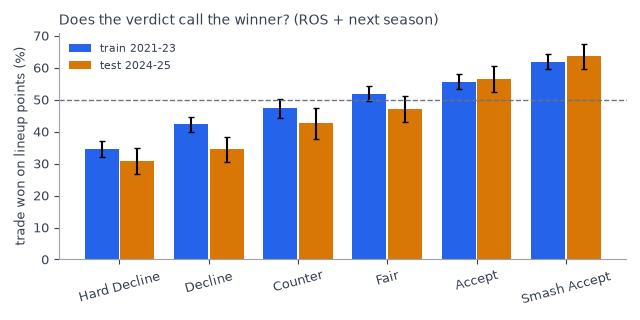
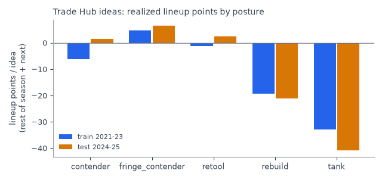
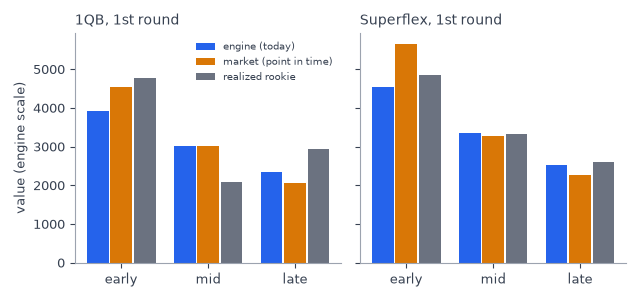

# Whole-system historical replay (2021-2025) and tuning candidates (2026-11-18)

Question from the product owner: run today's system on prior years, point in time, and see how the trades it would have suggested and graded turned out, so the
system can be tuned. Read-only audit. No product behaviour was changed.

**Pinned to `origin/main` at `71aeda696a09901200412da0fdcae644866ca371`** (merge of PR #2152), every flag at its shipped default: partner context ON (incl. Finder / Dashboard / Search surfaces),
usage-roles nudge ON, roster redundancy (P1-3) OFF, P1-5 rebuild/tank starter weights 0.05 / 0.0 as shipped, pick table = PR #2108 values (early 1st 4,200, mid 2,900, late 2,300).
Another agent is changing the pick top end and P1-5 / P1-3; the numbers below are for this commit only, and section 6 says which of them should move.

Code: `docs/audits/historical-replay/code/` (reuses `scripts/trade_advice_backtest.py` and `scripts/trade_advice_outcomes.py`, adds the Hub replay and the clock freeze).
Charts: `docs/audits/historical-replay/*.png`; summary tables: `docs/audits/historical-replay/results/*.csv`. The prior audit this extends: `docs/audits/2026-11-trade-advice-backtest.md`.

## 1. Summary

1. **The verdict calls the winner, and keeps doing it out of sample.** On 13,002 graded harness trades, ACCEPT-band trades win 59.2% on lineup points and DECLINE-band 37.4%
   (AUC 0.617 vs 0.613 for the point-in-time market). 2024-25 is as good as 2021-23 (SMASH ACCEPT 63.6% vs 61.9%, HARD DECLINE 30.8% vs 34.6%). Monotone across all six bands.
2. **The Trade Hub's ideas are not winners for the user on lineup points.** 12,677 ideas (every team, 8 per team) average -6.3 lineup points over the rest of the season and
   -6.9 over rest of season + next, win 46% of decided cases, and the partner gains +25. Only 10% are win-win. The loss is concentrated where it is by design:
   rebuild/tank ideas (sell vets for picks) lose lineup points and win market value (+170 to +310 at one year); contender / fringe ideas are about break-even to slightly positive.
   The real defects are the QB-receiving ideas (27.8% win, -49 points per idea, all in Superflex) and the ordering of the list (section 4).
3. **Ordering is the biggest lever and it is out-of-sample stable.** Putting the three best ideas by market-value edge first instead of by `priority` adds **+5.2 lineup points per idea
   (95% CI +3.2 to +7.4) in 2024-25** (+5.1 in 2021-23). The engine's own `trade_gain` and `priority` have AUC 0.49-0.50 on the surfaced set; market edge has 0.63-0.69.
4. **The 12% partner-loss ceiling is not a lever at all**: raising it to 15% changes zero ideas (ideas never get near it: p99 user edge is 8.4%, max 12.0%); 8% moves ROS outcomes by less than a point.
   The +/-6 context budget and the handshake weights **help out of sample** (switching them off cost 9-10 lineup points per idea in 2024, CI excludes zero; in-sample they looked free, +1 to +2): keep, do not widen on this evidence.
   The roles nudge is neutral. The age curve (+/-15% on the decline side) moves verdict AUC by less than 0.001.
5. **P1-3 / P1-5 / pick curve.** QB-only redundancy is the only P1-3 scope that gains without hurting the rest (domain AUC +0.064 train, +0.058 2024; all-trades 2024-25 +0.001);
   the all-bench scope hurts overall (-0.028). The rebuild/tank starter floor (0.2-0.3) gains **only out of sample** (+0.006 to +0.009 ROS AUC, CI excludes zero; flat in training).
   Early-1st at 4,800 wins in sample (+0.023) and not out of sample (+0.005, CI spans zero): **in-sample only**. Rounds 3-4 are priced 40-280% above the market and above anything a rookie realizes (market-only evidence).
   Full ranked list with expected gain and risk: section 6.

## 2. Method, data and no-leakage checks

**Data (all public, none new).** nflverse weekly stats, injury reports, schedule and player bios 2020-2026; DynastyProcess value snapshots (FantasyPros-ECR derived) at Apr 15, May 20, Aug 20, Oct 20, Dec 1 for
2021-2025, rank-matched onto FantasyCalc's current rank-to-value curve (the production market input, as in the prior audit). The replay needed no extra downloads. Intermediates were parquet, capped well under 2 GB, and deleted; only summary tables are kept.

**Point-in-time inputs.** For each replay date D the valuation frame is rebuilt from the snapshot nearest before D, usage / PPG from weeks completed before D, the latest published injury report, age at D, a usage-derived depth order
and a walk-forward weekly baseline. The real chain then runs: age curve, scarcity, role/opportunity, injury risk, composite, valuation lens, strategy age curve, pick model, Analyzer fit and verdict.

**Two replays on the same frames.**
* **Trade ideas (new).** The real `trade_hub_engine.generate_trade_idea_records` for every team of a seeded 10 / 12 / 14-team league at **3 dates a season: preseason (Aug 20), mid-season (Oct 20, week 7-8), deadline (Dec 1, week 13)**,
  in 3 formats (dynasty 1QB, Superflex, Superflex + TE premium). 1,620 team-dates, 12,677 ideas. Leagues are **synthetic**: real player pools from the snapshot, a seeded noisy snake draft by snapshot value, record-to-date earned by each
  static roster's real weekly lineup points. Real historical league rosters were not available. Team posture, needs, partner context and pick slots come from the engine's own league summary of those rosters
  (no trade history exists, so the partner **tendency** factor reads neutral; age and pick-stash factors are live). Role flags (`usage_trends`) are built from nflverse usage, in-season dates only (they need 7+ played games).
* **Grades (harness).** The existing trade universe (random value-band 1-for-1, 2-for-1, 1-for-2, pick and handcuff trades, 12-team leagues, 4 league types, 5 dates), graded with `grade_trade_for_user`: 16,210 trades (200 per league-date, seed 7), 13,002 scoreable (trades whose pick has no resolvable rookie are dropped).

**Outcomes** (user side, relative to not trading; the partner side is scored the same way). Hindsight-optimal weekly lineup points of the static roster (1QB/2RB/3WR/1TE/FLEX, +SF slot) over: rest of that season (**ROS**), ROS + next season (**ROS+next**),
the season after (**yr-2**); picks count as the rookie they became (slot-th rookie of the class); market-value change at +1y / +2y from the same-date snapshot; **playoff odds and title odds** from 240 random-schedule simulations of the 12-team (or 10/14-team) league
before and after the trade (6 playoff teams, 4 in 10-team leagues, 3-week bracket, actual weekly points). "Win" = lineup points > 0 with ties under 3 points dropped. 2025 has no complete following season, so ROS+next and +1y/+2y exist for 2021-24 only; 2025 enters ROS metrics.
Odds used by the **Season lean** are point-in-time: played weeks are actual, later weeks come from each roster's walk-forward projection plus weekly noise, never from actual future points.

**No-leakage checks** (`code/leak_check.py`, one league-date, 2023-10-20 dynasty Superflex, 6 weeks complete):
* **Poison test: passed.** 19,094 nflverse rows dated after the date were scrambled, future injury reports scrambled, the player-bio `last_season` column set to 2099, and any DynastyProcess snapshot dated after the date made unreadable.
  The valuation frame (76 numeric columns) and all 92 Hub ideas were identical to the clean run.
* **Wall clock: a real leak, now closed in the replay.** `modules/trust_engine` validates player freshness against today's date, so un-frozen, every 2023 player looks 3 years stale: trust drops from `pass` to `degraded` for all ideas,
  every confidence label becomes Low, and the idea count falls from 92 to 75. `trade_lineup_model` (bye weeks, `date.today().year`), `season_clock` (draft year, pick years-out) and `league_rankings` also read the clock.
  The replay freezes all of them at the replay date. The original harness did not (it left the lineup model's season at 2026); the grade numbers in this doc were re-run frozen.
* Outcome windows start after D by construction; snapshots at D+1y / D+2y are read only by the scorer.

**Harness caveats found (not changed).** (a) In `trade_advice_backtest.py` the pick-owner slot percentile is inverted relative to team strength (the strongest team's pick is priced and looked up as the earliest slot): slot and price stay
consistent so verdict calibration is unaffected, but pick-trade posture slices are unrealistic. The Hub replay uses the engine's own slot model. (b) Position cap in the synthetic draft (3-4 QBs) and a 20-round draft limit roster realism.
(c) Synthetic leagues have no real trade history, so partner tendencies and the Trade Finder's real-roster needs are under-exercised.

**Train / test.** Candidates were chosen on 2021-23 and judged on 2024-25 only. 2024 has a full following season; 2025 contributes ROS-only metrics. Only out-of-sample numbers are quoted as gains; anything that wins in training and not after is labelled **in-sample only**.

## 3. Grades on historical trades

| verdict band | trades | win % | 95% +- | mean lineup pts | win % 2021-23 | win % 2024-25 | mean pts 2024-25 |
|---|---|---|---|---|---|---|---|
| HARD DECLINE | 2022.0 | 33.7 | 2.1 | -48.6 | 34.6 | 30.8 | -66.6 |
| DECLINE | 2457.0 | 40.4 | 2.0 | -29.6 | 42.3 | 34.6 | -40.6 |
| COUNTER | 1523.0 | 46.1 | 2.6 | -9.5 | 47.3 | 42.6 | -17.4 |
| FAIR / PREFERENCE | 2409.0 | 50.7 | 2.0 | 1.4 | 51.8 | 47.2 | -5.7 |
| ACCEPT | 2265.0 | 55.9 | 2.1 | 15.8 | 55.7 | 56.5 | 18.9 |
| SMASH ACCEPT | 2326.0 | 62.3 | 2.0 | 30.8 | 61.9 | 63.6 | 38.0 |

AUC (outcome ROS+next, 2021-24): verdict score 0.617, point-in-time market 0.613. By season the verdict AUC is 0.614 / 0.610 / 0.603 / 0.644 / 0.617 (2021-25) against market 0.627 / 0.596 / 0.626 / 0.606 / 0.591.
By date: Apr 15 0.595, May 20 0.627, Aug 20 0.617, Oct 20 0.625, Dec 1 0.620. By shape: 1-for-1 0.624, player-for-pick 0.635, 2-for-1 0.593 (market 0.548), 1-for-2 0.588 (market 0.555), pick-for-player 0.592 (market 0.630), handcuff 0.602.

**Slices** (win % by verdict direction; spread = ACCEPT minus DECLINE; outcome ROS+next; `pts` = mean lineup points):

| posture | n | AUC verdict | AUC market | ACCEPT win % | DECLINE win % | spread (pp) | ACCEPT pts | DECLINE pts |
|---|---|---|---|---|---|---|---|---|
| contender | 3305 | 0.624 | 0.615 | 56.9 | 35.1 | 21.8 | 17.5 | -45.5 |
| fringe_contender | 3215 | 0.632 | 0.620 | 60.0 | 35.1 | 24.9 | 27.6 | -41.6 |
| retool | 3244 | 0.617 | 0.612 | 61.4 | 38.4 | 23.1 | 27.1 | -34.8 |
| rebuild | 2139 | 0.596 | 0.609 | 58.0 | 40.4 | 17.6 | 19.1 | -28.2 |
| tank | 1099 | 0.579 | 0.596 | 58.4 | 45.8 | 12.6 | 25.8 | -27.7 |

| position received | n | AUC verdict | AUC market | ACCEPT win % | DECLINE win % | spread (pp) | ACCEPT pts | DECLINE pts |
|---|---|---|---|---|---|---|---|---|
| receives QB | 1815 | 0.649 | 0.630 | 46.4 | 21.6 | 24.8 | -6.4 | -95.8 |
| receives RB | 4173 | 0.606 | 0.610 | 57.8 | 38.6 | 19.2 | 23.7 | -30.7 |
| receives WR | 3575 | 0.643 | 0.632 | 68.6 | 41.5 | 27.1 | 45.6 | -27.9 |
| receives TE | 1478 | 0.586 | 0.594 | 58.5 | 43.3 | 15.3 | 17.6 | -34.9 |
| picks / none | 1961 | 0.635 | 0.636 | 64.0 | 37.2 | 26.8 | 31.4 | -32.1 |

| age side | n | AUC verdict | AUC market | ACCEPT win % | DECLINE win % | spread (pp) | ACCEPT pts | DECLINE pts |
|---|---|---|---|---|---|---|---|---|
| receives older (2y+) | 2669 | 0.603 | 0.599 | 59.9 | 39.8 | 20.2 | 26.1 | -35.4 |
| similar age | 7514 | 0.622 | 0.618 | 59.8 | 37.4 | 22.4 | 24.4 | -37.8 |
| receives younger (2y+) | 2819 | 0.600 | 0.618 | 55.8 | 35.9 | 19.9 | 16.3 | -40.7 |

| picks vs players | n | AUC verdict | AUC market | ACCEPT win % | DECLINE win % | spread (pp) | ACCEPT pts | DECLINE pts |
|---|---|---|---|---|---|---|---|---|
| picks involved | 3799 | 0.619 | 0.620 | 59.7 | 38.9 | 20.8 | 22.0 | -30.1 |
| players only | 9203 | 0.616 | 0.610 | 58.9 | 36.8 | 22.1 | 24.1 | -41.3 |
| early 1st involved | 527 | 0.568 | 0.574 | 52.8 | 41.9 | 10.9 | 14.5 | -31.1 |

| league format | n | AUC verdict | AUC market | ACCEPT win % | DECLINE win % | spread (pp) | ACCEPT pts | DECLINE pts |
|---|---|---|---|---|---|---|---|---|
| 1QB | 3585 | 0.610 | 0.617 | 57.3 | 36.7 | 20.6 | 18.2 | -38.4 |
| Superflex | 3586 | 0.616 | 0.601 | 59.6 | 38.1 | 21.5 | 24.7 | -40.9 |
| SF + TE premium | 3640 | 0.628 | 0.618 | 61.1 | 37.3 | 23.8 | 29.2 | -39.6 |
| redraft 1QB | 2191 | 0.614 | 0.621 | 58.0 | 37.4 | 20.6 | 19.5 | -30.8 |

Reading: the verdict is weakest on rebuild/tank (AUC 0.596 / 0.579 vs market 0.609 / 0.596; spread 17.6 / 12.6 pp), when the user receives TEs (0.586), and on trades involving an early 1st (0.568, spread 10.9 pp, n = 527).
It beats the market on contender / fringe, Superflex and SF-TEP. Receiving a QB is best-ranked (0.649) and worst-calibrated: ACCEPT wins 46.4% (mean -6 points) and DECLINE 21.6% (mean -96): QB value is still over-credited (P1-1).
League size is not a harness dimension (12 teams); it is in the idea replay below. The spreads held in every posture and format (2024-25 spread 16.8-28.8 pp).

## 4. Trade ideas: what the Hub would have suggested and how it turned out

Overall: 12,677 ideas, 7.83 per team, 0.5% of team-dates with none. Mean ROS -6.3 (+-1.0), ROS+next -6.9 (+-2.2),
yr-2 +3.2, win 45.9%, partner +25.0, win-win 10.4%, playoff odds -0.83 pp (+-0.21), title odds -0.16 pp, market value +1y +57, +2y +112.
Mean engine `trade_gain` is -151: the Hub routinely suggests deals the engine itself scores slightly against the user because fit and need terms carry them.

**By posture** (rebuild/tank trade lineup now for value later; the table shows both sides):

| posture | ideas | ROS pts | ROS+next pts | yr-2 pts | win % | win-win % | partner pts | playoff odds pp | title pp | value chg +1y |
|---|---|---|---|---|---|---|---|---|---|---|
| contender | 1909 | 3.9 | -4.2 | -13.3 | 46.2 | 9.7 | 25.1 | 1.34 | 0.68 | -117 |
| fringe_contender | 3038 | 1.0 | 5.2 | -0.2 | 51.0 | 12.6 | 16.5 | -0.02 | 0.25 | -71 |
| rebuild | 2713 | -17.5 | -19.7 | 12.9 | 40.6 | 8.7 | 32.9 | -2.91 | -0.69 | 307 |
| retool | 3834 | -3.7 | -0.1 | 5.5 | 48.3 | 10.6 | 18.5 | -0.68 | -0.38 | 57 |
| tank | 1183 | -23.9 | -35.0 | 7.8 | 36.7 | 8.6 | 49.2 | -2.15 | -0.61 | 170 |

**By position received:**

| position received | ideas | ROS pts | ROS+next pts | yr-2 pts | win % | win-win % | partner pts | playoff odds pp | title pp | value chg +1y |
|---|---|---|---|---|---|---|---|---|---|---|
| gets QB | 1058 | -13.3 | -49.1 | -43.4 | 27.8 | 9.1 | 65.8 | -1.67 | -0.26 | -169 |
| gets RB | 3830 | -3.0 | -2.2 | -4.4 | 46.6 | 11.3 | 23.6 | -0.32 | 0.03 | -92 |
| gets TE | 1734 | -5.1 | -5.5 | 7.5 | 48.7 | 10.5 | 21.7 | -0.95 | -0.04 | 179 |
| gets WR | 4810 | 0.5 | 12.4 | 16.2 | 54.8 | 11.0 | 6.6 | 0.11 | -0.06 | 104 |
| picks only | 1245 | -38.0 | -61.0 | 18.6 | 21.5 | 5.7 | 68.5 | -5.18 | -1.19 | 721 |

**By age side, shape, format, league size and date:**

| age side | ideas | ROS pts | ROS+next pts | yr-2 pts | win % | win-win % | partner pts | playoff odds pp | title pp | value chg +1y |
|---|---|---|---|---|---|---|---|---|---|---|
| gets older (2y+) | 3355 | 3.9 | -0.1 | -12.4 | 48.4 | 10.5 | 18.9 | 0.86 | 0.21 | -334 |
| gets younger (2y+) | 4383 | -10.7 | -3.8 | 13.9 | 48.1 | 10.3 | 21.9 | -1.57 | -0.32 | 336 |
| similar age | 4939 | -9.3 | -14.4 | 5.4 | 42.2 | 10.3 | 32.0 | -1.32 | -0.26 | 97 |

| shape | ideas | ROS pts | ROS+next pts | yr-2 pts | win % | win-win % | partner pts | playoff odds pp | title pp | value chg +1y |
|---|---|---|---|---|---|---|---|---|---|---|
| 1-for-1 players | 4976 | 5.4 | 10.3 | -1.0 | 53.5 | 11.2 | 9.0 | 0.69 | 0.29 | -10 |
| involves picks | 7635 | -14.0 | -18.3 | 5.7 | 41.0 | 9.8 | 35.4 | -1.86 | -0.42 | 103 |
| multi-player, no picks | 66 | 9.0 | 19.0 | 12.9 | 50.0 | 10.0 | 17.5 | 3.62 | -3.73 | 255 |

| format | ideas | ROS pts | ROS+next pts | yr-2 pts | win % | win-win % | partner pts | playoff odds pp | title pp | value chg +1y |
|---|---|---|---|---|---|---|---|---|---|---|
| 1QB | 4234 | -4.8 | -8.0 | 1.6 | 44.9 | 11.0 | 27.2 | -0.53 | -0.19 | 16 |
| SF + TE premium | 4209 | -7.6 | -9.7 | 2.2 | 44.8 | 9.2 | 26.1 | -1.09 | -0.30 | 39 |
| Superflex | 4234 | -6.4 | -3.1 | 5.7 | 48.1 | 10.9 | 21.6 | -0.88 | 0.02 | 114 |

| league size | ideas | ROS pts | ROS+next pts | yr-2 pts | win % | win-win % | partner pts | playoff odds pp | title pp | value chg +1y |
|---|---|---|---|---|---|---|---|---|---|---|
| 10 teams | 3501 | -6.0 | -3.1 | 6.4 | 48.0 | 12.0 | 22.3 | -0.64 | -0.18 | 159 |
| 12 teams | 4241 | -7.1 | -9.2 | 2.2 | 44.5 | 9.9 | 25.8 | -0.95 | -0.06 | 17 |
| 14 teams | 4935 | -5.7 | -7.6 | 1.6 | 45.7 | 9.7 | 26.1 | -0.87 | -0.23 | 19 |

| date | ideas | ROS pts | ROS+next pts | yr-2 pts | win % | win-win % | partner pts | playoff odds pp | title pp | value chg +1y |
|---|---|---|---|---|---|---|---|---|---|---|
| deadline (Dec 1) | 4196 | -5.8 | -5.2 | 6.9 | 45.9 | 10.2 | 20.0 | -0.61 | -0.13 | 88 |
| mid-season (Oct 20) | 4184 | -9.0 | -10.0 | 2.4 | 45.6 | 9.8 | 26.5 | -1.46 | -0.42 | 30 |
| preseason (Aug 20) | 4297 | -4.1 | -5.6 | 0.3 | 46.2 | 11.1 | 28.3 | -0.44 | 0.07 | 52 |

**By idea type and list position** (the Hub's tag and its sort order):

| idea type | ideas | ROS pts | ROS+next pts | yr-2 pts | ROS win % | playoff pp | title pp | value chg +1y | value chg +2y |
|---|---|---|---|---|---|---|---|---|---|
| Ask for their pick | 262 | -34.3 | -52.9 | 41.7 | 4.6 | -5.85 | -1.41 | 367 | 705 |
| Buy need-position upgrade | 1441 | 25.3 | 19.2 | -33.3 | 63.9 | 4.85 | 1.89 | -326 | -666 |
| Consolidate for starter | 66 | 9.0 | 19.0 | 12.9 | 53.0 | 3.62 | -3.73 | 255 | 335 |
| Convert veteran to picks | 983 | -39.0 | -63.1 | 13.0 | 3.3 | -5.00 | -1.13 | 814 | 1212 |
| Direct one-for-one swap | 4976 | 5.4 | 10.3 | -1.0 | 54.2 | 0.69 | 0.29 | -10 | -99 |
| Get younger plus pick | 3007 | -22.8 | -20.3 | 20.1 | 24.1 | -3.63 | -0.91 | 334 | 512 |
| Player plus pick return | 1942 | -14.0 | -17.2 | 6.1 | 32.8 | -1.98 | -0.87 | -110 | 5 |

| position in the Hub list | ideas | ROS pts | ROS+next pts | ROS win % | win-win % | partner ROS+next pts |
|---|---|---|---|---|---|---|
| 0 | 1612 | 5.7 | 7.5 | 52.2 | 11.1 | 13.8 |
| 1 | 1606 | 3.4 | 5.1 | 49.9 | 10.6 | 14.5 |
| 2 | 1602 | 2.3 | 4.8 | 49.1 | 11.1 | 13.5 |
| 3 | 1591 | -4.8 | -1.2 | 40.3 | 9.8 | 20.1 |
| 4 | 1584 | -8.5 | -13.5 | 38.1 | 11.2 | 31.8 |
| 5 | 1573 | -13.5 | -15.8 | 33.2 | 10.8 | 33.1 |
| 6 | 1563 | -18.1 | -21.9 | 29.8 | 9.8 | 38.2 |
| 7 | 1546 | -17.5 | -21.2 | 28.8 | 8.5 | 35.7 |

**Train vs test for the main slices** (the posture and position effects have the same sign in both periods; the rebuild/tank lineup cost and the QB cost are 3-4x the standard error in each):

| slice | group | period | ideas | ROS pts | ROS+next pts | win % | partner pts | playoff pp |
|---|---|---|---|---|---|---|---|---|
| posture | contender | test 2024-25 | 773 | 7.1 | 1.5 | 46.0 | 17.5 | 1.56 |
| posture | contender | train 2021-23 | 1136 | 1.8 | -6.1 | 46.3 | 27.8 | 1.18 |
| posture | fringe_contender | test 2024-25 | 1186 | -0.6 | 6.5 | 51.1 | 17.6 | 0.06 |
| posture | fringe_contender | train 2021-23 | 1852 | 2.0 | 4.7 | 51.0 | 16.2 | -0.08 |
| posture | rebuild | test 2024-25 | 991 | -19.1 | -21.0 | 40.7 | 34.8 | -3.19 |
| posture | rebuild | train 2021-23 | 1722 | -16.5 | -19.3 | 40.6 | 32.4 | -2.74 |
| posture | retool | test 2024-25 | 1611 | -4.7 | 2.5 | 48.8 | 17.2 | -1.04 |
| posture | retool | train 2021-23 | 2223 | -3.0 | -1.1 | 48.2 | 19.0 | -0.41 |
| posture | tank | test 2024-25 | 507 | -22.1 | -40.9 | 34.5 | 61.7 | -2.02 |
| posture | tank | train 2021-23 | 676 | -25.3 | -32.9 | 37.5 | 44.8 | -2.25 |
| pos_group | gets QB | test 2024-25 | 311 | -12.7 | -44.0 | 27.0 | 60.0 | -1.52 |
| pos_group | gets QB | train 2021-23 | 747 | -13.5 | -50.1 | 27.9 | 66.9 | -1.74 |
| pos_group | gets RB | test 2024-25 | 1516 | 0.5 | 2.5 | 44.7 | 21.9 | 0.04 |
| pos_group | gets RB | train 2021-23 | 2314 | -5.3 | -3.9 | 47.2 | 24.2 | -0.56 |
| pos_group | gets TE | test 2024-25 | 736 | -9.3 | -13.6 | 45.2 | 28.9 | -1.44 |
| pos_group | gets TE | train 2021-23 | 998 | -2.1 | -2.6 | 49.9 | 19.1 | -0.59 |
| pos_group | gets WR | test 2024-25 | 2006 | -1.2 | 10.6 | 55.9 | 9.3 | -0.19 |
| pos_group | gets WR | train 2021-23 | 2804 | 1.7 | 13.0 | 54.4 | 5.7 | 0.33 |
| pos_group | picks only | test 2024-25 | 499 | -41.1 | -70.4 | 19.4 | 79.0 | -5.48 |
| pos_group | picks only | train 2021-23 | 746 | -36.0 | -58.3 | 22.2 | 65.4 | -4.98 |
| age_side | gets older (2y+) | test 2024-25 | 1219 | 2.9 | -2.7 | 47.6 | 23.4 | 0.66 |
| age_side | gets older (2y+) | train 2021-23 | 2136 | 4.4 | 0.7 | 48.7 | 17.5 | 0.97 |
| age_side | gets younger (2y+) | test 2024-25 | 1880 | -9.6 | 2.1 | 49.7 | 16.6 | -1.58 |
| age_side | gets younger (2y+) | train 2021-23 | 2503 | -11.4 | -6.0 | 47.5 | 23.8 | -1.57 |
| age_side | similar age | test 2024-25 | 1969 | -9.4 | -14.8 | 41.2 | 34.2 | -1.23 |
| age_side | similar age | train 2021-23 | 2970 | -9.2 | -14.3 | 42.6 | 31.2 | -1.38 |
| shape | 1-for-1 players | test 2024-25 | 2020 | 6.0 | 14.3 | 54.1 | 6.8 | 0.86 |
| shape | 1-for-1 players | train 2021-23 | 2956 | 5.0 | 9.0 | 53.3 | 9.7 | 0.58 |
| shape | involves picks | test 2024-25 | 3025 | -15.0 | -18.9 | 40.6 | 36.9 | -2.12 |
| shape | involves picks | train 2021-23 | 4610 | -13.4 | -18.0 | 41.2 | 34.9 | -1.70 |
| shape | multi-player, no picks | test 2024-25 | 23 | 12.7 | 23.2 | 47.1 | 32.7 | 3.35 |
| shape | multi-player, no picks | train 2021-23 | 43 | 7.0 | 17.3 | 51.2 | 11.4 | 3.76 |
| fmt | 1QB | test 2024-25 | 1704 | -3.4 | -6.0 | 44.6 | 25.6 | -0.29 |
| fmt | 1QB | train 2021-23 | 2530 | -5.7 | -8.6 | 45.0 | 27.8 | -0.70 |
| fmt | SF + TE premium | test 2024-25 | 1676 | -9.0 | -9.3 | 45.0 | 28.8 | -1.03 |
| fmt | SF + TE premium | train 2021-23 | 2533 | -6.7 | -9.8 | 44.8 | 25.1 | -1.12 |
| fmt | Superflex | test 2024-25 | 1688 | -7.1 | -1.4 | 48.3 | 20.7 | -1.41 |
| fmt | Superflex | train 2021-23 | 2546 | -6.0 | -3.6 | 48.0 | 21.9 | -0.52 |
| size | 10 teams | test 2024-25 | 1393 | -6.0 | 0.8 | 49.3 | 25.4 | -0.63 |
| size | 10 teams | train 2021-23 | 2108 | -6.1 | -4.4 | 47.6 | 21.3 | -0.65 |
| size | 12 teams | test 2024-25 | 1699 | -6.5 | -8.5 | 44.3 | 24.2 | -1.20 |
| size | 12 teams | train 2021-23 | 2542 | -7.6 | -9.5 | 44.6 | 26.4 | -0.77 |
| size | 14 teams | test 2024-25 | 1976 | -6.9 | -7.5 | 45.0 | 25.5 | -0.84 |
| size | 14 teams | train 2021-23 | 2959 | -4.9 | -7.6 | 45.9 | 26.3 | -0.88 |
| phase | deadline (Dec 1) | test 2024-25 | 1671 | -4.6 | -2.3 | 46.8 | 15.2 | -0.46 |
| phase | deadline (Dec 1) | train 2021-23 | 2525 | -6.5 | -6.1 | 45.6 | 21.6 | -0.71 |
| phase | mid-season (Oct 20) | test 2024-25 | 1680 | -10.8 | -8.3 | 46.8 | 28.5 | -1.82 |
| phase | mid-season (Oct 20) | train 2021-23 | 2504 | -7.8 | -10.6 | 45.2 | 25.9 | -1.21 |
| phase | preseason (Aug 20) | test 2024-25 | 1717 | -4.1 | -6.0 | 44.3 | 31.1 | -0.45 |
| phase | preseason (Aug 20) | train 2021-23 | 2580 | -4.1 | -5.5 | 46.9 | 27.3 | -0.43 |

**Do the engine's own scores predict the outcome among surfaced ideas?**

| predictor (surfaced ideas only) | n | AUC ROS+next | AUC ROS | Spearman |
|---|---|---|---|---|
| trade_gain (engine value gain) | 10161 | 0.49 | 0.44 | -0.01 |
| analyzer_trade_score | 10161 | 0.50 | 0.48 | -0.01 |
| fit_score | 10161 | 0.54 | 0.55 | 0.07 |
| market_realism_score | 10161 | 0.56 | 0.64 | 0.10 |
| trade_confidence_score | 10161 | 0.54 | 0.58 | 0.07 |
| priority | 10161 | 0.50 | 0.48 | -0.02 |
| mkt_delta_start | 10161 | 0.63 | 0.69 | 0.27 |

The confidence label does rank correctly:

| confidence label | ideas | ROS pts | ROS+next pts | win % | win-win % |
|---|---|---|---|---|---|
| High | 10665 | -4.4 | -4.3 | 47.2 | 10.6 |
| Low | 78 | -24.8 | -40.4 | 29.6 | 5.4 |
| Medium | 1934 | -16.0 | -20.4 | 39.3 | 9.0 |

Findings that matter:
* **Buy-need ideas pay immediately and borrow from later.** "Buy need-position upgrade": +25 ROS points, 64% ROS win, +4.9 pp playoff odds, +1.9 pp title; but -33 points in year 2 and -326 value at +1y. That is the contender trade, working as labelled.
* **Pick-selling ideas lose the lineup on purpose** ("Convert veteran to picks": ROS win 3%, +814 value at +1y). Judged on lineup points they look broken; the right outcome for them is value and year-2 points, which are positive.
* **QB-receiving ideas are a defect, not a trade-off**: 1,058 ideas, win 27.8%, -49 points ROS+next, the partner +66, and it holds in both periods (-50 / -44). All but 6 are Superflex.
* The ideas shown first are the better ones for lineups (list positions 1-3 win 51-52%, positions 6-8 win 39-42%) but that comes from tag grouping; `priority` itself has AUC 0.50.
* League size shows no gradient (ROS+next -3.1 / -9.2 / -7.6 for 10 / 12 / 14 teams, win 48.0 / 44.5 / 45.7%; win-win 12.0 / 9.9 / 9.7%): size is not worth a special case on this evidence.

## 5. GM Plan: buy / sell / hold and Season lean

**Season lean** (`playoff_context.lean`, buyer / seller / hold from point-in-time simulated odds + posture + core age) vs what happened:

| date | lean | teams | playoff odds on the date % | realized odds % | made playoffs % | title odds on the date % | realized title % |
|---|---|---|---|---|---|---|---|
| deadline (Dec 1) | buyer | 192 | 92.3 | 91.0 | 92.2 | 18.8 | 19.3 |
| deadline (Dec 1) | hold | 115 | 49.5 | 49.2 | 45.2 | 7.2 | 6.2 |
| deadline (Dec 1) | seller | 233 | 2.5 | 3.8 | 2.6 | 0.3 | 0.3 |
| mid-season (Oct 20) | buyer | 198 | 82.0 | 76.0 | 79.8 | 18.2 | 15.2 |
| mid-season (Oct 20) | hold | 165 | 39.9 | 39.8 | 40.0 | 4.9 | 7.2 |
| mid-season (Oct 20) | seller | 177 | 6.7 | 13.4 | 10.7 | 0.5 | 1.7 |
| preseason (Aug 20) | buyer | 159 | 76.2 | 53.3 | 56.0 | 18.7 | 12.3 |
| preseason (Aug 20) | hold | 264 | 41.5 | 46.1 | 46.6 | 5.5 | 7.3 |
| preseason (Aug 20) | seller | 117 | 8.0 | 28.8 | 25.6 | 0.5 | 5.2 |

The lean orders teams correctly on every date (deadline: buyers made the playoffs 92%, sellers 3%). Preseason it is overconfident: buyers were told 76% and got 53% (made playoffs 56%), sellers were told 8% and got 29%. The simulation's weekly noise and
static-roster projection are too tight early; the lean thresholds (65 / 50 / 20 / 8) are right in the order and wrong in the level before about week 6. Out of sample the same pattern holds (2024-25 buyers 74% made playoffs, sellers 10%).

**Did following the lean help?** For the idea a team would act on first, by lean:

| lean | set | ideas | ROS pts | ROS+next pts | ROS win % | playoff odds pp | value chg +1y | value chg +2y |
|---|---|---|---|---|---|---|---|---|
| buyer | top idea | 546 | 8.5 | 4.8 | 54.2 | 1.28 | -197 | -495 |
| hold | top idea | 542 | 3.7 | 7.5 | 48.8 | 0.67 | 31 | 19 |
| seller | top idea | 524 | 4.9 | 10.3 | 53.6 | 0.09 | -52 | -90 |
| buyer | all ideas | 4348 | -0.1 | 1.4 | 46.1 | 0.02 | -32 | -112 |
| hold | all ideas | 4291 | -10.0 | -12.4 | 37.9 | -1.63 | 72 | 193 |
| seller | all ideas | 4038 | -9.0 | -9.9 | 36.7 | -0.91 | 142 | 264 |

Buyers' top ideas raise ROS points (+8.5) and playoff odds (+1.3 pp) and cost future (yr-2 -20 points, value -197 at +1y). Sellers' ideas are value-positive over all ideas (+142 at +1y, +264 at +2y vs -32 / -112 for buyers) and cost lineup points (-9.0).
So the lean steers the right way; the size of the effect is modest and one-sided toward the near term for buyers.

**Hold.** `build_hold_verdict` shows Hold for 60% of team-dates and 100% of its reasons are `none_clear_bar` (idea confidence Low or gain under 200). It does not separate good from bad outcomes:

| Hold verdict shown | team-dates | ideas | ROS pts | ROS+next pts | win % | ideas that gained % | best idea (pts) |
|---|---|---|---|---|---|---|---|
| 0.0 | 641 | 5021 | -6.7 | -5.3 | 46.7 | 36.6 | 124.2 |
| 1.0 | 971 | 7656 | -6.0 | -7.9 | 45.4 | 36.7 | 128.1 |

Teams told to hold had the same chance (36.7% vs 36.6%) that an idea would have helped and the same best-idea outcome (128 vs 124 points): the bar is not tied to realized value. **Buy-low / sell-high tags**: `buy_low` ideas ROS+next -17, win 41% (year-2 +21);
`sell_high` ideas ROS+next -24, win 35% (year-2 +24, value +791 at +2y): both read as future-value plays and neither has an advantage for the lineup, so the tags should not be presented as immediate wins.

## 6. Tuning

**Method.** Each candidate changes one constant in the live modules (`trade_ideas.PARTNER_EDGE_HARD_CEILING`, `partner_context.COMBINED_MAX_POINTS` / `AGE_MAX_POINTS` / `PICK_MAX_POINTS`, `usage_roles_targets`, `trade_grade.STARTER_STRENGTH_WEIGHTS`,
`trade_grade.roster_redundancy_*`, `trade_ideas.PICK_TIER_BASE_VALUES`, `rankings.AGE_CURVE_CONTROL_POINTS`) and re-runs the same trades (grade variants: paired on the identical trade set, 100-200 per league-date) or the same leagues (idea variants,
12-team Superflex, 5 seasons). "Train" = 2021-23, "test" = 2024-25; effects are paired differences against the base run with a bootstrap 95% interval (grade variants: trades; idea variants: team-dates).
Verdict candidates are scored by AUC change on the trades they can affect (the domain) and on all trades. Only ROS metrics reach 2025. All numbers below are changes, not levels.

### 6.1 Verdict-level candidates (grade harness)

| family | variant | verdicts changed % | train n | train dAUC | 2024 dAUC | 2024 lo | 2024 hi | test n | 2024-25 ROS dAUC | lo | hi | all trades 2024-25 dAUC |
|---|---|---|---|---|---|---|---|---|---|---|---|---|
| P1-5 rebuild/tank starter floor | floor:0.1 | 2.0 | 2446 | -0.0003 | +0.0033 | +0.0017 | +0.0050 | 1627 | +0.0025 | +0.0014 | +0.0035 | +0.0006 |
| P1-5 rebuild/tank starter floor | floor:0.2 | 4.9 | 2446 | -0.0007 | +0.0076 | +0.0041 | +0.0118 | 1627 | +0.0060 | +0.0032 | +0.0082 | +0.0014 |
| P1-5 rebuild/tank starter floor | floor:0.3 | 6.7 | 2446 | -0.0011 | +0.0110 | +0.0055 | +0.0176 | 1627 | +0.0086 | +0.0043 | +0.0119 | +0.0020 |
| P1-3 redundancy scope | redund:all:0.5 | 48.5 | 2778 | +0.0340 | +0.0233 | -0.0065 | +0.0538 | 1821 | +0.0044 | -0.0164 | +0.0248 | -0.0281 |
| P1-3 redundancy scope | redund:all:0.75 | 33.6 | 2778 | +0.0260 | +0.0205 | +0.0046 | +0.0377 | 1821 | +0.0074 | -0.0045 | +0.0182 | -0.0089 |
| P1-3 redundancy scope | redund:qb:0.5 | 45.7 | 1330 | +0.0638 | +0.0580 | +0.0135 | +0.0991 | 913 | +0.0086 | -0.0229 | +0.0419 | +0.0012 |
| P1-3 redundancy scope | redund:recv:0.5 | 35.3 | 2778 | +0.0086 | +0.0133 | -0.0109 | +0.0348 | 1821 | -0.0091 | -0.0260 | +0.0080 | -0.0166 |
| Pick curve, early-1st top end | pick1e:4800 | 26.5 | 196 | +0.0228 | +0.0054 | -0.0257 | +0.0339 | 125 | +0.0056 | -0.0105 | +0.0225 | +0.0010 |
| Pick curve, all rounds scale | pickall:0.85 | 48.2 | 1458 | -0.0150 | -0.0084 | -0.0277 | +0.0107 | 951 | +0.0045 | -0.0092 | +0.0177 | +0.0015 |
| Age curve, 27+ (all positions) | age:old:0.85 | 0.5 | 2046 | -0.0000 | +0.0003 | -0.0003 | +0.0008 | 1367 | +0.0003 | +0.0000 | +0.0007 | +0.0002 |
| Age curve, 27+ (all positions) | age:old:1.15 | 0.5 | 2045 | -0.0000 | -0.0001 | -0.0006 | +0.0005 | 1397 | -0.0002 | -0.0005 | +0.0001 | -0.0002 |
| Age curve, RB 25+ | age:rb:0.8 | 0.5 | 2655 | -0.0001 | -0.0000 | -0.0005 | +0.0004 | 1644 | +0.0003 | +0.0000 | +0.0006 | +0.0001 |

`dAUC` = change in AUC of the verdict score against lineup points; domain: floor = rebuild/tank trades, redundancy = trades with a QB, pick1e = trades with a top-4 1st, pickall = trades with any pick, age:old = trades with a 2y+ age gap, age:rb = trades with an RB.
`2024 dAUC` uses ROS+next; `2024-25 ROS dAUC` uses ROS only. Reading:
* **P1-5 floor (rebuild/tank starter weight 0.1 / 0.2 / 0.3):** training says nothing (-0.0003 to -0.0011, interval spans zero), 2024-25 says yes (+0.003 / +0.006 / +0.009 ROS, intervals exclude zero; 2024 ROS+next +0.011 at 0.3). Touches 2-7% of verdicts.
  This is **out-of-sample only**: it would not have been chosen from training, and the effect is small. Consistent with the earlier P1-5 run (+0.003 to +0.009).
* **P1-3 redundancy scope.** All-bench (shipped flag if turned on): in-domain train +0.034, 2024 +0.023, but all trades 2024-25 **-0.028** and 48% of verdicts in the domain change. Receiving-side only: +0.009 train, **-0.009** test ROS. QB-only (retention 0.50):
  train **+0.064** [0.041, 0.091], 2024 **+0.058** [0.014, 0.099], ROS test +0.009 [-0.023, 0.042] (n.s.), all trades 2024-25 +0.001. QB-only is the scope with no collateral damage; its test ROS interval is wide (n = 913).
* **Pick curve.** Early 1st at 4,800 (from 4,200): train +0.023 [0.009, 0.037] (n = 196), 2024 +0.005 [-0.026, 0.034], test ROS +0.006 [-0.011, 0.023]: **in-sample only**. Scaling every round by 0.85: train -0.015 [-0.025, -0.005], test +0.005 [-0.009, 0.018]: not supported (it also cuts the rounds that are right).
* **Age curve (decline side x^0.85 / x^1.15, RB 25+ x^0.8):** changes under 0.5% of verdicts, change in AUC under 0.001 everywhere. Not a lever at this size. Separately, at fixed engine score older RBs realize more than the curve says
  (+12.6 +-3.8 points per year of age (24+) in 2021-23 1QB, +15.7 +-4.3 Superflex; 2024-25 rest of season +4.2 +-2.8 / +5.0 +-3.2; WR flat; QB -2.7 +-2.1 / -1.3 +-1.7 train): same sign in both periods, significant only in training.

**Pick curve vs the market and realized rookies** (round 1-4, 12 teams, pre-draft as of Apr 15; "realized" = the slot-th rookie's first two seasons mapped to engine points by a veteran regression fit on 2021-23 only; realized for rounds 3-4 is floor-bound at about 1,260 because most such rookies score nothing, so read rounds 1-2 only):

| fmt | round | tier | engine | market 2021-23 | market 2024-25 | realized 2021-23 | realized 2024-25 | engine vs market 2021-23 % | engine vs market 2024-25 % |
|---|---|---|---|---|---|---|---|---|---|
| 1QB | 1 | early | 3932 | 4503 | 4600 | 5331 | 4237 | -13 | -15 |
| 1QB | 1 | late | 2341 | 2127 | 2006 | 2363 | 3524 | +10 | +17 |
| 1QB | 1 | mid | 3015 | 3046 | 2997 | 2655 | 1502 | -1 | +1 |
| 1QB | 2 | early | 1984 | 1786 | 1692 | 1878 | 1255 | +11 | +17 |
| 1QB | 2 | late | 1580 | 1307 | 1176 | 1549 | 1258 | +21 | +34 |
| 1QB | 2 | mid | 1777 | 1523 | 1399 | 2026 | 1833 | +17 | +27 |
| 1QB | 3 | early | 1605 | 1137 | 1029 | 1877 | 1547 | +41 | +56 |
| 1QB | 3 | late | 1254 | 828 | 600 | 1851 | 1255 | +51 | +109 |
| 1QB | 3 | mid | 1418 | 990 | 836 | 1439 | 2168 | +43 | +70 |
| 1QB | 4 | early | 811 | 684 | 397 | 1310 | 1255 | +19 | +104 |
| 1QB | 4 | late | 500 | 396 | 177 | 1255 | 1255 | +26 | +182 |
| 1QB | 4 | mid | 642 | 535 | 263 | 1909 | 1255 | +20 | +144 |
| SF | 1 | early | 4537 | 5262 | 6055 | 4967 | 4725 | -14 | -25 |
| SF | 1 | late | 2523 | 2291 | 2224 | 3200 | 1991 | +10 | +13 |
| SF | 1 | mid | 3360 | 3120 | 3422 | 2590 | 4070 | +8 | -2 |
| SF | 2 | early | 2179 | 1812 | 1802 | 1444 | 3576 | +20 | +21 |
| SF | 2 | late | 1649 | 1365 | 1249 | 1618 | 1260 | +21 | +32 |
| SF | 2 | mid | 1903 | 1572 | 1512 | 2307 | 1260 | +21 | +26 |
| SF | 3 | early | 1637 | 1195 | 1030 | 1528 | 1263 | +37 | +59 |
| SF | 3 | late | 1278 | 871 | 543 | 1438 | 2143 | +47 | +135 |
| SF | 3 | mid | 1446 | 1033 | 822 | 1647 | 1260 | +40 | +76 |
| SF | 4 | early | 811 | 692 | 336 | 1890 | 1260 | +17 | +141 |
| SF | 4 | late | 500 | 298 | 131 | 1260 | 1260 | +68 | +282 |
| SF | 4 | mid | 642 | 453 | 201 | 1893 | 1260 | +42 | +219 |

Top end: today's early 1st (3,932 1QB / 4,537 SF) is 13-15% under the market in 1QB and 14-25% under in Superflex in **both** periods; realized rookies sit above the engine value in all four cells (1QB 5,331 train / 4,237 test, SF 4,967 / 4,725).
Mid 1st is right (1QB within 2%, SF +8% / -2%), late 1st is 10-17% rich, rounds 2-4 are 11-282% rich against a market that fell further in 2024-25 (late 3rd 828 to 600, 4th 396 to 177). The direction is the same in training and test; the magnitude of the test gap in rounds 3-4 is large because the market kept falling.

### 6.2 Idea-generation candidates (Hub replay)

12-team Superflex, 5 seasons, 12 teams x 3 dates. `d` = change vs base; intervals are bootstrap 95% over team-dates; the test ROS+next column is 2024 only (2025 has no following season).

| variant | period | ideas / team | d ROS+next pts | lo | hi | d ROS pts | lo | hi | d win-win | d value chg +1y | partner pts | base partner pts |
|---|---|---|---|---|---|---|---|---|---|---|---|---|
| ceiling:0.08 | train | 7.89 | +0.29 | -2.00 | +2.78 | -0.06 | -1.14 | +1.22 | -0.005 | +7 | 24.9 | 25.2 |
| ceiling:0.08 | test | 7.93 | -2.30 | -6.73 | +0.77 | -0.24 | -0.92 | +0.36 | -0.002 | -6 | 25.4 | 24.6 |
| ceiling:0.15 | train | 7.91 | +0.00 | +0.00 | +0.00 | +0.00 | +0.00 | +0.00 | +0.000 | +0 | 25.2 | 25.2 |
| ceiling:0.15 | test | 7.93 | +0.00 | +0.00 | +0.00 | +0.00 | +0.00 | +0.00 | +0.000 | +0 | 24.6 | 24.6 |
| budget:0 | train | 7.92 | +1.11 | -2.31 | +4.52 | -1.25 | -3.07 | +0.03 | -0.001 | +30 | 23.4 | 25.2 |
| budget:0 | test | 7.93 | -9.66 | -15.48 | -3.82 | -0.59 | -2.70 | +1.07 | -0.005 | -41 | 31.9 | 24.6 |
| handshakes:off | train | 7.90 | +2.17 | -1.22 | +5.15 | -0.89 | -2.68 | +0.72 | +0.001 | +40 | 22.4 | 25.2 |
| handshakes:off | test | 7.90 | -9.07 | -15.03 | -3.24 | +0.55 | -1.75 | +2.45 | -0.002 | -59 | 31.6 | 24.6 |
| roles:off | train | 7.91 | -0.13 | -1.19 | +0.80 | +0.09 | -0.17 | +0.37 | -0.002 | -5 | 25.1 | 25.2 |
| roles:off | test | 7.93 | -0.52 | -1.69 | +0.50 | -0.30 | -0.83 | +0.18 | -0.003 | -20 | 24.2 | 24.6 |

* **12% ceiling.** 0.15: **zero** change (same ideas). 0.08: -0.1 / -0.2 ROS points, intervals span zero. The ceiling is not binding; the adaptive cap (6-9%) is what limits ideas. No gain available here.
* **+/-6 context budget and handshake weights.** Budget 0 and all partner context off look free in training (+1.1 / +2.2 ROS+next, intervals span zero) and **cost 9.7 / 9.1 points per idea in 2024** (intervals exclude zero; ROS-only effect about zero).
  Switching them off also raises the partner's gain (25 to 32 points), i.e. the factors are what keep ideas acceptable to the other side. Keep. Only 0 and 6 were tested, so nothing here supports widening. The partner **tendency** weight and the age/pick split
  could not be tested separately (no trade history in synthetic leagues; the age and pick factors were only ablated together).
* **Roles nudge.** Off: -0.1 train / -0.5 test ROS+next, ROS +0.1 / -0.3, intervals span zero. Neutral; low value either way.

### 6.3 Re-ordering and filtering the surfaced ideas (no re-generation)

| ordering of the first three ideas | period | ideas | ROS pts | ROS+next pts | ROS win % | playoff odds pp |
|---|---|---|---|---|---|---|
| current order (idea_rank) | train | 2889 | 3.3 | 4.7 | 49.8 | 0.51 |
| current order (idea_rank) | test | 1931 | 4.5 | 9.0 | 51.3 | 0.65 |
| market_realism_score desc | train | 2889 | 3.5 | 5.0 | 50.2 | 0.55 |
| market_realism_score desc | test | 1931 | 5.1 | 9.3 | 51.8 | 0.67 |
| market value delta at trade desc | train | 2889 | 8.5 | 16.8 | 54.1 | 1.48 |
| market value delta at trade desc | test | 1931 | 9.7 | 18.8 | 54.3 | 1.47 |
| trade_confidence_score desc | train | 2889 | 0.4 | 1.1 | 46.1 | 0.10 |
| trade_confidence_score desc | test | 1931 | 0.7 | 3.0 | 46.5 | 0.05 |

| ordering | period | team-dates | paired gain (ROS pts) | 95% lo | 95% hi |
|---|---|---|---|---|---|
| market_realism_score | train | 965 | +0.19 | -0.19 | +0.62 |
| market_realism_score | test | 647 | +0.61 | -0.05 | +1.27 |
| mkt_delta_start | train | 965 | +5.12 | +3.65 | +6.42 |
| mkt_delta_start | test | 647 | +5.24 | +3.20 | +7.35 |

| filter | period | % of ideas dropped | dropped ideas: ROS pts | dropped: ROS+next pts | change in mean ROS pts | change in mean ROS+next pts |
|---|---|---|---|---|---|---|
| drop 'gets QB' ideas | train | 9.8 | -13.5 | -50.1 | +0.80 | +4.66 |
| drop 'gets QB' ideas | test | 6.1 | -12.7 | -44.0 | +0.40 | +2.42 |
| drop 'Convert veteran to picks' + 'Ask for their pick' for contender/fringe | train | 0.6 | -33.6 | -56.0 | +0.16 | +0.29 |
| drop 'Convert veteran to picks' + 'Ask for their pick' for contender/fringe | test | 0.6 | -26.7 | -52.3 | +0.12 | +0.20 |
| drop 'Thin' market-realism ideas | train | 10.0 | -19.8 | -29.3 | +1.52 | +2.44 |
| drop 'Thin' market-realism ideas | test | 10.3 | -24.0 | -28.9 | +2.01 | +2.20 |

### 6.4 TOP-10 ranked tuning list

Ranked by supported out-of-sample gain, then breadth, then risk. "OOS" = 2024-25 only.

| # | change | expected OOS gain | in-sample vs OOS | risk |
|---|---|---|---|---|
| 1 | **Order the Hub list by market-value edge (within the already accepted ideas), not `priority`.** | +5.2 ROS lineup pts per top-3 idea (95% CI +3.2 to +7.4); ROS win 51.3% to 54.3%; title odds +0.4 pp. 2024-25 ROS+next top-3: 9.0 to 18.8 pts | train +5.1, test +5.2: **holds** | Raises the user's market edge by ~550 points and cuts the partner's lineup gain from about 6.5 to 1.5 points: partner acceptance is not modeled here; keep the 6-9% cap and recheck acceptance. |
| 2 | **Haircut or suppress ideas that hand the user a QB (P1-1 in ideas).** | Dropping them: +0.4 ROS / +2.4 ROS+next pts per idea overall (6% of ideas); each dropped idea averaged -13 ROS / -44 ROS+next. | train +0.8 / +4.7, test +0.4 / +2.4: **holds** | Real Superflex QB needs get missed; a need-conditional haircut is safer than removal. |
| 3 | **P1-3 redundancy: switch on for QBs only (retention 0.50), keep off elsewhere.** | QB trades: +0.058 AUC (2024, CI +0.014 to +0.099); all trades 2024-25 +0.001 (no harm). 46% of QB-trade verdicts change. | train +0.064, 2024 +0.058: **holds**, but the ROS-only test (+0.009, CI -0.023 to +0.042) does not confirm | Moves almost half of QB verdicts; all-bench scope is harmful (-0.028 overall) and receiving-side-only is negative OOS. |
| 4 | **P1-5: raise the rebuild/tank starter weight floor to 0.2-0.3.** | +0.006 to +0.009 ROS AUC on rebuild/tank trades (CI +0.003 to +0.012), 2024 ROS+next +0.011 at 0.3; 5-7% of verdicts change | train flat (-0.001): **wins only out of sample** | Small gain, small blast radius; a floor of 0.3 is above the shipped 0.05 / 0.0 and treats retools and rebuilds alike. |
| 5 | **Early 1st: raise toward the market, 4,200 to about 4,500-4,800 (1QB), SF about 5,000.** | Market gap is 13-25% in both periods; verdict AUC gain not demonstrated OOS | in-sample +0.023, OOS +0.005 (CI spans zero): **in-sample only** on outcomes; the market and realized-rookie comparison supports the direction in both periods | Do not exceed the market; n = 527 trades involve an early 1st, so verdict gains are hard to measure. |
| 6 | **Lower rounds 3-4 (and late 2nds) toward the market.** | Engine is +40-110% over market in round 3 and +17-280% in round 4 (2024-25); round 2 +17-34%. No outcome gain demonstrated: realized value is floor-bound and a flat 0.85 scale did not help | market-only evidence | Cutting all rounds (flat 0.85) lost AUC in training; target 3rd/4th only. Matters for Finder pick searches, not for verdict AUC. |
| 7 | **Re-base the Hold verdict.** The `none_clear_bar` reason (60% of team-dates) does not predict whether an idea would have helped (36.7% vs 36.6%). | Not measurable from this data; fixes a no-signal gate | n/a | Hold copy currently reads as advice; tie it to market-realism or edge, or soften the wording. |
| 8 | **Keep the +/-6 context budget and the age/pick handshake weights; do not widen or remove.** | Avoids a -9 to -10 point per idea OOS loss (2024) | looks free in-sample, **costs OOS** | Only 0 and 6 tested; 2024 is one season. |
| 9 | **12% partner-loss ceiling: no change.** | 0 (0.15 identical; 0.08 -0.2 ROS pts, n.s.) | no effect in either period | The binding constraint is the 6-9% adaptive cap; testing 5-7% base caps is the real follow-up. |
| 10 | **Roles nudge and age curve: no change.** | 0 (roles +/-0.5 pts, n.s.; age exponent +/-15%: AUC change under 0.001) | no effect | Aging RBs realize about +4 to +13 points per year over the curve (same sign both periods): revisit with 2026 data before touching the curve. |

## 7. Limits

* Synthetic leagues and trades, not real ones; outcomes are static-roster hindsight lineups (no adds, drops or later trades), so ideas that unlock a later move are undercounted. Playoff and title odds use random weekly pairings of the same scores (schedule luck only).
* Market baseline is DynastyProcess / FantasyPros-ECR rank-matched to FantasyCalc, not FantasyCalc. Production's Sleeper depth charts and live news are replaced as in the prior audit.
* 2025 has no full following season; 2021-24 carry ROS+next, so the test period for horizon metrics is 2024 alone (4 league-date families per format). Single-season test intervals are wide; treat 2024-only effects as directional.
* Grade variants use 100 trades per league-date (pick, age, QB redundancy) or 200 (floor, redundancy all / receive-only), paired against the same trades in the base run.
* Tendency weight, partner acceptance and the Trade Finder's real-roster flows were not testable. The 6-9% adaptive partner cap was not varied. Hub idea tuning was run on dynasty Superflex only (base replay: 1QB, Superflex, SF-TEP at 10 / 12 / 14 teams).

## 8. Reproduce

`REPLAY_REPO=<repo> REPLAY_DATA=<dir with nv/ and dp/> REPLAY_OUT=<dir> python docs/audits/historical-replay/code/<script>`:
`ideas_run.py --variant base --seasons 2021 --sizes 12,10,14` (one process per season), `grades_run.py --variant base --per-league 200`, `pick_cal.py`, `leak_check.py`, `analyze_grades.py`, `analyze_ideas.py [tune <variants>]`, `make_charts.py <dir>`.
Variants: `ceiling:0.15`, `budget:0`, `handshakes:off`, `roles:off` (ideas); `floor:0.3`, `redund:qb:0.5`, `pick1e:4800`, `pickall:0.85`, `age:old:0.85`, `age:rb:0.8` (grades). Seeds are fixed, so the same leagues and trades regenerate.
