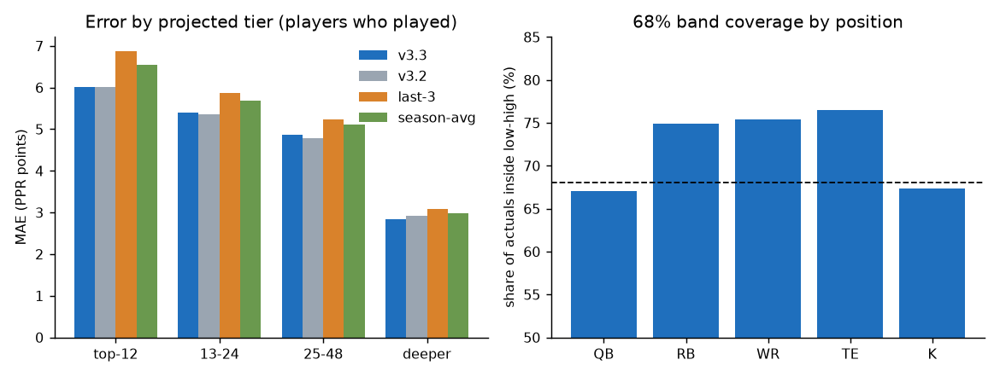
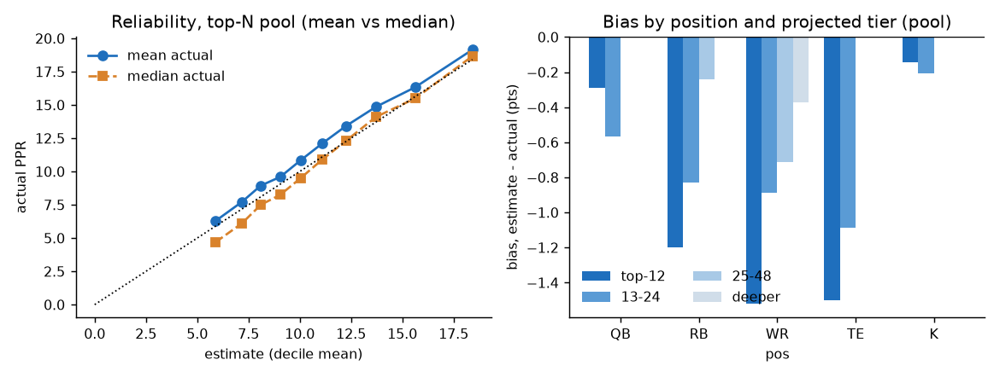
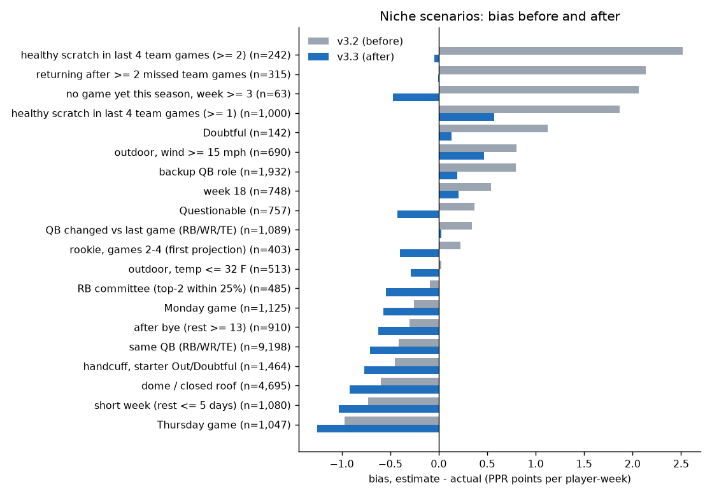
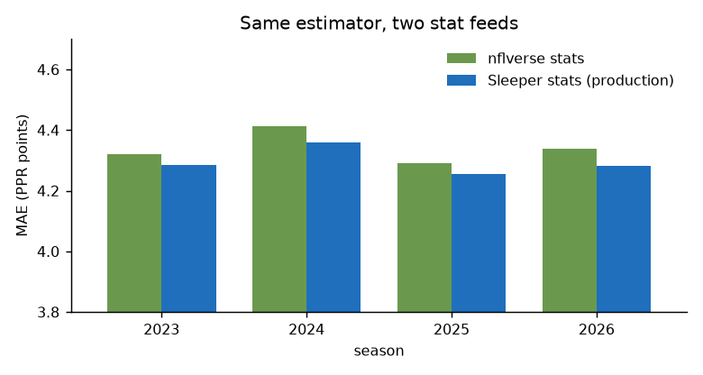
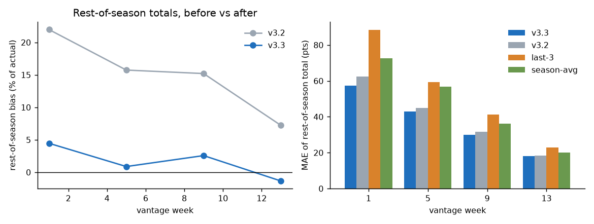
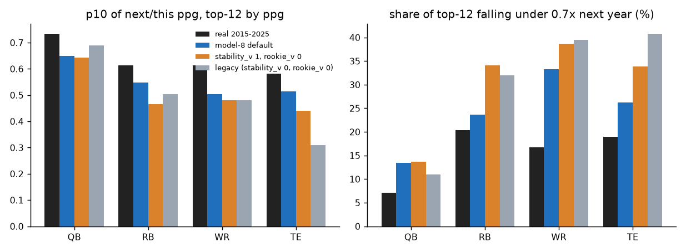

# Projections backtest against real seasons (2026-11-17)

Owner-approved audit of the FantasyDesk weekly / rest-of-season projections (`modules/player_projections.py`,
`project_player_week`, the per-week loop behind `GET /v1/players/{id}/schedule`) and of the Fantasy Sim player model
(`player-model-8`) against real NFL history. Everything is reproducible from public nflverse files (CC BY 4.0); nothing
is committed except code, this document and six PNGs. `rankings.load_players` / `build_players_table` were never called and
`data/players.db` was never opened.

Charts: `docs/audits/projections-backtest/01..06_*.png`. Harness: `scripts/projections_audit_backtest.py` (build / ros /
sleeper), `scripts/projections_audit_analyze.py` (tables, charts), `scripts/real_history_rows.py` +
`modules/sim/calibration/real_history_report.py` (Part B).

## Summary

* The v3.2 usage model is sound: it beats the last-3 and season-average baselines in every season and position (MAE 4.28 vs
  4.69 / 4.53 on players who played, 5.70 vs 6.31 / 6.07 on the top-N pool), has rank correlation 0.51 vs 0.47 / 0.48, and its
  68% band covers 70-74%. It trails Sleeper's own (Rotowire-sourced) projections by about 0.12 MAE.
* The misses were not in the average case. They were in **availability**: who actually plays. Three clear biases fixed in
  this PR (model `v3.3-participation-2026-11`): (1) rest-of-season totals over-projected by **16.9%** (22% at week 1) because
  every future game assumed full health; (2) players with missed recent games and no injury tag (healthy scratches, slow
  returns) were projected like regulars (bias **+2.1 to +2.5 points**, 58% / 52% coverage); (3) the game-time probabilities
  were never measured: Questionable played **68-72%** (not 85%), Doubtful played **0.5%** (not 15%).
* Not fixed, needs owner approval (P1): the mean/median gap for regulars, the unmodeled-starter fallback anchors, wind for
  QB/WR/TE, and Sim persistence tails for WR/TE (the p10 *season-outcome* tail is fixed by model-8, the next-year tail is not).

## Method

Point-in-time replay of the **real** `project_player_week` for every regular-season week of 2021-2026 (2021-22 only train
the constants; headline is 2023, 2024, 2025 and 2026 weeks 1-10). Inputs available before kickoff only: the player's own
weekly rows from earlier weeks plus the prior season (production's seeding), the Friday injury report, a usage-derived depth
order (QB1 = announced starter), the schedule. Actuals: nflverse PPR (kickers rebuilt with Sleeper's K scoring, exact to 1 pt).
Weeks >= 2; certain-out players removed (the model projects them 0). Pools: **played** (stat line, conditional on playing),
**pool** (position top-N by *our* estimate, QB 24 / RB 48 / WR 60 / TE 24 / K 16, non-appearances score 0). Interval nominal
coverage is 68%. DEF is not projected by the pipeline (`unsupported_position`) and is not scored.

## Headline (2023-2026, weeks 2+)

| | n | v3.3 MAE | v3.2 MAE | last-3 MAE | season-avg MAE | rho v3.3 | rho last-3 | rho season-avg | 68% cov v3.3 |
|---|---|---|---|---|---|---|---|---|---|
| Played player-weeks | 21,106 | 4.270 | 4.282 | 4.690 | 4.527 | 0.512 | 0.466 | 0.484 | 73.9% |
| Top-N pool (non-appearances = 0) | 10,320 | 5.69 | 5.70 | 6.31 | 6.07 | 0.296 | 0.232 | 0.258 | 70.8% |
| Rest-of-season totals (2021-25, 4 vantage weeks) | 3,440 | **37.0** | 39.4 | 52.9 | 46.3 | 0.450 | 0.301 | 0.383 | - |
| Rest-of-season bias, % of actual | | **+2.3%** | +16.9% | +31.0% | | | | | |

Per season (played): MAE 4.251 / 4.363 / 4.191 / 4.281 (2023-26) vs last-3 4.660 / 4.716 / 4.686 / 4.702. Bias on played
rows is negative (-0.9 v3.3, -0.6 v3.2, see "mean vs median" below).

Reference only: Sleeper's weekly projections (a Rotowire feed, no redistribution licence, never an input) on the same rows:
MAE 4.359 vs our 4.483 on 19,426 player-weeks, 5.600 vs 5.717 on the Sleeper top-N pool; Spearman 0.488 vs 0.450. **No free
public consensus with a usable licence exists** (Sleeper payloads are tagged `company: rotowire`; FantasyPros/ESPN/Yahoo forbid
redistribution or have no public API), so none is used as a baseline.




## Breakdowns (played, 2023-26)

By position (MAE v3.3 / last-3 / season-avg, bias, coverage): K 3.79 / 4.32 / 4.17, -0.17, 67%; QB 6.03 / 6.70 / 6.51, -1.62, 67%;
RB 4.32 / 4.65 / 4.49, -0.85, 75%; TE 3.46 / 3.88 / 3.69, -1.04, 76%; WR 4.30 / 4.68 / 4.53, -0.92, 75%.

By projected tier (rank of our estimate that week): top-12 MAE 6.00 vs 6.86 / 6.53 (coverage 68%); 13-24 5.40 vs 5.86 / 5.67
(70%); 25-48 4.86 vs 5.25 / 5.10 (74%); deeper 2.86 vs 3.10 / 3.00 (78%, too wide). In the top-N pool, regulars are
under-projected: WR top-12 -1.51, TE top-12 -1.52, RB top-12 -1.22 (QB -0.31), K -0.1.

By age (played): <=23 4.73, 24-26 4.20, 27-29 4.10, 30-32 4.30, 33+ 4.65 (v3.3); last-3 is 0.3-0.5 worse everywhere. Young
players are under-projected most (-1.32 at <=23, -0.72 at 33+).

By week phase (played): wk2-3 4.35 (baseline season-avg 5.16: the prior-season seed matters most here), wk4-9 4.28, wk10-14
4.19, wk15-17 4.29, wk18 4.37. Week-18 pool bias flips to +0.16 (resting starters, 90% play rate) from -0.8 in other weeks.

By role (derived depth order, pool): WR1 6.61 / WR2 5.98 / WR3+ 5.44; RB1 6.39 / RB2 5.33 / RB3+ 4.31; TE1 5.31; QB1 6.32.
Depth-2/3 players are unbiased (-0.3 to +0.6); starters carry the whole shortfall.

## Niche scenarios (relevant = estimate >= 4, 2023-26; bias = estimate - actual)

| scenario | n | played % | est v3.3 | est v3.2 | actual | bias v3.3 | bias v3.2 | MAE v3.3 | MAE v3.2 | MAE last-3 | cov v3.3 | cov v3.2 |
|---|---|---|---|---|---|---|---|---|---|---|---|---|
| all relevant | 14,568 | 95.3 | 9.38 | 9.69 | 9.96 | -0.57 | -0.27 | 5.32 | 5.33 | 5.84 | 70.7 | 69.3 |
| rookie, games 2-4 | 403 | 94.8 | 8.10 | 8.73 | 8.50 | -0.40 | +0.22 | 5.17 | 5.26 | 5.41 | 73.2 | 68.2 |
| returning after >= 2 missed team games | 315 | 76.5 | 6.94 | 9.08 | 6.94 | -0.01 | +2.14 | 5.83 | 6.16 | 6.68 | 85.4 | 65.4 |
| no game yet this season, wk >= 3 | 63 | 77.8 | 6.64 | 9.18 | 7.11 | -0.47 | +2.07 | 6.70 | 5.68 | 7.25 | 74.6 | 69.8 |
| new team in season | 50 | 82.0 | 7.85 | 8.51 | 5.95 | +1.90 | +2.56 | 4.16 | 4.64 | 4.87 | 72.0 | 60.0 |
| new team, weeks 1-3 | 41 | 61.0 | 6.87 | 6.89 | 3.41 | +3.46 | +3.48 | 5.77 | 5.79 | 6.51 | 36.6 | 36.6 |
| QB changed vs last game (RB/WR/TE) | 1,089 | 93.8 | 8.40 | 8.71 | 8.37 | +0.03 | +0.34 | 5.11 | 5.15 | 5.72 | 72.8 | 72.0 |
| same QB (RB/WR/TE) | 9,198 | 94.5 | 8.82 | 9.12 | 9.53 | -0.71 | -0.41 | 5.43 | 5.45 | 5.97 | 71.4 | 70.2 |
| handcuff, starter Out/Doubtful | 1,464 | 94.1 | 7.20 | 7.51 | 7.96 | -0.77 | -0.45 | 5.02 | 5.06 | 5.31 | 83.3 | 83.1 |
| RB committee (top-2 within 25%) | 485 | 96.5 | 10.18 | 10.63 | 10.72 | -0.54 | -0.09 | 5.73 | 5.75 | 6.43 | 74.2 | 72.0 |
| backup QB role | 1,932 | 17.7 | 0.81 | 1.41 | 0.62 | +0.19 | +0.79 | 1.26 | 1.79 | 5.89 | 94.4 | 94.4 |
| suspended-list code (RES/R48, inferred) | 16 | 68.8 | 2.77 | 3.44 | 1.87 | +0.91 | +1.57 | 1.96 | 2.11 | 2.94 | 100 | 100 |
| short week (rest <= 5) | 1,080 | 95.4 | 9.50 | 9.81 | 10.54 | -1.03 | -0.73 | 5.56 | 5.57 | 5.93 | 67.5 | 65.8 |
| Thursday game | 1,047 | 95.7 | 9.55 | 9.83 | 10.80 | -1.25 | -0.97 | 5.63 | 5.62 | 5.96 | 67.7 | 66.1 |
| after bye (rest >= 13) | 910 | 97.1 | 9.44 | 9.77 | 10.07 | -0.62 | -0.30 | 4.90 | 4.92 | 5.42 | 73.3 | 71.9 |
| Monday game | 1,125 | 95.4 | 9.52 | 9.83 | 10.09 | -0.57 | -0.25 | 5.09 | 5.14 | 5.72 | 70.5 | 69.5 |
| week 18 | 748 | 90.1 | 8.99 | 9.32 | 8.78 | +0.21 | +0.54 | 5.40 | 5.43 | 5.98 | 68.3 | 67.3 |
| Questionable | 757 | 71.6 | 7.14 | 7.94 | 7.57 | -0.43 | +0.37 | 6.10 | 6.18 | 7.55 | 89.8 | 89.8 |
| Doubtful | 142 | 0.7 | 0.16 | 1.15 | 0.03 | +0.13 | +1.13 | 0.18 | 1.16 | 9.30 | 100 | 100 |
| healthy scratch in last 4 team games (>= 1) | 1,000 | 80.0 | 6.14 | 7.44 | 5.57 | +0.57 | +1.87 | 5.04 | 5.34 | 5.50 | 69.2 | 58.0 |
| healthy scratch (>= 2) | 242 | 73.1 | 6.25 | 8.81 | 6.30 | -0.04 | +2.52 | 6.04 | 6.65 | 6.40 | 83.5 | 51.7 |
| outdoor, wind >= 15 mph | 690 | 95.7 | 9.41 | 9.74 | 8.94 | +0.47 | +0.80 | 5.03 | 5.11 | 5.82 | 72.8 | 70.4 |
| outdoor, temp <= 32 F | 513 | 94.2 | 9.27 | 9.58 | 9.55 | -0.29 | +0.03 | 5.17 | 5.24 | 5.75 | 72.3 | 70.2 |
| dome / closed roof | 4,695 | 95.3 | 9.51 | 9.83 | 10.43 | -0.92 | -0.60 | 5.48 | 5.48 | 5.95 | 69.9 | 68.7 |



Reading, with the caveat that several cells are small (n shown):

* **Healthy scratches / "inactive weeks"** (#2053): the projection correctly ignores a scratch as a zero-skill game (a row with
  no `gp` is skipped, so his per-game baseline is clean). The miss was the opposite: it ignored the scratch as *evidence of
  role and availability*. After 2+ scratches in 4 team games the player plays 73% of the time and scores 6.3 when he does.
  Fixed by the participation prior (bias +2.5 to -0.04, coverage 52% to 83%).
* **Returns from injury / long absences**: same mechanism (+2.1 to -0.0). "No game yet this season" players (n=63) are now
  unbiased but MAE rose 5.68 to 6.70: a bimodal outcome (zero or full) that a point estimate cannot serve; the wide band is the
  honest output.
* **Handcuffs** (#2036): n=1,464, bias -0.8, MAE 5.02 vs 5.31 for last-3; the inherited share holds up. Coverage 83% (too wide).
* **QB change**: RB/WR/TE are unbiased when the QB changed (+0.03, n=1,089); the model needs no QB layer (consistent with the
  v2 decision not to apply the team-QB multiplier).
* **Rookies' first games**: games 2-4 are fine (bias -0.4). **Week 1 has no projection at all** for 100% of rookies and
  other no-history players: 920 played player-weeks 2021-26 (about 150 a season; 36% in week 1). See the fallback table below.
* **Team changes**: 50 in-season movers are over-projected by 1.9; 41 weeks-1-3 movers by 3.5 with 37% coverage (61% play).
  Small n, P1.
* **Byes / short weeks / TNF**: after a bye bias is -0.6 (same as normal); Thursday and short-week games are under-projected
  by 1.0-1.25 (n about 1,050, 4 sigma). Thursday teams are better teams and score more; not a rest effect. No action.
* **Week 18**: players play 90% of the time (vs 95%), bias flips to +0.2; mild, and the rest decision depends on seeding the
  pipeline cannot see. P1 only if seeding data is added.
* **Weather** (observed stadium wind/temperature, the product applies a forecast): `actual / estimate` for wind >= 15 mph vs
  calm: QB 0.93 vs 1.08, WR 0.99 vs 1.09, TE 1.05 vs 1.21, RB 1.02 vs 1.09 (n 85-262 per cell). The product's weather table
  adjusts QB only for rain/cold and WR/TE only for rain / wind 20+, on the strength of a 2011-2025 study (`docs/weather-effects.md`)
  whose reanalysis wind did not replicate with stadium wind; this replay uses stadium wind and sees a 7-14% shortfall for
  QB/WR/TE. P1.
* **Suspensions**: no free point-in-time feed; nflverse marks them in the weekly roster as RES with code R48 (inferred).
  n=16 over four seasons, 69% play, projections correctly near zero. Not enough data to score.
* **Superflex / TE premium / half-PPR**: the league-scoring conversion works. Half-PPR MAE 5.44 / 5.37 / 4.41 (RB/WR/TE) vs
  5.58 / 5.67 / 4.62 unconverted; TE premium + 6-pt pass TD: TE bias -1.26 vs -3.20 unconverted, QB -0.49 vs -3.43. Superflex is a
  lineup rule, not a projection input.
* **Unmodeled-starter fallback** (#2032, `REPLACEMENT_WEEK`): realized points of no-history players who played, by draft round:

| pos | R1 | R2 | R3 | R4+ | UDFA | fallback anchor |
|---|---|---|---|---|---|---|
| QB | 8.1 (n17) | 10.1 (3) | 1.0 (6) | 4.2 (23) | 3.3 (15) | **12.0** |
| RB | 11.5 (6) | 5.6 (7) | 3.5 (10) | 2.6 (71) | 1.3 (58) | 4.5 |
| WR | 8.1 (25) | 5.4 (17) | 4.4 (26) | 2.5 (74) | 2.0 (93) | 5.0 |
| TE | 9.6 (5) | 3.0 (13) | 2.9 (10) | 2.8 (41) | 0.8 (49) | 3.5 |
| K | - | - | 14 (1) | 8.4 (12) | 7.0 (17) | 7.0 |

  The QB anchor is 4 points above even first-round QBs; the RB/WR/TE anchors are right for round 2-3 and low for round 1
  (conditional on having played, so this is an upper bound for lineup starters).

## Independence check

The only non-free inputs of the weekly projection are the weekly stat rows (Sleeper); the schedule is already nflverse. Same
estimator, only the stat feed swapped (no availability / role layers in either arm, same candidates, scored on nflverse actuals,
20,839 player-weeks 2023-26):

| season | MAE nflverse feed | MAE Sleeper feed | bias nflverse | bias Sleeper |
|---|---|---|---|---|
| 2023 | 4.321 | 4.285 | -0.37 | -0.60 |
| 2024 | 4.412 | 4.358 | -0.60 | -0.82 |
| 2025 | 4.292 | 4.256 | -0.36 | -0.55 |
| 2026 | 4.339 | 4.283 | -0.53 | -0.72 |
| all | **4.341** | **4.297** | -0.46 | -0.67 |

**Accuracy delta of going fully free for stats: +0.044 MAE (+1.0%), paired SE 0.004.** The constants were fit on Sleeper's
field definitions (targets / attempts counted slightly differently), so a refit on nflverse should recover most of it; the gap
is largest for WR/TE (0.05-0.06), zero for K. Injury status (nflverse Friday report) and depth (nflverse) are free sources
already used in this replay; Sleeper has no point-in-time injury history, so production availability cannot be backtested at all
without nflverse. Vegas lines (nflverse `games.csv`, CC BY) as a game-environment multiplier: fitted exponent 0 in every
walk-forward fold, no gain (confirms the earlier audit). Verdict: the pipeline can run on nflverse + free sources at about a 1% MAE cost.



## Ranked misses

1. **Rest-of-season totals over-projected 16.9%** (22% at week 1; QB/RB 22%, WR 15%): games not played were free. FIXED.
2. **Recent non-appearance ignored** (returning, scratched, slow return): +2.1 to +2.5 points, coverage 52-65%. FIXED.
3. **Game-time probabilities**: Questionable 0.85 vs 0.68-0.72 measured; Doubtful 0.15 vs 0.005. FIXED.
4. **Mean vs median for regulars**: top-12 WR/TE/RB under-projected by 1.2-1.5 points per game (median error is +0.4 to +0.7:
   points are right-skewed and the estimate is MAE-optimal). P1.
5. **Fallback anchors** for unmodeled starters (QB 12.0 vs 3-8 realized). P1.
6. **Wind >= 15 mph** not modeled for QB/WR/TE. P1.
7. New-team players in weeks 1-3 (+3.5, coverage 37%). P1, small n.
8. Interval too wide for deeper tiers and handcuffs (78% / 83% vs 68%) and slightly narrow for QB (67%).
9. Kickers' rest-of-season totals +11.7% (no durability knots for K). P1.
10. Stale `EXTERNAL_PROJECTIONS_MODEL_VERSION = "v2"` (services/mobile_api_service.py) although the formula is v3.3: a bot caching
    on that constant never invalidates.

## What shipped (model `v3.3-participation-2026-11`)

* **Participation prior** (`_participation_adjustment`): share of the team's last 4 completed games (>= 2) with no played row,
  for QB/RB/WR/TE with no injury designation, on the next game only: multiplier 1.0 / 0.89 / 0.758 / 0.669 / 0.331 by share
  missed (<=0 / <=1/3 / <=2/3 / <1 / 1), normalised to regulars so they are untouched (play rates by missed-share bucket are
  97% / 88% / 79% / 67% / 42%, within +-0.05 in every season 2021-26). Below 0.85 the low end opens to 0 and confidence is "low".
  Safety: a missed game only counts when the week's stats are known loaded (`sleeper.complete_stats_through_week`, from the
  completeness manifest) and the stats build is later than kickoff + 4 h (`sleeper.stats_built_at`), so a stale cache never
  reads as "everyone missed last week"; unknown means off.
* **Future-game durability** (`_durability_multiplier`): games after the next one are scaled by the measured relative chance a
  healthy player is available k games ahead (QB 0.90 / 0.82 / 0.78 / 0.72 at k 1.5 / 3.9 / 7.4 / 12.4; RB, WR, TE 0.92-0.93 /
  0.88 / 0.84-0.85 / 0.80-0.82). The next game is unchanged.
* **Calibrated game-time probabilities** (`injury_status`): Questionable 0.85 to 0.70, Doubtful 0.15 to 0.02 (day-to-day,
  limited, unknown keep 0.85; Probable 0.95), flagged calibrated; the Questionable conditional factor 0.87 to 0.95 (pooled 0.94,
  0.98 / 0.97 in 2025-26). This also feeds trade grading and lineup-loss pricing from the same table; three tests that pinned the
  old priors were updated (`weeks_out` 0.3 / 0.98).

Before / after on the same player-weeks (2023-26): scenarios above; rest-of-season MAE 39.4 to 37.0 (-6.0%), bias +16.9% to +2.3%,
RMSE 54.5 to 50.4, rank correlation 0.443 to 0.450, better in all 5 seasons and all 4 vantage weeks; handled rows (healthy
and no designation, missed games) MAE 3.19 to 2.79. The overall weekly MAE gain is small by construction (4.282 to 4.270 played,
5.696 to 5.694 pool) because most rows are regulars; the effect is concentrated in the rows users get burned on.



Cost: playing-conditional bias moves from -0.58 to -0.92 (a discounted player who then plays looks under-projected; that is what
a mean over "plays / does not" looks like). It is the same mean-vs-median question as item 4.

## P1 proposals (owner approval needed; each weighs the several factors named)

1. **Mean-calibrated number alongside the median-like weekly estimate.** Per-position lift fit on earlier seasons only (QB 1.01-1.02,
   RB 1.04-1.05, WR 1.06-1.08, TE 1.14-1.17): pool bias -0.70/-0.92/-0.52/-0.79 to -0.17/-0.33/+0.16/-0.15; MAE +0.01 to +0.07 worse;
   coverage +1-2 points. Gain: unbiased lineup and matchup totals (a 9-starter lineup is 6-8 points light today); cost: slightly
   worse single-player MAE and a rank-neutral but visible number change. Recommend exposing it as a separate field (totals,
   win probability, trade lineup) and keeping the weekly point estimate for start/sit, as the v3 audit also suggested. Expected: total
   bias -8 points to about 0.
2. **Fallback anchors by draft capital** (`REPLACEMENT_WEEK`): QB 12.0 to about 8; RB/WR/TE round 1 about 11 / 8 / 9.5, rounds
   2-3 about 5 / 4.5 / 3, later 2-3. Gain: win probability no longer over-credits unmodeled QBs by 4+ points; n is small
   (17 R1 QBs), so ship as a round-aware table with the wide spread kept.
3. **Wind >= 15 mph for QB/WR/TE** (-7% to -14%): needs the weather study re-run on stadium wind before changing
   `WEATHER_EFFECTS` (it currently says the effect did not replicate); the replay says it does.
4. **New-team prior for weeks 1-3** (players whose last game was for another team): projected from last team's usage, 3.5 over, 37%
   coverage; use a draft-capital-style prior or widen the band. n=41, so confirm on 2015-2022 first.
5. **Kicker durability knots** (K rest-of-season +11.7%), **interval widths** (deeper tiers/handcuffs 78-83%, QB 67%), and **refit
   usage constants on nflverse** if the stat feed is moved off Sleeper (recovers most of the +0.044 MAE).
6. **Bump `EXTERNAL_PROJECTIONS_MODEL_VERSION`** (stale since v2) so bot caches invalidate.
7. **Wire the participation prior to `inactive_weeks`** for players Sleeper lists as confirmed scratches (#2053): only 70% of
   healthy no-shows and 10% of injured no-shows are listed, so the schedule-based rule used here stays primary.

## Part B: Fantasy Sim player model vs real 2015-2025

Real: nflverse weeks 1-17, 8+ games, PPR (n about 100 top-12 players per position for year-over-year, 11 seasons). Sim: 6 seeds x 5
dynasty seasons per configuration on the 2025 panel pool, same definitions (`real_history_report`). Top-12 by ppg, next / this
year ppg (same NFL team):

| | QB p10 | RB p10 | WR p10 | TE p10 | WR median | share < 0.7 (QB/RB/WR/TE) |
|---|---|---|---|---|---|---|
| real 2015-2025 (n 95-102) | 0.73 | 0.61 | 0.61 | 0.58 | 0.875 | 7 / 20 / 17 / 19% |
| real 2021-25 (n 39-41) | 0.69 | 0.59 | 0.61 | 0.69 | 0.880 | 13 / 20 / 22 / 17% |
| **model-8 default (stability_v 2, rookie_v 1)** | 0.65 | 0.55 | 0.50 | 0.52 | 0.82 | 13 / 24 / 33 / 26% |
| rookie_v 0 | 0.66 | 0.58 | 0.53 | 0.47 | 0.83 | 13 / 20 / 29 / 26% |
| stability_v 1, rookie_v 0 | 0.64 | 0.47 | 0.48 | 0.44 | 0.78 | 14 / 34 / 39 / 34% |
| legacy (stability_v 0) | 0.69 | 0.50 | 0.48 | 0.31 | 0.82 | 11 / 32 / 40 / 41% |
| star terms off (model-7) | 0.63 | 0.54 | 0.45 | 0.47 | 0.82 | 15 / 24 / 29 / 32% |



**Verdict on the p10 tail.** The earlier audit's p10 of 0.43-0.54 against 0.59-0.69 was the *realized / projected* season
outcome and the next-year ratio. Model-8 fixed the first: top-12 realized/projected p10 is now QB 0.61 / RB 0.68 / WR 0.68 / TE 0.62
against real 0.66 / 0.72 / 0.73 / 0.63 (p05 0.56-0.61 against 0.58-0.70; the 6-seed run of `season_variance_report`). stability_v 2
and rookie_v 1 moved the **next-year** tail the right way versus stability_v 1 (RB 0.47 to 0.55, TE 0.44 to 0.52, share under
0.7 for RB 34% to 24%, TE 34% to 26%) but **WR and TE are still too fat** (p10 0.50 / 0.52 against 0.61 / 0.58; share under 0.7 of
33% / 26% against 17% / 19%) and WR persistence is low (median 0.82 against 0.875). QB and RB are within noise of the real interval.

Other season-level comparisons (model-8 default vs real 2015-25):

* **Breakouts / busts per season** (top-12 next year from outside the top 24; top-12 falling outside the top 24): QB 2.0 / 2.8 vs
  2.3 / 2.2; RB 2.2 / 4.5 vs 2.7 / 3.3; **WR 3.8 / 5.3 vs 2.2 / 3.2**; TE 2.2 / 2.6 vs 1.7 / 2.9. WR and RB churn too much.
* **Aging** (mean next / this ppg, ppg >= 8): WR 25-26: 0.95 vs 0.90, 27-28: 0.90 vs 0.87, 29-30: 0.81 vs 0.89; RB 25-26: 0.98 vs 0.90,
  27-28: 0.78 vs 0.82. Early-career RB/WR decline is too gentle and the late WR cliff too early.
* **Games missed** (last year's top-N, age <= 31, share of 16 games missed): sim 0.30-0.38 vs real 0.18-0.22; share under 8
  games 11-21% vs 9-16%. Part of this is the sim counting retired and benched players as missed; injury rate needs a cleaner
  cohort before changing `injuries.py`.
* **Positional scarcity** (ppg at rank 1 / 6 / 12 / 24): sim QB 23.0 / 18.3 / 15.7 / 9.2 vs real 24.5 / 19.9 / 17.6 / 14.0 (the sim's
  QB13-24 are too weak, a one-QB-league effect), RB 24.2 / 18.9 / 16.0 / 11.9 vs 24.8 / 18.1 / 15.1 / 12.1, WR 23.4 / 18.6 / 16.2 / 13.2
  vs 23.4 / 18.4 / 15.9 / 13.7, TE 16.2 / 12.2 / 9.8 / 6.3 vs 17.4 / 12.4 / 10.1 / 7.4. Within about 5% except QB depth and TE depth.

**No Sim behaviour was changed in this PR.** A fix needs a new frozen model (player-model-9) or a `stability_v` 3 flag in
`game_rules.UPGRADABLE_FLAGS` with the digest pins re-recorded; it should not be rushed on a 6-seed sample.

P1 (Sim): (a) WR/TE persistence: shrink the WR/TE season-multiplier variance (or raise the last-season carry for WR/TE in
`stability_v`) until the top-12 next-year p10 reaches about 0.6 and the share under 0.7 about 17-19%; expected effect, WR breakouts
3.8 to about 2.5 per season. (b) RB/WR early-career aging flatter than real at 25-26. (c) QB13-24 and TE13-24 depth too thin.
(d) Re-measure games missed with a retirement-free cohort. Each behind a new flag, with old saves replaying identically.

## Reproducing

```
python scripts/projections_audit_backtest.py fetch --nv /tmp/nv
python scripts/projections_audit_backtest.py build --nv /tmp/nv --out /tmp/pa --seasons 2021 2022 2023 2024 2025 2026
python scripts/projections_audit_backtest.py ros   --nv /tmp/nv --out /tmp/pa --seasons 2021 2022 2023 2024 2025
python scripts/projections_audit_backtest.py sleeper --nv /tmp/nv --sl /tmp/sl --out /tmp/pa   # sl = projection_walkforward.py fetch cache
python scripts/projections_audit_analyze.py --after /tmp/pa --before /tmp/pa_before --out /tmp/pa --charts docs/audits/projections-backtest --sl /tmp/sl
python scripts/real_history_rows.py --nv /tmp/nv --out /tmp/real_rows.json
python -m modules.sim.calibration.real_history_report --real /tmp/real_rows.json --json /tmp/partb.json
```

`--before` is a `build` run on the commit before this change. Caches live outside the repo and were deleted afterwards.
