# Fantasy Sim long-run soak: 30 dynasty seasons (2026-11)

Ask (owner-approved item 9): play 30+ dynasty seasons automatically and catch slow drift in balance or the economy.
Result: two real drifts found and fixed behind `stability_v 4` (a veteran market that flattened and deflated, and a quarterback depth that thinned 18 percent), everything else
is flat or a start-up transient, and a short regression test now guards the key metrics. Residual gaps are listed at the end.

## Setup

- Harness: `modules/sim/calibration/dynasty_run.py` (headless, 12 teams, PPR, the committed 2025 panel pool, never `data/players.db`) driven by the new
  `modules/sim/calibration/longrun_soak.py` (`run`, `report`, `BOUNDS`). `dynasty_run` now plays past the product cap of 20 seasons, takes `superflex=`, and records the
  extra per-season facts (events, retirements, ages, rookie markets, price curve) the soak needs.
- 8 seeds x 30 seasons x {1QB, superflex} = 16 games per side, 4 processes, all current flags for a new game (`stability_v 3` -> now 4, `rookie_v 1`, `cap_v 1`, `wire_v 1`,
  `need_v 1`, `posture_v 1`, `cover_v 1`, `incumbent_v 1`, `injury_v 1`, `ai_v 1`, `dynasty_v 3`...). Before = the same code with `stability_v 3` forced (`--flags '{"stability_v": 3}'`),
  which reproduces the pre-fix soak exactly.
- Every team-level number reads the 11 AI teams: the harness leaves the user's team (slot 3) with no lineup or waiver management, so it is excluded from scores, QB counts,
  team value and parity. The harness league is the game default (K, no DEF), so its low-score tail sits above the real K+DEF target of #2091 (see residual gaps).
- "s1-3" / "s14-16" / "s28-30" are means over those seasons and seeds. Windows with rookie metrics start at season 2 (season 1 has no class).

## Drift table (1QB unless marked; before = `stability_v 3`, after = `stability_v 4`)

| metric | target | before s1-3 | before s14-16 | before s28-30 | after s1-3 | after s14-16 | after s28-30 | verdict |
| --- | --- | --- | --- | --- | --- | --- | --- | --- |
| weekly AI team score mean | long-dynasty audit 101.7, plateau within 10% | 102.5 | 101.2 | 102.0 | 102.0 | 103.3 | 103.9 | flat |
| weekly team score sd | 23-26 (sweep) | 24.1 | 24.1 | 24.3 | 24.4 | 24.3 | 24.8 | flat |
| team-weeks under 70 / under 60 (%) | real 3.6 / 1.2 (K+DEF) | 8.6 / 3.0 | 9.5 / 4.0 | 9.0 / 2.9 | 9.3 / 3.2 | 7.8 / 2.3 | 7.7 / 3.1 | flat (level gap, below) |
| team-weeks over 170 (%) | real 0.8 | 0.7 | 0.5 | 0.6 | 0.6 | 0.8 | 0.9 | flat |
| p1 / p99 team score | 58 / n.a. | 55 / 162 | 52 / 157 | 54 / 161 | 54 / 161 | 56 / 162 | 55 / 163 | flat |
| superflex score mean | | | | | 115.4 | 113.3 | 115.1 | flat (before: 115.2 -> 111.3, -3.4%) |
| superflex under 70 / under 60 (%) | real 3.6 / 1.2 | 3.1 / 1.0 | 4.6 / 1.2 | 4.7 / 1.9 | 3.0 / 1.1 | 3.8 / 1.4 | 3.8 / 1.5 | mild, QB2 supply (below) |
| QB12 ppg | s1 level 16.0 | 16.0 | 14.1 | **13.1** | 16.1 | 15.0 | 15.0 | **mostly fixed** (was -18%, now -7%) |
| RB12 / WR12 / TE12 ppg |  | 15.6 / 16.3 / 9.3 | 15.6 / 17.3 / 10.0 | 16.0 / 16.6 / 10.4 | 15.5 / 16.3 / 9.4 | 16.2 / 17.1 / 9.9 | 16.4 / 17.2 / 10.3 | flat (TE +10%, watch) |
| rank-1 QB / RB / WR / TE ppg | | 22.8 / 24.2 / 23.5 / 16.3 | 23.2 / 23.9 / 24.2 / 17.4 | 23.0 / 24.0 / 23.8 / 17.6 | 23.0 / 24.4 / 23.4 / 16.4 | 23.5 / 23.9 / 24.4 / 16.8 | 23.7 / 23.8 / 24.4 / 17.0 | flat |
| best rookie / 12th veteran (RB, WR, TE) | real 0.9 (#2030) | 0.90 | 1.00 | 0.88 | 0.92 | 0.96 | 0.90 | on target |
| rookies in a skill position's top 12 (class) | real under 1 per position | 0.9 | 2.0 | 1.0 | 1.0 | 1.7 | 1.2 | on target (class-to-class noise: 1.7-2.0 in the s14-16 window) |
| starter age (mean) | 26-27 (long-dynasty audit) | 26.1 | 26.1 | 26.3 | 26.1 | 26.2 | 26.5 | flat |
| starters 30+ (%) |  | 9.1 | 11.9 | 13.5 | 9.3 | 12.5 | 15.7 | +7 points over 30 seasons (watch) |
| roster age mean / under 24 / 30+ (%) |  | 26.4 / 20.3 / 13.2 | 26.5 / 16.2 / 16.6 | 26.7 / 14.2 / 17.9 | 26.4 / 20.0 / 13.3 | 26.6 / 13.7 / 16.9 | 26.8 / 13.5 / 19.7 | mostly transient: the season-1 pool is young-heavy; the under-24 share is flat from season 7, the 30+ share still creeps (watch) |
| retirements per offseason | = class size | 63.9 | 68.4 | 64.9 | 64.9 | 66.8 | 67.2 | flat, equals incoming class (63-64) |
| pool size | 383 (anchor head count) | 383 | 383 | 383 | 383 | 383 | 383 | held by design; kickers 30, QBs 33 |
| QBs per AI team (1QB) / with 3+ | cap_v 1 audit: 33% with 3+ | 2.09 / 28% | 1.82 / 21% | 1.80 / 14% | 2.11 / 27% | 1.79 / 21% | 1.93 / 22% | ok |
| QBs per AI team (superflex) | 2-3 | 2.10 | 1.64 | 1.69 | 2.11 | 1.61 | 1.78 | **residual**: below the 2 starters |
| waiver adds per league-season | 60-100 (earlier audit) | 56.7 | 57.5 | 53.8 | 56.7 | 55.1 | 55.3 | flat |
| drops per league-season |  | 21 | 32 | 31 | 21.5 | 32.6 | 32.0 | start-up step, flat after |
| trades per league-season (AI-AI) | 8-14 (earlier audit) | 2.3 | 3.2 | 3.2 | 1.7 | 3.2 | 2.5 | low and flat (below) |
| trade size mismatch, mean abs log(give / get), players only |  | 0.71 | 0.73 | 0.89 | 0.56 | 0.60 | 0.65 | flat (picks are not in the sum, so it overstates) |
| injuries per league-season |  | 315 | 311 | 309 | 315 | 312 | 311 | flat |
| top-30 market (mean) | s1 85 | 82.0 | 76.8 | **70.9** | 85.2 | 84.1 | 82.2 | **fixed** (was -17%, now -3.5%) |
| pool mean market (skill positions) | s1 33 | 33.0 | 28.2 | **27.7** | 34.1 | 34.4 | 34.4 | **fixed** (was -16%) |
| price curve: log market on log projection, RB / WR / TE | s1 1.5 / 1.6 / 1.2 | 1.53 / 1.56 / 1.18 | 1.22 / 1.33 / 0.92 | **1.18 / 1.27 / 0.90** | 1.61 / 1.63 / 1.29 | 1.49 / 1.50 / 1.15 | 1.49 / 1.48 / 1.14 | **fixed** (was flattening) |
| team value (sum of rostered markets), mean |  | 567 | 490 | 503 | 592 | 617 | 628 | +6%, watch |
| draft pick value: 12th / 36th best rookie market |  | 43 / 18 | 80 / 53 | 73 / 50 | 49 / 20 | 89 / 63 | 85 / 61 | step s2-s8, flat after (below) |
| parity: win sd / points-for cv / team value cv |  | 0.17 / 0.10 / 0.18 | 0.17 / 0.10 / 0.24 | 0.17 / 0.11 / 0.25 | 0.17 / 0.11 / 0.18 | 0.17 / 0.10 / 0.20 | 0.17 / 0.11 / 0.19 | flat; value cv no longer widens |
| champions: distinct per 10 seasons / repeat champion (%) / most titles by one team in 30 | random: 7.2 / 8.3 / about 5 | 6.5 / 15.5 / 6.3 | | | 6.2 / 14.2 / 6.5 | | | mild dynasties (below) |

Charts (mean over seeds, band = min/max seed; orange = superflex, green = before): `docs/audits/sim-longrun/`

| | |
| --- | --- |
| 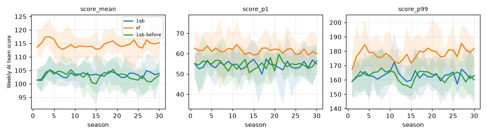 | 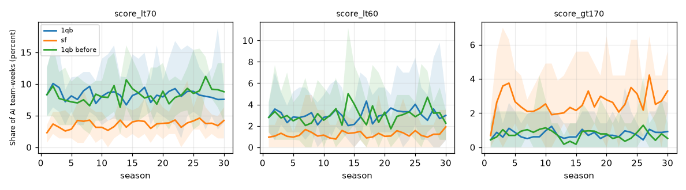 |
| 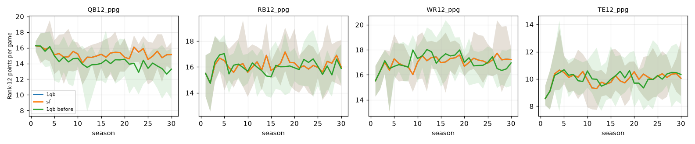 | 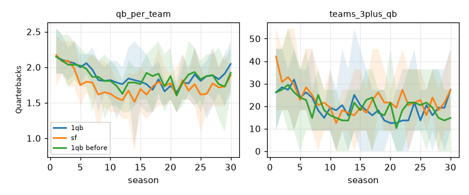 |
| 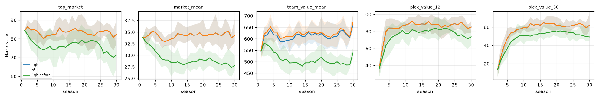 | 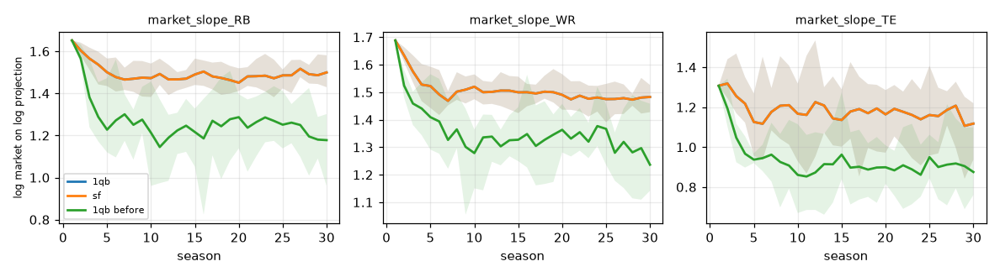 |
| 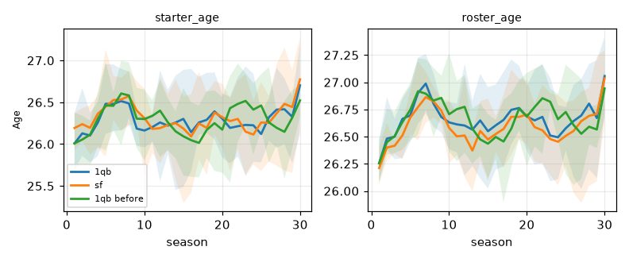 | 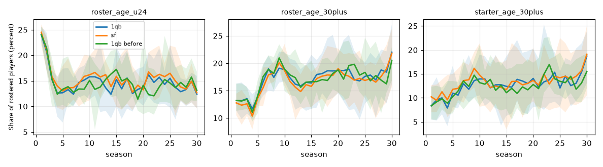 |
| 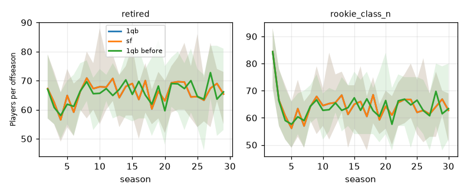 | 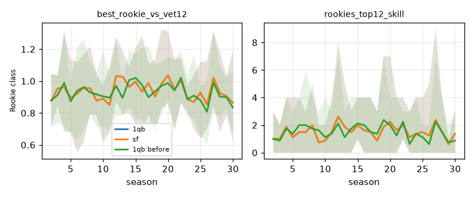 |
| 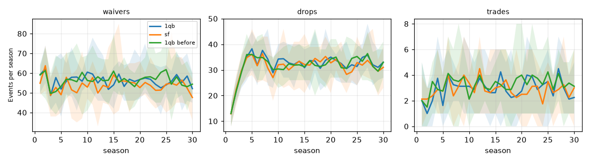 | 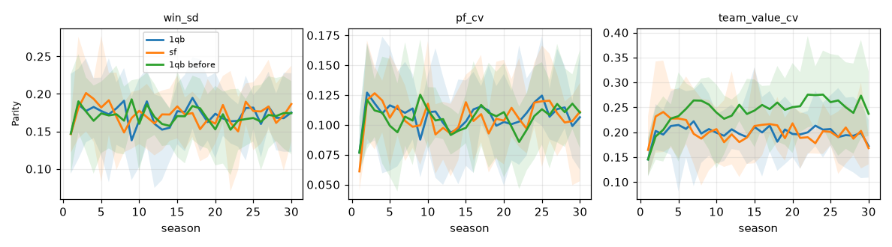 |

## Findings

**1. Quarterback depth thinned 18 percent (fixed).** QB12 fell 16.0 -> 13.1 ppg over 30 seasons (QB24 17.0 -> 13.2, QB32 11.7 -> 7.9) while the top six QBs and every RB / WR / TE
rank held; in superflex that took the league's scoring mean down 3.4 percent and doubled the under-60 share. Cause: a quarterback class is one to four players and the rookie depth response
(`game_dynasty._depth_response`) lifts a middle-of-the-class rookie to at most 0.8 x the 12th veteran. That cap suits a 12-player RB class, but it means no drafted QB ever refills QB ranks 12-24, so the mid-tier
controller saturates every year. Fix: a quarterback class's cap is 0.95 x the 12th veteran (`DEPTH_CAP_QB`, `stability_v 4`; QB13-24 are about 0.9 x the 12th in the panel). QB12 recovers from -18 to -7 percent (16.1 -> 15.0 ppg), QB18 and QB24 to about -5 and -13 percent; the rest is residual. A cap above 1.0 restores more depth but sends 1.2 rookie QBs per class
into the top 12 against 0.4 in the real classes (#2030), so 0.95 is the highest cap that keeps the rookie class realistic (0.3 per class).

**2. The market flattened and deflated (fixed).** A veteran's `market` carried only 0.6 of each year's production change (`aging.MARKET_HALF_LIFE`) although the season-1 pool prices production
at an elasticity of 1.5-1.6 (log market on log projection, RB / WR). Rookies enter at the pool's price curve, veterans drift off it: after 30 seasons the price curve slope was RB 1.18 / WR 1.27 / TE 0.90 and the top 30 markets
had fallen from 82 to 71 with production unchanged (top-six QB market 67 -> 30-45). Trade values, draft-pick prices and ADP all read market, so this is a slow deflation of the economy's
top and inflation of its bottom. Fix: under `stability_v 4` a veteran carries a year's production change at `aging.MARKET_EXP_V4 = 1.5`, the pool's own elasticity (tried 0.6 / 1.0 / 1.4 on 4 seeds x 20 seasons: top-30 market 78 / 80 / 83 and slopes
1.33 / 1.40 / 1.48 at season 20; the full soak at 1.5 holds the slopes within 0.15 of season 1). Not a clamp: nothing is capped, the carry is the measured elasticity.

**3. Start-up transients, not drift.** Roster age (under-24 share 20.7 -> 13.8 percent, 30+ 13 -> 19 percent) and the draft pick price (12th rookie 43 -> 80, 49 -> 89 after the fix) move in seasons 2-7 and then (pick price, under-24 share) stay flat for 23 seasons: the
season-1 pool is a young, freshly drafted league, and the controllers (retire hazard, class depth response) walk it to its own equilibrium. Retirements match the incoming class every year (64 vs 63-64), the pool never grows or shrinks, kickers hold at 30. Starters aged 30+ keep creeping (9 -> 16 percent, mean starter age 26.1 -> 26.5) and are the one age metric to watch.

**4. Flat for 30 seasons (no action):** weekly score mean / sd / tails, RB / WR rank-12 and rank-1 ppg, starter age, rookie class strength vs the 12th veteran (0.9, real 0.9), waivers, injuries, retirements, parity (win sd, points-for cv).

## What changed in the code

- `modules/sim/game_types.py`: `STABILITY_VERSION = 4`, `GameSettings.stable4`. `modules/sim/game_rules.py` offers it to old saves at the next season boundary (`UPGRADABLE_FLAGS`, copy updated).
- `modules/sim/aging.py`: `progress(..., market_exp=None)`; the default path is byte-identical, `MARKET_EXP_V4 = 1.5` is passed only when `stable4`.
- `modules/sim/game_dynasty.py`: `_depth_cap(settings, pos)`, `DEPTH_CAP_QB = 0.95`, wired through `_depth_response` in both the solver and the class writer.
- Old saves: a `stability_v 3` save builds the same pools as before (pinned digests for seasons 2, 5 and 12 of seed 3, identical on `origin/main` and here), and the Realism update schedules `stability_v 4` at the season boundary like every earlier generation.
- Harness: `dynasty_run.py` (30+ seasons, superflex, soak facts), `longrun_soak.py` (new).
- Test: `tests/test_sim_longrun_regression.py` (about 20 s: 1 seed x 5 seasons held to `longrun_soak.BOUNDS` and a loose trend against season 1, plus the v3 pins and the v4 gate).

## Residual gaps (not fixed here)

1. **Superflex AI teams hold 1.6-1.8 QBs** (2.1 after the draft), under the two starting spots; under-70 weeks 3.0 -> 3.8 percent and under-60 1.1 -> 1.5 percent (the real target
   is 3.6 / 1.2). `cap_v 1` allows three QBs in superflex, so the cause is the AI waiver / trade planner not backfilling a QB2 (the deferred `ai_v 2` backup-QB planning in the advice audit), not the cap.
2. **QB depth** is still 7 percent under season 1 at QB12 and about 13 percent at QB24 (a backup tier in 1QB; it matters for superflex starters). The cap cannot go higher without flooding the top 12 with rookies (above); the next lever is how long mid QBs keep their jobs (retirement / aging), not the class.
3. **Pick price step**: the 12th rookie of a class is priced 49 in season 2 and 89 from season 8 (top-6-RB territory) and the 36th 20 -> 63. Rookie market follows the class's mean, and the depth controller turns late class slots
   into flex-level starters, so it is consistent with the production, but a late pick priced above the average veteran (35) should be reviewed with the trade-advice backtest before touching it.
4. **Team value +6 percent** after the fix (592 -> 628), with the price curve held; the pool's mean market is flat (34.1 -> 34.4), so it is more rostered value, not price inflation. Watch it in the next soak.
5. **Low tail level**: the harness league (K, no DEF) scores under 70 in 8-9 percent of AI team-weeks against the real K+DEF 3.6 percent. It is flat, so it is a level (not drift) and a format difference
   (no DEF slot); `team_score_report` on K+DEF is the right place to hold the target.
6. **AI-AI trade volume is 2-3 per league-season** against 8-14 in the 20-season audit and flat; the AI trade planner (`stability_v 1`, no picks, consensus value) is quiet. Not drift, but the trade-advice backtest should know AI partners are scarce late.
7. **Mild dynasties**: 14.2 percent repeat champions (random 8.3) and 6.5 titles for the best team in 30 seasons (random about 5): the best AI teams hold a small edge for years. Distinct champions per 10 seasons 6.2 (random 7.2). Not a blocker; watch.
8. Trades are measured on players only (picks have no market in the harness), so the size-mismatch number overstates unfairness.

## Reproduce

```
python -m modules.sim.calibration.longrun_soak run --out DIR --seeds 8 --seasons 30 --procs 4                         # about 12 min on 4 cores
python -m modules.sim.calibration.longrun_soak run --out DIR3 --seeds 8 --seasons 30 --flags '{"stability_v": 3}'      # the before side
python -m modules.sim.calibration.longrun_soak report --out DIR --before DIR3 --png docs/audits/sim-longrun            # tables + charts (matplotlib)
python -m pytest tests/test_sim_longrun_regression.py
```
