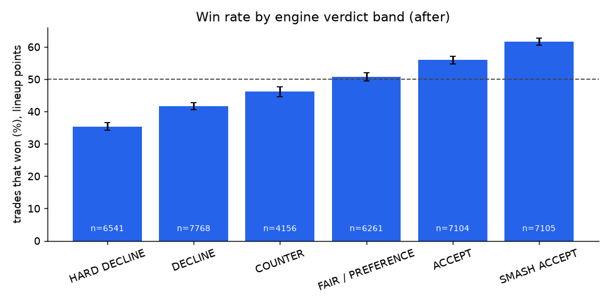
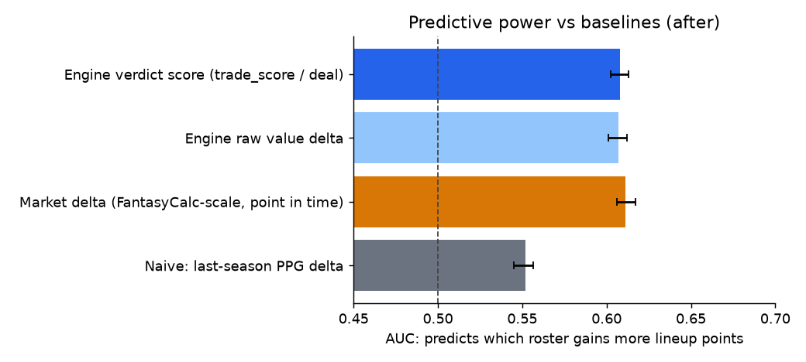
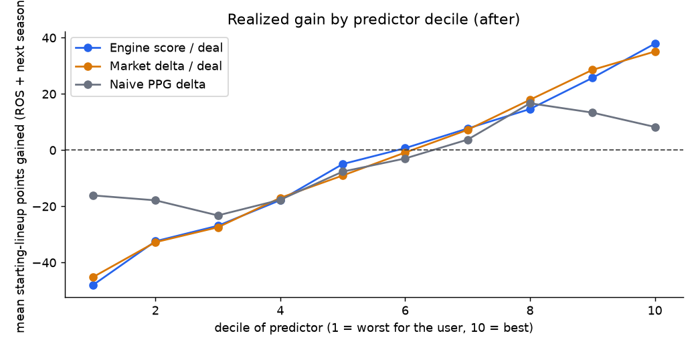
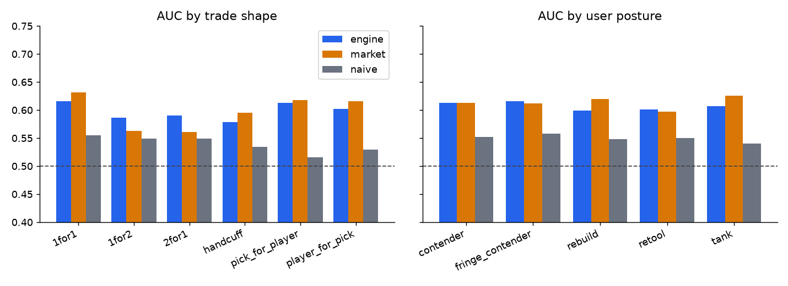
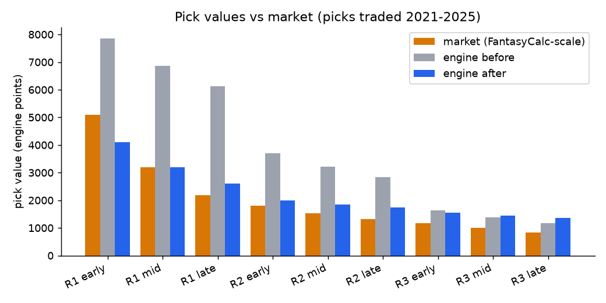
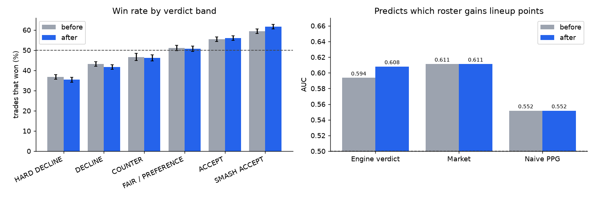

# Trade advice vs market and real outcomes (2026-11-17)

Owner-approved audit 2. Question: do our trade grades, trade ideas and Analyzer verdicts predict what happens?
Everything is a point-in-time replay on real NFL history (nflverse 2020-2026 weekly stats, injuries, schedule) with the
real production valuation and verdict code. `rankings.load_players` / `build_players_table` were never called,
`data/players.db` was never opened, nothing is written to `data/`. Downloads (nflverse, DynastyProcess value snapshots) were
kept in a scratch directory and deleted.

Charts: `docs/audits/trade-advice-backtest/01..06_*.png`. Code: `scripts/trade_advice_backtest.py` (league + trade
simulation + grading), `scripts/trade_advice_outcomes.py` (scoring against what happened), `scripts/trade_advice_report.py`
(tables and charts).

## Summary

* **A "win" grade does win more often, but only modestly.** Of 48,521 graded trades (38,935 with a full following season),
  ACCEPT trades won on lineup points **58.8%** of the time (+23.8 starting-lineup points over rest of season + next
  season), DECLINE trades **38.8%** (-32.6 points), FAIR 50.7%. SMASH ACCEPT 61.7%, HARD DECLINE 35.4%. Monotone across all
  six bands, adjacent bands' 95% intervals do not overlap. Ties (|gain| < 3 points) are excluded from win rates.
* **Against the baselines.** After the fixes below the verdict is as good as the point-in-time market delta (AUC 0.608 vs
  0.611, intervals overlap) and clearly better than the naive last-season-PPG delta (0.552). Before the fixes it trailed the
  market (0.594 vs 0.611). On points over replacement the verdict beats the market (0.619 vs 0.608), and rest-of-season
  it beats it clearly (0.621 vs 0.596), which is the in-season lineup model doing real work (its slope is 0.97 lineup
  points per model point). The market is better 1-2 seasons out (next season 0.606 vs 0.580, season after 0.593 vs 0.536).
* **Five findings**
  1. Draft picks were valued at roughly **2x** what they turn into (mid 1st 6,867 vs 3,200 market and ~2,900 realized; 2nds
     1.7-2.1x). Pick trades were the worst-predicted shape (AUC 0.568). **Fixed.**
  2. The user-side **consolidation premium over-credited** star-for-depth deals: +1,000 premium points went with -13 lineup
     points the same season, 2-for-1 deals it favoured won 47%, and where it disagreed with the market the market was
     right more often. **Fixed (share 0).**
  3. **QB and TE are inflated against WR/RB in 1QB leagues** (at equal market value the engine adds +1,100 to +1,400 for a QB, +900 to +1,300 for a TE, +500 for a WR;
     realized, a QB scores 19 and a TE 13 fewer points over replacement than a player with the same engine score). It drives the 1QB gap to market (0.596 vs 0.620). Not fixed, P1: it changes every ranking.
  4. **Every player with no market value carries about +850 engine points** (neutral production/opportunity anchors), so
     depth pieces add value out of nothing in 1-for-2 packages. P1.
  5. **Roster redundancy is not priced**: receiving a QB in Superflex that the roster cannot start wins 46% on an ACCEPT;
     selling the surplus QB wins 75%. P1.
* **P0 fixes** (before / after, same 48,521 trades re-graded): verdict AUC 0.594 -> 0.608; pick trades 0.568 -> 0.603 (market
  0.607); 2-for-1 / 1-for-2 0.607 -> 0.612 (market 0.593); ACCEPT win 57.5% -> 58.8%, DECLINE 40.0% -> 38.8%, SMASH ACCEPT
  59.4% -> 61.7%; when the engine disagreed with the market on the sign, the engine ACCEPT/market-lose cell went 47.0% ->
  49.0% and the engine DECLINE/market-win cell 52.1% -> 50.9% (its departures from the market no longer hurt); the engine's own
  contribution beyond the market doubled (t 13 -> 27). 28.3% of verdicts changed, 61% of those pick trades.
* **Our own track record.** Not readable from here: `decision_log` / `trade_outcomes` live in Supabase behind service-role
  credentials (and `local_secrets/` was off limits). **Sample size used: 0.** Section 6 says what the sweep measures and
  how well that measure agrees with the longer outcomes in this backtest.

## 1. Method

**Dates.** Five per season, 2021-2025: Apr 15 (before the NFL draft), May 20 (after), Aug 20 (after rookie drafts, preseason),
Oct 20 (week 7-8, the deadline window), Dec 1 (week 13). 90 league-dates.

**Point-in-time inputs.** Market: the DynastyProcess value snapshot committed nearest before the date (FantasyPros-ECR dynasty
values; FantasyCalc itself keeps no archive). Its tail is far steeper than FantasyCalc's, so each snapshot is rank-matched
onto FantasyCalc's own current rank-to-value curve (`data/fantasycalc_values.csv`), order preserved; the 1QB column is the
production input (`get_dynasty_values` fetches `numQbs=1`; Superflex is the lens's own QB uplift) and the 2QB column is
the Superflex **market baseline**. Age at the date, current-season and prior-season usage/PPG (weeks before the date only), the
latest published injury report, a usage-derived depth order (production reads Sleeper's chart; none exists historically).
This is a proxy for FantasyCalc, not FantasyCalc: absolute numbers will differ, the ranking of fixes should not.

**Real engine.** `rankings`: age curve, scarcity, `production_usage_frame`, `apply_role_and_opportunity`,
`apply_injury_risk_fields`, `compose_composite_score`; then `league_value_settings.apply_valuation_lens` (Dynasty / Superflex /
TE premium / Non-Dynasty), `trade_hub_engine.apply_strategy_age_curve`, the pick model (`trade_ideas._pick_value_components`),
and the verdict from `trade_grade.grade_trade_for_user` (Analyzer fit + `decide_offer_verdict`, the Hub's own entry point),
with the in-season lineup model fed a walk-forward weekly baseline. Production's Sleeper search rank and live news are not
available historically (search rank is replaced by the market rank).

**Leagues and trades.** 90 random 12-team leagues (1QB/2RB/3WR/1TE/FLEX; dynasty 1QB, dynasty Superflex, dynasty Superflex +
TE premium, redraft), snake-drafted by noisy snapshot value. Posture = roster-strength rank (top 3 contender, next 3 fringe,
3 retool, 2 rebuild, 1 tank). 48,521 trades from plausible value bands: 1-for-1 (0.55-1.6x the sent value), 2-for-1 and 1-for-2
(0.6-1.15x the sum), pick-for-player, player-for-pick (the pick priced by slot), and handcuff buys.

**Outcomes** (user side, three windows: rest of that season, next season, the one after).
* *Starting-lineup points over replacement (SPOR, primary):* the receiving roster's hindsight-optimal weekly lineup points
  (QB, 2 RB, 3 WR, TE, FLEX, +Superflex), empty slots filled at replacement, after minus before the trade. A pick is scored
  as the rookie it became (slot -> the slot-th rookie of that class by post-draft value).
* *Points over replacement per asset* (below-replacement seasons count 0, the player is replaced off waivers), and the
  market-value change one year on.
* Replacement = the PPG of the 12th QB / 30th RB / 42nd WR / 14th TE (24th QB in Superflex) by that season's real points; TE premium
  adds 0.5/rec.

**Win** = SPOR over rest of season + next season > 0 (ties under 3 points dropped). "Predictor AUC" = how often a predictor
ranks the trade that gained more above the one that gained less.

## 2. Calibration: does a "win" grade win?

| verdict (after fixes) | n | decided | win % | 95% CI | mean lineup points gained |
|---|---|---|---|---|---|
| ACCEPT (both bands) | 14,209 | 13,641 | 58.8 | 0.8 | +23.8 |
| FAIR | 6,261 | 5,983 | 50.7 | 1.3 | -0.6 |
| COUNTER | 4,156 | 3,965 | 46.2 | 1.6 | -8.9 |
| DECLINE (both bands) | 14,309 | 13,827 | 38.8 | 0.8 | -32.6 |

| band | n | win % | mean lineup points |
|---|---|---|---|
| SMASH ACCEPT | 7,105 | 61.7 | +30.8 |
| ACCEPT | 7,104 | 56.0 | +16.8 |
| FAIR / PREFERENCE | 6,261 | 50.7 | -0.6 |
| COUNTER | 4,156 | 46.2 | -8.9 |
| DECLINE | 7,768 | 41.7 | -23.3 |
| HARD DECLINE | 6,541 | 35.4 | -43.6 |

Before the fixes: ACCEPT 57.5%, DECLINE 40.0%, SMASH 59.4%, HARD DECLINE 36.7% (`01_verdict_calibration_before.png`).
Reading it honestly: a green card is a 3-in-5 shot, not a lock, because one-or-two-season production is noisy; the
grades rank trades correctly, they do not forecast outcomes sharply. The "market value one year later" column in the
tables is mechanical (a trade that starts with a positive value margin shrinks back) and is not used as an outcome.

## 3. Against the market and the naive baseline

AUC, outcome = lineup points, rest of season + next (n = 38,935):

| predictor | before | after |
|---|---|---|
| Engine verdict score (trade_score / deal) | 0.594 (0.589-0.600) | **0.608** (0.603-0.613) |
| Engine raw value delta | 0.590 | 0.607 |
| Market delta (point in time, FantasyCalc scale) | 0.611 (0.606-0.617) | 0.611 |
| Naive: last-season PPG delta | 0.552 (0.545-0.557) | 0.552 |

On points over replacement: engine 0.608 -> **0.619**, market 0.608, naive 0.572.

By horizon (after / market / naive): rest of that season **0.621** / 0.596 / 0.589; next season 0.580 / 0.606 / 0.509; the season
after 0.536 / 0.593 / 0.461 (trades through 2023, n = 29,207). The engine is a better one-season forecaster than the market (the
lineup model) and a worse multi-season one. The consolidation fix accounts for the drop in the third season (premium
coefficient on year-3 points is +5.5 per 1,000, on same-season points -12.8); equal-weighting the three seasons it nets to about -0.2 of a
market point, hence share 0 rather than a negative. Revisit with a time-decayed premium (P1).

Does the engine add anything beyond the market? Regress lineup points on the market delta and on the engine's departure from it
(standardized): market 29.2 (t 49), engine-minus-market **16.2 (t 27)** after, 7.7 (t 13) before. Its departures carry real,
now twice as much, signal. When the two disagree on the sign:

| case | n | win % before | win % after |
|---|---|---|---|
| Engine ACCEPT, market agrees | 10,187 | 61.2 | 62.2 |
| Engine ACCEPT, market says lose | 4,397 | 47.0 | 49.0 |
| Engine DECLINE, market agrees | 13,480 | 37.9 | 37.2 |
| Engine DECLINE, market says win | 4,557 | 52.1 | 50.9 |

## 4. Breakdowns

AUC (engine / market / naive) and ACCEPT / DECLINE win % after the fixes:

| group | n | engine | market | naive | ACCEPT win % | DECLINE win % |
|---|---|---|---|---|---|---|
| 1-for-1 | 12,868 | 0.616 | 0.632 | 0.555 | 59.3 | 37.2 |
| 2-for-1 (consolidate) | 6,916 | 0.590 | 0.561 | 0.549 | 55.2 | 38.6 |
| 1-for-2 (break up) | 4,678 | 0.586 | 0.562 | 0.549 | 61.4 | 43.5 |
| pick for player | 5,598 | 0.613 | 0.618 | 0.516 | 57.2 | 35.1 |
| player for pick | 5,797 | 0.602 | 0.615 | 0.529 | 61.2 | 41.2 |
| handcuff buy | 3,078 | 0.578 | 0.595 | 0.534 | 54.3 | 40.1 |
| contender | 9,893 | 0.613 | 0.613 | 0.552 | 57.6 | 37.5 |
| fringe contender | 9,607 | 0.616 | 0.612 | 0.558 | 60.4 | 39.1 |
| retool | 9,702 | 0.601 | 0.597 | 0.550 | 59.3 | 39.7 |
| rebuild | 6,473 | 0.599 | 0.619 | 0.548 | 57.8 | 39.2 |
| tank | 3,260 | 0.607 | 0.625 | 0.540 | 58.3 | 39.2 |
| dynasty 1QB | 10,827 | 0.596 | 0.620 | 0.545 | 58.3 | 40.7 |
| dynasty Superflex | 10,779 | 0.611 | 0.601 | 0.556 | 59.0 | 38.6 |
| dynasty SF + TE premium | 10,835 | 0.628 | 0.612 | 0.567 | 60.7 | 36.8 |
| redraft | 6,494 | 0.589 | 0.613 | 0.530 | 55.9 | 39.6 |
| picks involved | 11,395 | 0.603 | 0.607 | 0.536 | 58.1 | 40.1 |
| players only | 27,540 | 0.610 | 0.613 | 0.561 | 59.1 | 38.3 |
| receives a QB | 4,546 | 0.673 | 0.629 | 0.613 | 47.3 | 18.2 |
| receives a TE | 4,041 | 0.593 | 0.604 | 0.554 | 59.3 | 40.5 |
| older side received (2+ years) | 8,023 | 0.604 | 0.609 | 0.550 | 61.7 | 41.4 |
| younger side received (2+ years) | 8,446 | 0.591 | 0.618 | 0.542 | 54.1 | 36.6 |

* The engine beats the market on **consolidation shapes** (2-for-1, 1-for-2) and on contender / fringe postures and
  Superflex; it trails it on 1QB, redraft and rebuild/tank, and on trades that hand the user the younger side.
* Naive last-season PPG is the weakest everywhere except in-season deadline deals; it is blind to picks (0 for a pick).
* Receiving a QB is both the best-ranked shape (AUC 0.673) and the worst-calibrated: ACCEPT wins 47%.

## 5. Niche checks

Bias = mean lineup points the outcome sits above (+) or below (-) what the engine's score implies at the overall slope.
Win % are by the engine's own verdict; AUC engine / market.

| niche | n | AUC engine / market | ACCEPT win % | DECLINE win % | bias (pts) |
|---|---|---|---|---|---|
| Aging RB (27+) received | 2,932 | 0.60 / 0.59 | 60.2 | 41.2 | +8.5 |
| Aging RB (27+) sent | 2,245 | 0.60 / 0.60 | 57.1 | 37.1 | -7.4 |
| Injured star (Out / Doubtful, 2.5k+) received | 240 | 0.56 / 0.60 | 56.6 | 44.6 | +13.6 |
| Injured star sent | 243 | 0.64 / 0.69 | 65.7 | 37.9 | +7.8 |
| Rookie pick, before NFL draft (Apr 15) | 1,948 | 0.59 / 0.60 | 57.3 | 42.7 | -3.1 |
| Rookie pick, after NFL draft (May 20) | 1,924 | 0.60 / 0.59 | 57.5 | 40.8 | -1.7 |
| Rookie pick, after rookie drafts (Aug 20) | 2,556 | 0.59 / 0.61 | 56.2 | 39.7 | -0.9 |
| Rookie pick, in season | 4,967 | 0.61 / 0.62 | 59.5 | 39.1 | +0.3 |
| QB received in Superflex | 2,750 | 0.68 / 0.63 | 46.0 | 17.0 | **-52.0** |
| QB sent in Superflex | 3,208 | 0.63 / 0.61 | 75.5 | 55.4 | **+55.0** |
| QB received in 1QB | 1,128 | 0.65 / 0.64 | 49.2 | 20.2 | **-41.8** |
| TE in trade, TE-premium league | 2,523 | 0.65 / 0.62 | 61.5 | 35.1 | +0.7 |
| TE in trade, same league, no premium | 2,478 | 0.60 / 0.59 | 58.1 | 40.3 | +4.5 |
| Handcuff RB bought | 3,078 | 0.58 / 0.59 | 54.3 | 40.1 | -1.4 |
| Deadline (Oct 20), contender / fringe | 3,091 | 0.65 / 0.60 | 61.1 | 32.9 | -2.1 |
| Deadline (Oct 20), rebuild / tank | 1,616 | 0.58 / 0.62 | 59.2 | 43.0 | +4.6 |
| Dec 1, contender / fringe | 3,044 | 0.63 / 0.63 | 61.7 | 37.3 | +4.2 |
| 2-for-1 consolidation | 6,916 | 0.59 / 0.56 | 55.2 | 38.6 | +3.6 (was -13.2) |
| 1-for-2 break-up | 4,678 | 0.59 / 0.56 | 61.4 | 43.5 | +3.6 (was +18.7) |

What stands out: the engine is **best at the deadline for contenders** (0.65 vs the market 0.60); the pick biases are small once
the table is fixed and are flat before/after the NFL draft; TE premium is priced about right (bias +0.7); aging RBs are mildly
**under**-valued (received +8.5, sent -7.4: the engine's RB age decline is a touch steep over two seasons; P1); injured stars are
a small sample (the engine's injury-availability price is not obviously wrong, but n = 240 cannot say). The redundancy bias on
QBs is the loud one (finding 5); handcuffs are fine.

## 6. Player-level valuation and our own track record

Per asset (7,980 dynasty-1QB player-dates, 2021-2024, points over replacement over rest of season + next, below-replacement
seasons counted 0):

| market tier | n | market | engine | engine - market | realized points over replacement |
|---|---|---|---|---|---|
| < 500 | 2,740 | 181 | 1,042 | +861 | 0.6 |
| 500-1.5k | 2,460 | 1,030 | 1,863 | +833 | 6.2 |
| 1.5-3k | 1,540 | 2,016 | 2,940 | +924 | 26.3 |
| 3-5k | 860 | 3,800 | 4,554 | +755 | 72.8 |
| 5-8k | 280 | 6,504 | 6,568 | +64 | 133.1 |
| 8k+ | 100 | 9,747 | 8,971 | -776 | 178.9 |

At fixed engine score, QB -19.2 (+-2.8), TE -12.6 (+-2.5) points over replacement in 1QB dynasty (market: QB -5.5, TE -1.6).

**decision_log / trade_outcomes.** Both tables are Supabase-only (RLS, service role writes the results); the repository
has no local rows and the secrets were not touched. The sweep (`modules/trade_outcome_results.py`) scores executed trades
only, on raw net PPR per week over the first 4-8 weeks (verdict at +-2.5 per week) with no replacement level. Run on this
backtest's 15,395 in-season player trades: 35% read "gain", 41% "loss", 24% "even"; it agrees with the rest-of-season
lineup outcome **88%** of the time but with next season's only **65%**; and the engine's ACCEPT trades read "gain" 68% of the
time vs 27% for DECLINE, a much sharper separation than the longer outcomes show (that is a same-window effect, not
extra skill). So when real rows exist the first sweep is a fair 8-week check, not a dynasty verdict; its sample sizes
should be reported against these numbers (about 400 graded trades are needed to tell a 55% win rate from a coin flip).

## 7. P0 fixes (shipped in PR #2108)

**P0-1: pick values** (`modules/trade_ideas.py` `BASE_PICK_VALUES` / `PICK_TIER_BASE_VALUES`, `modules/league_rankings.py` fallback).
The tables were set at mid 1st 6,500 / 2nd 3,200 / 3rd 1,400. Realized: the slot-th rookie of the 2021-2025 classes scores (engine
scale, after the draft) 4,200 / 2,900 / 2,300 for an early / mid / late 1st, 2,000 / 1,850 / 1,700 for a 2nd and 1,600 /
1,450 / 1,350 for a 3rd; the market says 5.1k / 3.2k / 2.2k for the 1st tiers. Picks now use the realized values; the
Superflex / team-strength / future-discount / class-strength multipliers are unchanged (the realized Superflex 1st-round uplift
is +10-12%, matching the model's).

| pick | engine before | engine after | market | realized rookie (engine scale) |
|---|---|---|---|---|
| 1st early | 7,858 | 4,098 | 5,083 | ~4,200 |
| 1st mid | 6,867 | 3,201 | 3,196 | ~2,900 |
| 1st late | 6,118 | 2,605 | 2,188 | ~2,300 |
| 2nd mid | 3,222 | 1,851 | 1,535 | ~1,850 |
| 3rd mid | 1,389 | 1,438 | 999 | ~1,450 |

Effect: pick-trade AUC 0.568 -> 0.603 (market 0.607); the Finder / target-offer search now needs more pick assets to buy a star
(four picks for a mid player; tests updated).

**P0-2: user-side consolidation premium** (`modules/trade_grade.py`, `USER_CONSOLIDATION_SHARE = 0.0`). The premium
(best asset x (8% + 24% x headliner gap)) is the right price of what a *partner* demands and the Hub's partner-side check
keeps the full rate, but as the user's own credit it double-counts: market values already price star concentration and the
lineup effect is priced separately (starter strength offseason, lineup model in season). Conditional on the value delta,
each +1,000 premium points went with -12.8 lineup points the same season (offseason), -4.2 in season, -1.9 next year and
+5.5 in year three; inside 2-for-1 / 1-for-2 deals -15 to -25 at every horizon. `full_consolidation_premium` keeps the unscaled
number for any future lineup-based premium.

| before -> after | |
|---|---|
| Verdict AUC, all trades | 0.594 -> 0.608 |
| Verdict AUC, pick trades | 0.568 -> 0.603 |
| Verdict AUC, 2-for-1 / 1-for-2 | 0.607 -> 0.612 (market 0.593) |
| Verdict AUC, points over replacement | 0.608 -> 0.619 |
| ACCEPT / DECLINE win % | 57.5 / 40.0 -> 58.8 / 38.8 |
| SMASH ACCEPT / HARD DECLINE win % | 59.4 / 36.7 -> 61.7 / 35.4 |
| Engine contribution beyond market (t) | 13 -> 27 |
| Engine-ACCEPT, market-lose win % | 47.0 -> 49.0 |
| Verdicts changed | 28.3% (61% of them pick trades) |

Not fixed on purpose: the posture weights, the age curves, and anything that moves every ranking (below).

## 8. P1 list (needs owner approval)

1. **QB and TE inflation in 1QB** (finding 3). Equal market value: QB +1,100 to +1,400 engine points, TE +900 to +1,300, WR +500, RB +700.
   Cause: role and opportunity anchors are market independent and saturate for any QB1 or TE1 on a depth chart (0.06 x 8,500 +
   0.10 x 8,800 = 1,390 for every starting QB). Fix: make role/opportunity position-relative to the league's starting demand
   (a QB19 in a 1QB league is not a starter). Moves rankings everywhere, so approval first. Accounts for most of the 1QB (0.596 vs 0.620) and
   redraft gaps.
2. **No-market floor of about +850** (finding 4): neutral production (2,200 x 0.12) and opportunity (2,800 x 0.10) anchors plus
   usage give every depth piece ~900-1,000. Options: anchor to 0 when there is no evidence, or count each piece beyond the
   first at a depth weight in package totals (`PACKAGE_DEPTH_PIECE_WEIGHT` exists in the Hub only).
3. **Roster redundancy / depth discount** (finding 5): price an asset by what it adds to the lineup plus a trade-chip residual,
   not full market value when it cannot start (receiving a QB: -52 points vs the verdict in Superflex, -42 in 1QB; selling one +55).
   Needs a decision on how much liquidity value a bench asset keeps.
4. **Time-decayed consolidation premium**: year-3 lineup points do reward the star (+5.5 per 1,000). Re-introduce as a lineup-based
   premium that decays over the first two seasons, not the flat 8% + 24% x gap.
5. **Rebuild / tank starter weights** (0.05 / 0): realized two-season lineup points are ~0.55-0.6 of a market point at every
   posture; the engine trails the market for rebuild/tank (0.599 / 0.607 vs 0.619 / 0.625). Either keep the weights and say the
   verdict is future-weighted, or raise the floor to ~0.2. Same for the youth bonus: trades handing the user the younger side trail
   the market (0.591 vs 0.618).
6. **RB age curve past 27**: aging RBs received outperform the verdict by +8.5 points, sold ones by -7.4 (about 1% of a
   trade's size); the per-asset age slope is small (-0.3 points per year past 27 at fixed engine score vs +0.6 for the market),
   so a 3-season check is needed before changing the curve.
7. **Injured-star pricing**: the sample is small (n = 240 per side); collect more before touching
   `injury_availability_cost`.
8. **Track-record sweep**: add a replacement level and a longer window (next season) to `trade_outcome_results`, and a minimum-n
   banner (about 400 graded trades to tell a 55% win rate from a coin flip); today it agrees 88% with the rest of the season but 65% with next season.
9. **Market baseline**: a first-party point-in-time FantasyCalc snapshot job (weekly archive of `/values/current`) would
   remove the proxy caveat in this document at near zero cost.

## 9. Caveats

* The market baseline is DynastyProcess / FantasyPros-ECR rank-matched onto FantasyCalc's curve, not FantasyCalc itself.
* The league simulation (random drafts, random value-band trades) is not a sample of real trades; real managers trade for
  need, and the engine's roster-need logic gets less to work with. Win rates describe the engine on plausible trades, not on
  the trades users actually make.
* Outcomes are hindsight-optimal lineups for a static roster (no adds, drops or later trades); dynasty value beyond three seasons is
  not measured; injuries are unmodelled luck (this is why a 59% win rate is a strong result).
* Production's Sleeper search rank, depth charts, news and class-strength editorial multipliers have no point-in-time history and
  are replaced as described in section 1.
* Reproduce: `python scripts/trade_advice_backtest.py run --nv NV --dp DP --out OUT --per-league 600`, then
  `scripts/trade_advice_outcomes.py --graded OUT/graded.parquet --out OUT/scored.parquet [--assets-out ...]`, then
  `scripts/trade_advice_report.py --scored OUT/scored.parquet --out charts [--compare BEFORE.parquet]`. The "before" run is the same
  command on `origin/main` at `1877d65d`; the same seed regenerates the identical 48,521 trades.
