# End-to-end UI audit (2026-11-16): phone web + app, good / bad / needs work

Owner request: every page and key state at phone width, what is good, what is bad, what needs work, with screenshots; fixes come after review.
This PR is the audit only (no product code changed). Named `-e2e` because `2026-11-ui-audit-2.md` (Sim sizing/a11y pass) already exists.

Contact sheet of everything captured: 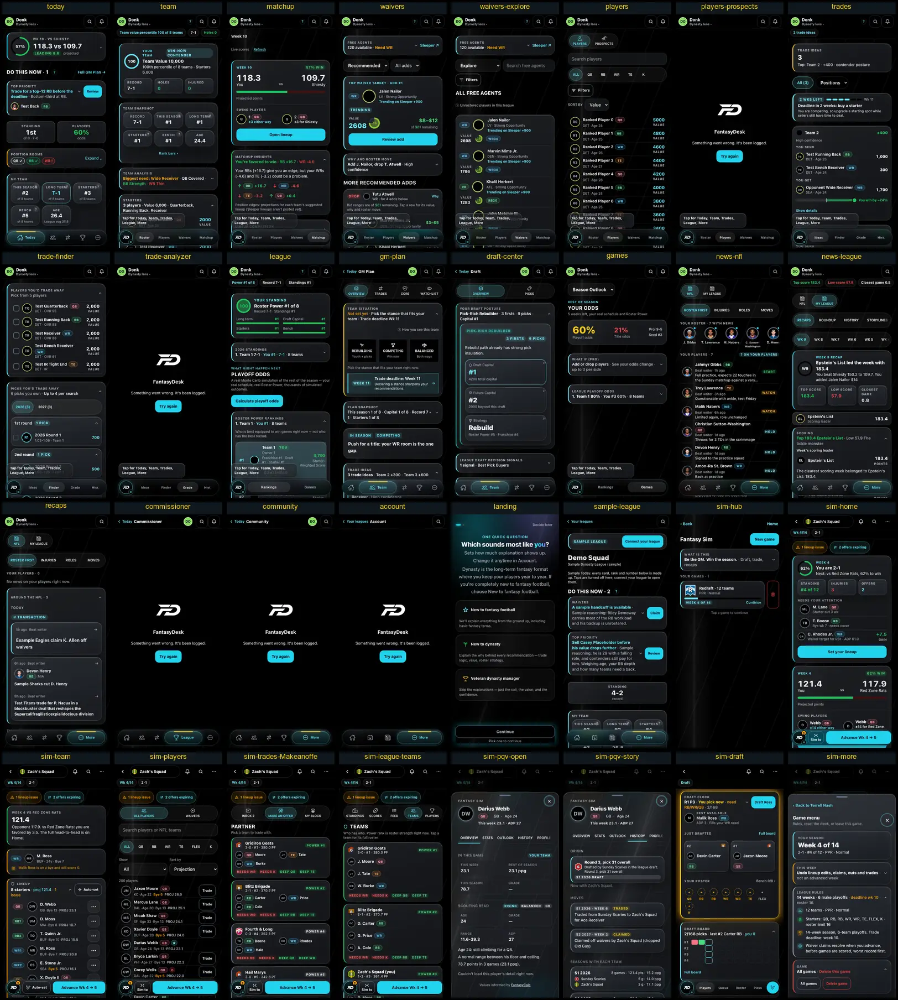

## How this was captured, and what was NOT seen

- **Web (SEEN):** the CI harness `scripts/sim_layout_playwright/module_scan.mjs` (28 routes, the `route-overflow` set, fixtures for the league endpoints) driven with `OVERFLOW=1 FULL=1 WIDTHS=390`, Chromium headless shell, dark theme, `reducedMotion: reduce`, `isMobile` touch, full-page screenshots. A second copy of the scan marks every "?" / info control (magenta boxes) and records their geometry. Fantasy Sim: `sim_ui_pass.mjs` style scenarios against `simmock.mjs` (hub, home, team, players, trades, league tabs, team sheet, PQV peek, PQV tabs, draft, complete). No overflow was reported on any of the 28 routes (`module scan clean`).
- **Capture artifacts to ignore:** full-page shots put the fixed bottom pill and its "Tap for Today, Team, Trades..." coach-mark in the middle of the image. Black avatar discs on Waivers/League and "Ranked Player 3" names are fixture data, but the empty black disc (no initials) is a real component behavior (finding B6).
- **Fixture limits (honest list):** Account, Commissioner, Community, Trade Analyzer and Players > Prospects render the global "Something went wrong" because the fixture answers `{}` and the component calls `.map/.length` on undefined (finding B5). So their real data layouts were **not seen**; they are code-reviewed only. Also **not seen**: Latest big play (#2017: the Matchup fixture has no big-play payload), signed-out landing and sign-in (the harness is pre-signed-in; `/` showed the onboarding question), live draft room (`/live-draft` needs a live provider), PQV Depth Chart / Injury History (Sim mock answers "Couldn't load this player's detail", code lives in `PlayerDepthInjury.tsx` web + app), Sim week recap (the advance-confirm step did not open in the mock), Pro/Premium states, light theme, and real avatars.
- **App (CODE-REVIEWED only, one owner screenshot seen):** no simulator/device was available. Mobile findings come from reading `mobile/src` against the web counterpart, plus the owner's iOS Matchup screenshot. Each app item below says "app (code)" or "app (owner screenshot)".

## Owner-flagged P0s (folded in)

### P0-1. The "?" system is five components in three placements and it creates its own rows

Owner: the "?" buttons "are adding too much space in many different places and creating conflicts where they're creating their own rows".

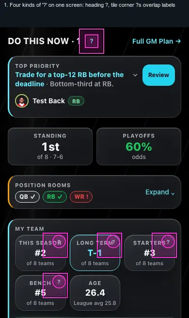

Catalogue (web = SEEN where a screenshot is cited, otherwise code-reviewed):

| # | Component | Placement | Where (page, file:line) | Problem |
|---|---|---|---|---|
| 1 | `PageTitle info` / `usePageHelp` -> header "?" | header, top-right | Team (`MyTeamContent.tsx:274`), Matchup (`MatchupContent.tsx:90`), League Rankings (`LeagueRankingsContent.tsx:535`), Waivers (`WaiversContent.tsx:625`), Trade Hub (`TradeHubContent.tsx:118`) - [team](ui-audit-e2e/help-team.webp), [matchup](ui-audit-e2e/help-matchup.webp) | Good placement (no row) but it is a *page-level* "?" next to search/bell: reads as app help, and is absent on Today/Players/GM Plan/Games/News, so the same affordance is sometimes in the header, sometimes inline. |
| 2 | `WhyCorner` (`ui/TapForWhy.tsx:29`, `.ui-why-corner` in `ui.css:349`) | 44px box pinned top-right of a stat tile | `StatStrip.tsx:40` and `ui/ModuleTemplates.tsx:176`: Today "My team" tiles (4), Team snapshot tiles (4), sample league (4) - [today](ui-audit-e2e/help-today.webp), [team](ui-audit-e2e/help-team.webp) | The glyph overlaps the tile label: "THIS SEASON" and "LONG TERM" are visibly struck through by the "?" at 390px (`ui-why-host [data-tile-label]` pads 22px, not enough). 4 identical "?" in one 2x3 grid is "a row of orphan circles". |
| 3 | `BeginnerHelp popover` (`BeginnerHelp.tsx`) in `SectionHeading help` | beside heading | Today "Do this now" (`DashboardContent.tsx:238/262`, `DecisionQueue.tsx:213`) | Correct pattern (inline after the label), but a 20px glyph with a `padding 12 / margin -12` hit area, and separate "?" per section. |
| 4 | `BeginnerHelp` (non-popover) | own row ("? label" line, expands in place) | Trade Hub hold card (`TradeHubHoldCard.tsx:101`), Analyzer verdict/balance/confidence (`TradeAnalyzerContent.tsx:337/392/522`), Trade idea cards x3 per card (`TradeIdeaCard.tsx:256/359/377`), GM Plan look (`GmPlanSections.tsx:154`), PQV (`PlayerQuickView.tsx:443`), Decision queue empty (`DecisionQueue.tsx:224`) | Own row, then expands to a full-width paragraph with "Got it". Per card, so a list of 3 ideas gets 9 "?" rows. |
| 5 | `InfoTip` ("ⓘ label") (`InfoTip.tsx`) | own row, label text + chevron-less expand | Waivers x3 (`WaiversContent.tsx:666/836/853`), GM Plan (`GmPlanContent.tsx:800`, `GmPlanSections.tsx:110`), Team (`MyTeamContent.tsx:303`), Trade History (`TradeHistoryContent.tsx:103`), Community (`CommunityTradesContent.tsx:176`), College scouting (`CollegeScoutingContent.tsx:357`), SuggestedDrop (`SuggestedDrop.tsx:445/457`) - [waivers](ui-audit-e2e/help-waivers.webp), [GM Plan](ui-audit-e2e/help-gm-plan.webp) | A full row with a right-aligned "ⓘ How you see this team" (GM Plan, 44px row of its own, 80px of dead space above the stance tiles); a different glyph (ⓘ) from the "?" used elsewhere. |
| 6 | `TapForWhy` (inline/chip/tile) | wraps a number/chip | `PlayerHeroHeader.tsx` x4, `PlayerListRow.tsx` x2, `SimGameTrades.tsx` | Right idea (nothing added to the resting layout, no row). Keep; it is the standard to converge on. |
| 7 | "Why" text link | inline right of a row | Waivers drop row "Why" ([waivers](ui-audit-e2e/help-waivers.webp)) | A third vocabulary ("Why" vs "?" vs "ⓘ"). |
| 8 | App `BeginnerHelp` (`mobile/src/components/BeginnerHelp.tsx`) | **always-visible caption line** | MyTeam x2 (`MyTeamScreen.tsx:282-283`), Matchup x2 (`MatchupScreen.tsx:357-358`), PlayoffOdds x2, Waivers (`WaiversScreen.tsx:443`), PlayerDetail x3 (`PlayerDetailScreen.tsx:1425-1427`), TradeAnalyzer x3, Dashboard x6+, TradeIdeaCard x4 per card, WaiverRecommendationCard x3 per card | **Parity gap, app (code):** web hides these behind a "?" or the header; the app prints them as full-width text rows above/inside modules. This is the biggest source of dead vertical space in the app. |
| 9 | App `ScreenInfoNote` ("ⓘ label") | own row | 17 screens: Community, TradeAnalyzer, TradeFinder, TradeHub, TradeHistory, Players, TeamRoster, News, Waivers x2, Teams, Dashboard, GuessThePlayer, Matchup lineup caption (`MatchupScreen.tsx:733-736`), PlayoffOdds, CollegeScouting, SuggestedDrop | Owner screenshot: in Lineup Comparison the "?" sits alone in a `lineupHeader` row with `<View style={{flex:1}}/>` beside it, ~60pt of empty space above the Suggested/Actual toggle (**app, owner screenshot**). |

**Proposed ONE standard (web + app):**

1. A single shared `InfoMark` (wrap today's `TapForWhy` chip variant on web, mirror on app): a glyph-sized "?" (16-18px glyph, no ring fill) rendered **inline directly after the label or heading it explains**, with a 44pt hit area from slop/`hitSlop`, never a sibling row, never absolutely positioned over text.
2. **Max one per module.** A module that explains several terms gets one "?" in its title line that opens one sheet listing those terms (`lines` is already supported by web `BeginnerHelp`). Tile grids (Today/Team snapshot) get **one** "?" on the section title, not one per tile; per-tile why remains reachable by tapping the number (TapForWhy).
3. Page-level help (the header "?") is removed from the header; it becomes the "?" after the first module's title, same component.
4. Retire `InfoTip` and `ScreenInfoNote` rows; their text moves into the module "?" sheet. Retire the non-popover `BeginnerHelp` row; on the app `BeginnerHelp` stops rendering paragraphs and becomes the same inline mark.
5. Beginner "Got it" stays inside the sheet. One glyph: "?" (not ⓘ, not "Why").

**Files the fix batch must change (web):** `components/ui/TapForWhy.tsx`, `ui/ui.css` (`.ui-why-corner*`, `.ui-why-host`), `StatStrip.tsx:36-40`, `ui/ModuleTemplates.tsx:176`, `BeginnerHelp.tsx`, `InfoTip.tsx`, `PageHelpLines.tsx`, `SectionHeading.tsx`, `DashboardContent.tsx:238,262`, `DecisionQueue.tsx:213,224`, `MyTeamContent.tsx:118,274,303`, `MatchupContent.tsx:87,90`, `LeagueRankingsContent.tsx:515,535`, `WaiversContent.tsx:625,666,836,853`, `TradeHubContent.tsx:118`, `TradeHubHoldCard.tsx:101`, `TradeIdeaCard.tsx:256,359,377`, `TradeAnalyzerContent.tsx:337,392,522`, `GmPlanContent.tsx:800`, `GmPlanSections.tsx:110,154`, `TradeHistoryContent.tsx:103`, `CommunityTradesContent.tsx:176`, `CollegeScoutingContent.tsx:357`, `SuggestedDrop.tsx:445,457`, `PlayerQuickView.tsx:443`.
**Files (app):** `components/TapForWhy.tsx`, `BeginnerHelp.tsx`, `ScreenInfoNote.tsx`, `GlossaryNote.tsx`, `TradeHubHoldCard.tsx`, `WaiverRecommendationCard.tsx`, `DecisionQueue.tsx`, `SuggestedDrop.tsx`, `TradeIdeaCard.tsx`, `CollegeScoutingPanel.tsx`, `DashboardStatRow.tsx`, and screens `MyTeamScreen`, `MatchupScreen` (357-358, 733-736), `PlayoffOddsPanel`, `PlayerDetailScreen` (1425-1427), `TradeAnalyzerScreen` (543, 913-938), `TradeFinderScreen:544`, `TradeHubScreen` (303, 372), `GmPlanScreen:460`, `PlayersScreen:417`, `TeamRosterScreen:220`, `DashboardScreen` (568, 655, 888, 933), `TradeHistoryScreen:112`, `NewsScreen:312`, `WaiversScreen` (437, 443, 712), `TeamsScreen:497`, `CommunityScreen:69`, `GuessThePlayerLeaderboardScreen:95`. Effort: M (2-3 days across both platforms, mostly mechanical once `InfoMark` exists). Also add a guard test: no element matching the info mark may be the only visible child of its row.

### P0-2. One compact page header and consistent top spacing

Owner (iOS Matchup): "Week 10" + a separate "Updated 3m ago - Refresh" row eat ~250px (about 110pt) before the first module, and WEEK 10 is repeated in the hero.

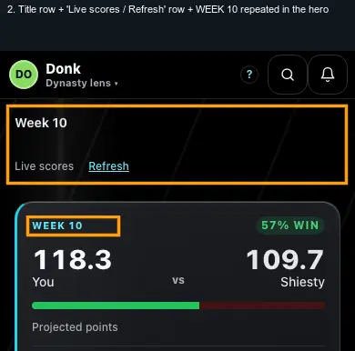

- **Web Matchup (SEEN):** title row "Week 10" then a "Live scores / Refresh" row (first card starts ~165px from the top vs 65px on Today), and the hero's own "WEEK 10" eyebrow repeats the week. `MatchupContent.tsx:93` and the freshness row at `MatchupContent.tsx:822-832`.
- **App Matchup (owner screenshot + code):** `MatchupScreen.tsx:270/330` renders `PageTitle` + `weekLabel`, `freshnessRow` (340-351), then two `BeginnerHelp` lines (357-358) before the hero. Same duplication.
- **Top-of-page audit (SEEN, web, px from top to first module):** Today 65, Players ~70 (+ 3 stacked control rows: segmented tabs, search, position chips, Filters, Sort = ~230px of controls before row 1), GM Plan 70, Games 70 (a `select` row), Waivers 78 (free-agent card, then two selects), League 80 (chip strip), Team 83 (chip strip), Trades 87 (chip + 2 control rows), News NFL ~190 (segmented NFL/My League + tab strip + roster avatar strip), Matchup 165, Sim pages ~150 (header + Wk/record chips + alert chips + tab row before content). Header variants in use: avatar+league (Today/Team/Matchup/Players/Trades/Waivers/League), back-arrow+title (GM Plan, Draft, Commissioner, Community, Account), no-title search-only (News, Recaps) - [contact sheet](ui-audit-e2e/contact-sheet.webp).
- **Chip strips that repeat the content below:** Team "Team value percentile 100 of 8 teams | 7-1 | Holes 0", League "Power #1 of 8 | Record 7-1 | Standings #1", Trades "3 trade ideas", News "Top score 183.4 | Low 57.9 | Closest 0.8" - each restates the first module.

**Proposed standard:** one `PageHeader` = the shell header (identity, search, bell) + **at most one** sub-line: `Title · Week N` on the left and freshness ("3m ago") with a refresh icon on the right, 32-36pt tall, 8pt to the first module. No separate "Updated" row; refresh is the pull-to-refresh gesture plus the icon. The hero card must not repeat the week. Chip strips are removed or merged into the hero. Control rows (selects, filters) collapse into one "Filters" chip row. Effort: M-L (shared header component web + app, then page by page, 3-4 days). Files: `MatchupContent.tsx`, `MatchupScreen.tsx`, `PageTitle` (web/app), `ShellHeader`, `Team/League/Trades/News` chip strips, Players/Waivers control rows.

### P0-3 (owner item 3). Red used as a verdict colour in Matchup Insights

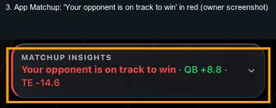

`matchupPresentation.ts` (web `:379`, app `:208`) maps "Your opponent is on track to win / is favored" to `tone: "risk"`, rendered as the module headline in red, with a red left border on the card, a red "3% WIN" pill, and red `-27.2` / `TE -14.6`. Project rule is no red verdicts on share images; in-app the same sentence is the *headline* of a module and reads as an error. Also red: Matchup "Teams & Values -2,954" (value is money-like, should not be red), Games "21% title odds", Today "WR !" chip (red for a thin position is defensible, but the same row also has green checks).
**Standard:** verdict headlines are neutral text (primary) with a small coloured dot/arrow or an amber "behind" state; red only for destructive/out/injury; negative deltas use muted text with a down arrow, positive use green. One `verdictTone` map shared web/app. Effort: S (half a day) plus a test that no verdict headline resolves to the danger token.

## Top findings, ranked

| Rank | ID | Priority | Effort | Finding |
|---|---|---|---|---|
| 1 | P0-1 | P0 | M | "?" system: 5 components, overlap, own rows, app prints help as paragraphs (above) |
| 2 | P0-2 | P0 | M-L | Page header / top spacing, Matchup 165px before module (above) |
| 3 | P0-3 | P0 | S | Red verdict headlines (above) |
| 4 | B4 | P1 | M | Duplicate facts across hero, chips and modules |
| 5 | B5 | P1 | S-M | One bad payload blanks the whole page (Trade Analyzer, Prospects, Commissioner, Community) |
| 6 | B6 | P1 | S | Avatar placeholders: empty black discs; Sim and Players lists have initials only |
| 7 | B7 | P1 | M | Sim Home: same matchup three times, 2542px tall |
| 8 | B8 | P1 | S | Empty / error states have four treatments |
| 9 | B9 | P2 | S | Probability colours disagree (60% green vs gold, 21% red) |
| 10 | B10 | P1 | S | Sim PQV: duplicate values, two empty GRADE tiles, orphan star row |

### B4. Duplicate and contradictory facts (P1, M)

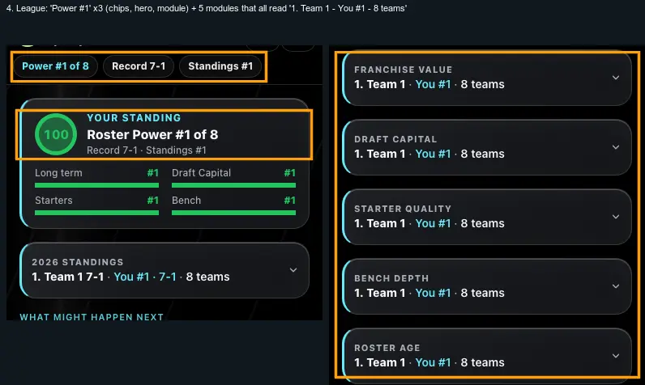

- **League (SEEN):** "Power #1 of 8" appears in the chip strip, the hero ("Roster Power #1 of 8") and the Roster Power module; five collapsed modules (Franchise Value, Draft Capital, Starter Quality, Bench Depth, Roster Age) all read "1. Team 1 · You #1 · 8 teams", so the collapsed summaries carry no information (the ">= 12 chars" rule passes but the content is identical). Hero already shows Long term / Draft Capital / Starters / Bench bars.
- **Team (SEEN):** "7-1", Holes 0, Injured 0 appear in the hero tiles, the chip strip and again in Team Snapshot (Record 7-1, ranks #1 x5); "Team value percentile 100 of 8 teams" chip + "100th percentile of 8 teams" in the hero.
- **Matchup (SEEN) contradiction:** hero says 118.3 vs 109.7, "57% WIN", while Lineup Comparison says 49.0 vs 49.0, "57% win · EVEN" (suggested lineup vs projected points are different bases and neither is labelled). Heading "Teams & Values" repeats the margin shown in Matchup Insights.
- **GM Plan (SEEN):** the Team Situation header says "Pick the stance that fits your team" and the body says it again; the week-11 deadline is stated in the header line, in the banner and in the plan snapshot.
- **Today (SEEN):** "WK 10 · vs Shiesty 118.3 vs 109.7" strip and the Matchup page hero are the same card; "Standing 1st of 8 · 7-6" duplicates the My Team tiles' "#2 of 8 teams".
Fix: one owner for each fact per page; chips only for facts not in the hero; collapsed summaries show the *distinguishing* number (the one that differs from the other modules). Label the basis on Matchup ("Projected" vs "Suggested lineup").

### B5. Whole-page crash on a partial payload (P1, S-M)

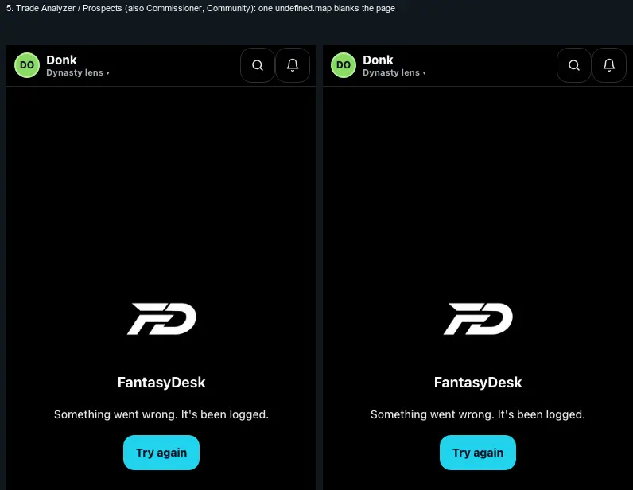

With the fixture's `{}` bodies: Trade Analyzer (`TradeAnalyzerContent` `useMemo[otherTeams]` -> `undefined.map`), Prospects (`CollegeScoutingContent` `.length`), Commissioner (`splitTeams` `.filter`), Community (`CommunityTradesContent` `.length`) all fall through to the route error boundary ("Something went wrong. It's been logged."). A shape drift or a partial response would blank the page, including header-less state (the bottom pill remains but nothing else). Fix: default arrays at the API-parse boundary (`?? []`), a per-module error boundary using the standard module error state, and fixtures for these pages in the harness so CI catches layout. (Seen: error states only.)

### B6. Avatars (P1, S)

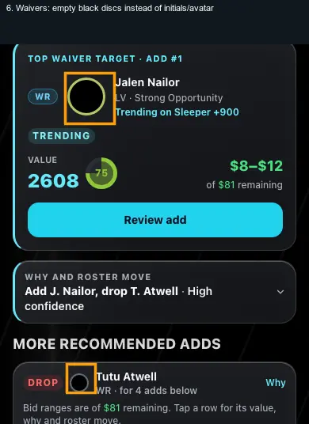

Waivers "Top waiver target" and the drop row show an empty black disc ringed in gold (no initials, no image) while the rows below use initials, and League team rows (SEEN) use the same empty disc; Players list and every Sim list use initials only (`Ranked Player 0`, `JM`, `DW`), Sim trade partner chips use initials. Standing rule is avatars wherever possible: one `PlayerAvatar` fallback (initials on position tint) everywhere; Sim players need generated faces or the position-tinted initials with the team logo, as the real PQV does. Also team logos in the Sim league list are present but not on Sim Players/Trades rows.

### B7. Sim Home (P1, M)

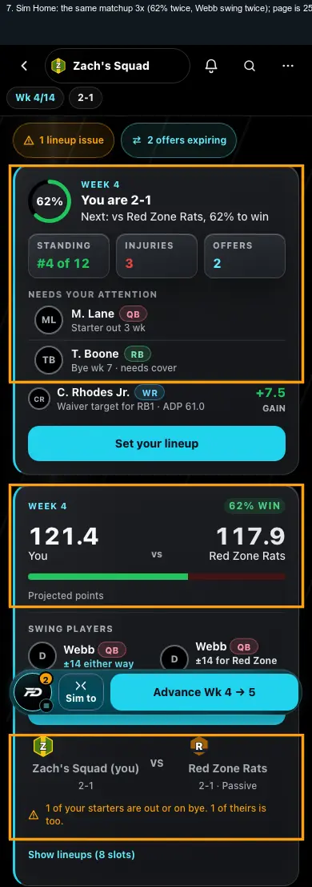

Home is 2542px (about 3 screens): header, a Wk/record chip row, an alert chip row, then the attention card ("You are 2-1 · 62% to win"), the matchup card ("62% WIN · 121.4 vs 117.9 · Swing players Webb ±14") and a third "Zach's Squad vs Red Zone Rats" block with a lineup-issue warning that repeats the chip above, then Week checklist, Trade Inbox and Waiver Targets (both expanded by default with big cyan CTAs). Against the compact-modules rule: one matchup card, the two alert chips become the checklist, inbox/waivers collapsed with a one-line summary. The Sim hub itself is clean ([sim-hub](ui-audit-e2e/sim-hub.webp)).

### B8. Empty / error states (P1, S)

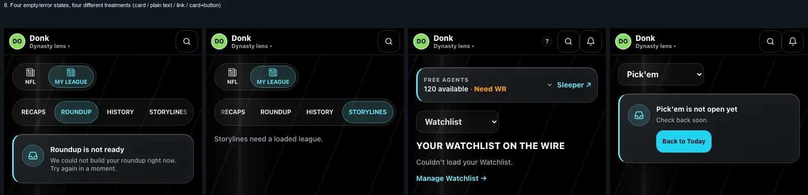

News Roundup: card with icon; Storylines: bare grey sentence "Storylines need a loaded league."; Watchlist: bare text + link; Pick'em: card + button; Season Outlook (Games): amber text + outline button *above* the content; History: skeleton that never resolved; the global error screen is a full-page brand card. One `EmptyState` / `ErrorState` (icon, one-line reason, one action) in the module glass style.

### B9. Probability colours (P2, S)

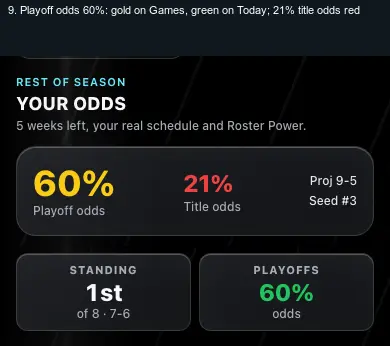

Playoff odds 60% is green on Today and gold on Games; title odds 21% is red. Use one scale (neutral numerals; colour only the delta), consistent with the red rule.

### B10. Sim player sheet (P1, S)

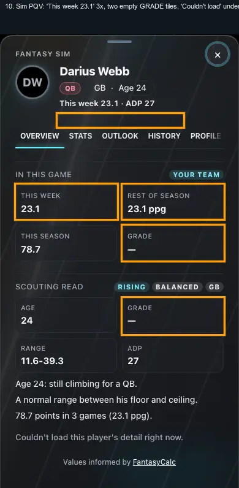

Overview repeats "This week 23.1" in the header, in the THIS WEEK tile and again as "Rest of season 23.1 ppg"; two empty GRADE tiles ("—") in different sections; an orphan star badge on its own row on the Stats tab ([stats](ui-audit-e2e/sim-pqv-stats.webp)), tab strip clipped at "PROFILE". The History tab (origin, moves, seasons with each team = the #2015 player story) reads well ([story](ui-audit-e2e/sim-pqv-story.webp)). Depth chart / injury history tabs were not reachable in the mock (not seen).

## Page by page

Format: **GOOD / BAD / NEEDS WORK**. Image = web at 390px, dark, reduced motion. "app (code)" = reviewed in source only.

### Landing / onboarding
[onboarding question](ui-audit-e2e/web-landing.webp) (the harness is signed in, so `/` shows onboarding, not the marketing landing; sign-in not captured).
GOOD: three clear choices, one primary action, "Pick one to continue". BAD: the Continue button is rendered but disabled-looking with the caption underneath; at 390x844 the paragraph pushes the options to the fold ("Sets how much explanation shows up" repeated twice as subtitle and body). NEEDS WORK: signed-out landing and sign-in must be captured with a no-session harness (next pass).

### Today
[today](ui-audit-e2e/web-today.webp) · [with ? marked](ui-audit-e2e/help-today.webp)
GOOD: the rebuilt page has a clear order (matchup strip, one top priority with avatar and a single Review action, standing and odds tiles, compact modules with expand), money/odds green, alerts with real faces. BAD: My Team tile "?" corners overlap labels (P0-1); two heading styles ("DO THIS NOW" large caps vs "PLAN AHEAD" vs card eyebrows); three CTA rows with different names (Plan ahead / Fix a weak spot / Make a move) across pages. NEEDS WORK: "Standing 1st of 8 · 7-6" vs "This season #2" reads as a contradiction (record rank vs power rank, unlabeled); Position rooms chips mix check/red "!" with no legend. App (code): `DashboardScreen` prints 6 BeginnerHelp captions (P0-1).

### My Team
[team](ui-audit-e2e/web-team.webp)
GOOD: modules collapse with a distinguishing summary ("3 players · Value 6,000 · QB, RB, WR"), position tags use semantic colours. BAD: triple-stated record/rank (B4); snapshot corner "?" collide with labels; the page has no avatar header for the roster rows in the collapsed state. NEEDS WORK: hero "Team Value 10,000 · 100th percentile of 8 teams" is meaningless at 8 teams; "Win-Now Contender" pill clipped at 390 ("CONTENDER" wraps under it).

### Matchup (with Latest big play)
[matchup](ui-audit-e2e/web-matchup.webp) · [header marked](ui-audit-e2e/top02-page-header-spacing.webp)
GOOD: hero is strong (score, win bar, swing players, single CTA); position-edge chips are readable. BAD: header rows (P0-2), contradiction between the 57% hero and EVEN comparison (B4), red/neutral tone (P0-3). NEEDS WORK: Latest big play (#2017) not seen (fixture), verify it sits inside the hero or a single compact module and does not add another row. App (owner screenshot): same, plus the lone "?" row in Lineup Comparison.

### Waivers (tabs)
[recommended](ui-audit-e2e/web-waivers.webp) · [explore](ui-audit-e2e/web-waivers-explore.webp) · [watchlist (error)](ui-audit-e2e/web-waivers-watchlist.webp)
GOOD: top target card is the best "one decision" card in the app (value, FAAB in green, one CTA); a compact "Why and roster move" module. BAD: avatar discs empty (B6); two `select`s ("Recommended", "All adds") stack as pseudo-tabs while the family pill also has tabs (one-tab-row rule); drop row ("DROP ... Why") plus an inline helper sentence repeats "Bid ranges are of $81 remaining" which is already in the card above. NEEDS WORK: "ⓘ Stash, depth and FAAB: ranked by raw value" is an own-row at the bottom (P0-1). Watchlist error is bare text (B8).

### Players (+ Prospects)
[players](ui-audit-e2e/web-players.webp) · [prospects (crash)](ui-audit-e2e/web-players-prospects.webp)
GOOD: list rows are dense and scannable with the right tier colours; sort and position chips are tappable (44px). BAD: ~230px of controls (segmented tabs, search, positions, Filters, Sort) before row 1; no avatars (B6); Prospects blank on partial data (B5). NEEDS WORK: merge Filters/Sort into one row.

### Player quick view (Sim, the shared PQV)
[overview](ui-audit-e2e/sim-pqv-open.webp) · [stats](ui-audit-e2e/sim-pqv-stats.webp) · [history/story](ui-audit-e2e/sim-pqv-story.webp) · [peek from team sheet](ui-audit-e2e/sim-pqv-peek.webp)
GOOD: the History tab is the best new surface: dated chips (TRADED / CLAIMED), origin card, seasons with each team. BAD / NEEDS WORK: B10; tab strip clips "PROFILE" without a scroll affordance. Not seen: Depth Chart, Injury History (code: `PlayerDepthInjury.tsx`, app twin `components/PlayerDepthInjury.tsx` + `PlayerQuickViewSheet`; parity exists).

### League Rankings + team sheet
[league](ui-audit-e2e/web-league.webp) · [sim team sheet](ui-audit-e2e/sim-team-sheet.webp)
GOOD: hero with four rank bars is the right summary. BAD: B4 (identical collapsed summaries, repeated Power #1); empty avatars; "PLAYOFF ODDS" inline section uses a different heading style (large caps + paragraph + outlined button) than every module around it. NEEDS WORK: the expanded rankings row is cramped: "Franchise #1 · Draft #1 · Starter #1" wraps to three lines next to "Starter-Weighted Score". Sim team sheet: sheet content heading "Strengths and needs" is larger than the sheet's own title, and "Needs RB" tiles use red for a need.

### Trade Hub (Ideas / Finder / Grade / History)
[hub](ui-audit-e2e/web-trades.webp) · [finder](ui-audit-e2e/web-trade-finder.webp) · [analyzer (crash)](ui-audit-e2e/web-trade-analyzer.webp)
GOOD: idea cards are the right size: send/get lists with avatars, one value bar, "Show details" expand; money-like values green. BAD: win bars are all full green with "You win by ~24 / 38 / 48%" which does not match +400 / +800 / +1,200 as a ranking; trade-hub family pill labels truncated to "Hist."; Finder lists every asset at "2,000" (fixture) but its pick-year pills and nested round headers use three nesting levels. NEEDS WORK: Analyzer crash (B5); BeginnerHelp rows per card (P0-1). History tab not captured (fixture).

### GM Plan
[gm-plan](ui-audit-e2e/web-gm-plan.webp) · [marked](ui-audit-e2e/help-gm-plan.webp)
GOOD: stance tiles with icons are clear; modules collapse with summaries. BAD: the stance text is stated 3 times (B4); "ⓘ How you see this team" row (P0-1). NEEDS WORK: the stance tiles are black boxes inside a glass module (not glass); "Season Outlook ... Pro" link card looks like a module but navigates.

### Draft (center) + live room
[draft center](ui-audit-e2e/web-draft-center.webp) · [sim draft](ui-audit-e2e/sim-draft.webp)
GOOD (Sim): the draft clock with "Your roster" slot strip (#2016) is excellent: needs shown as dashed position rings, best available, just drafted. BAD (Sim): the clock card is glowing gold, a second "Draft board" module repeats the pick count ("2/168"), and every one of 198 rows has a full-size cyan check button (a one-tap draft with no confirmation); no league title in the header. NEEDS WORK (web): Draft Center overview nests three cards inside one module (posture, capital, future capital, strategy), each with a chevron. Live room not captured.

### Games
[season outlook](ui-audit-e2e/web-games.webp) · [pick'em](ui-audit-e2e/web-games-pickem.webp)
GOOD: odds hero is quick to read. BAD: B9 colours; 450px of blank space under three modules (short page, no related content). NEEDS WORK: a native `select` as the page switcher is a fourth navigation idiom (tabs, pills, selects, chips).

### Commissioner / Community / Account
[commissioner](ui-audit-e2e/web-commissioner.webp) · [community](ui-audit-e2e/web-community.webp) · [account](ui-audit-e2e/web-account.webp): all three show the error boundary under the fixture (B5), so layouts are **code-reviewed only**. Community `InfoTip` row (P0-1). Account also needs a settings pass for the explanation-level control (not seen).

### News (NFL / My League)
[nfl](ui-audit-e2e/web-news-nfl.webp) · [league recaps](ui-audit-e2e/web-news-league.webp) · [roundup](ui-audit-e2e/web-news-league-roundup.webp) · [storylines](ui-audit-e2e/web-news-league-storylines.webp) · [history](ui-audit-e2e/web-news-league-history.webp) · [recaps route](ui-audit-e2e/web-recaps.webp)
GOOD: NFL tab is the best use of avatars in the app (roster strip with dots, row with action tag START/WATCH/HOLD). BAD: two tab rows plus a week strip (segmented, sub-tabs, WK chips) = three control rows on My League; chip strip "Top score / Low score / Closest game" repeats the hero (B4) and "Low score 57.9" is red; NFL row action tags (START/WATCH/HOLD) are colour-only. NEEDS WORK: the `/league-recaps` route renders the NFL tab with "No news on your players right now" (redirect loses the league context in the fixture); empty states B8.

### Fantasy Sim (home, draft, week, trades, team sheet, league)
[hub](ui-audit-e2e/sim-hub.webp) · [home](ui-audit-e2e/sim-home.webp) · [team](ui-audit-e2e/sim-team.webp) · [players](ui-audit-e2e/sim-players.webp) · [trades](ui-audit-e2e/sim-trades-Makeanoffe.webp) · [league scores](ui-audit-e2e/sim-league-scores.webp) · [league teams](ui-audit-e2e/sim-league-teams.webp) · [team sheet roster](ui-audit-e2e/sim-team-sheet-roster.webp) · [more](ui-audit-e2e/sim-more.webp) · [complete](ui-audit-e2e/sim-complete.webp) · [advance](ui-audit-e2e/sim-week-advance-sheet.webp)
GOOD: Sim hub (first-timer) is minimal and clear; Team tab lineup rows (slot tag, initials, bye in amber, PROJ) are a model dense list; Make-an-offer partner cards show needs/deep chips; the fixed "Advance Wk 4 -> 5" pill is a clear primary. BAD: Home (B7); two chip rows plus tab row (~150px) above every Sim page; Sim Players has "Trade" outlined buttons on every row (200 players) plus the "Wk 4/14 · 2-1" chips; red/green need/deep chips are 4 per team on 12 team cards (visual noise). NEEDS WORK: `Game menu` has "Delete this game" in red inside an expanded section on the same card as "All games"; "Show 20 more on this page (20 left)" plus Previous/Next on Players is two pagination idioms.

### Sample league (public)
[sample](ui-audit-e2e/web-sample-league.webp)
GOOD: honest "SAMPLE LEAGUE" banner with a single "Connect your league" CTA. BAD: it re-uses the live Today components so the "?" corner overlap (P0-1) shows here too, for first-time visitors; 4 tiles of the same overlap. NEEDS WORK: "Sample Today: every card ... is made up. Taps are turned off" paragraph is longer than it needs to be.

### Cross-cutting: shell, pill, orb coach-mark
GOOD: bottom pill is page-aware, family tabs read well; no horizontal overflow anywhere (28 routes); every control found was >= 44px high in the scan sample. NEEDS WORK: the first-run coach-mark ("Tap for Today, Team, Trades, League, More") sits directly above the pill on every page until dismissed and covers the last visible row; the header has three patterns (above).

## App (code-reviewed) parity gaps, summary

1. Help copy printed as paragraphs on 10+ screens (web hides behind "?") - P0-1.
2. Matchup header: `PageTitle` + week label + freshness row + two help lines - P0-2.
3. `ScreenInfoNote` is an own-row "ⓘ label" on 17 screens - P0-1.
4. `matchupPresentation.ts` duplicates the web verdict tone map (risk -> red) - P0-3; share one source (`lib/` twins drift).
5. `Button size="sm"` and `SimIconButton` 44pt parity was fixed in the earlier audit; header icon sizes were not re-measured here (needs device).
6. Not verifiable without a device: safe areas, keyboard overlap, haptics, the app's Lineup Comparison toggle clipping behind the bottom pill (visible in the owner screenshot: the Suggested/Actual toggle is cut by the pill at the fold - may just be scroll position).

## Proposed fix batches

| Batch | Contents | Effort | Order |
|---|---|---|---|
| A. InfoMark standard | P0-1: one inline "?" component, max one per module, retire InfoTip/ScreenInfoNote/BeginnerHelp rows, app BeginnerHelp to inline mark, guard test | M (2-3d, web+app) | 1 |
| B. PageHeader standard | P0-2: single sub-line (title · week · freshness+refresh), no repeated week in hero, remove restating chip strips, collapse control rows; audit all pages' top gap to <= 12px | M-L (3-4d) | 2 (after A, shares files) |
| C. Verdict and colour tokens | P0-3 + B9: one `verdictTone`, no red headlines, probability scale, money green audit (Matchup -2,954) | S (0.5-1d) | 1 (parallel with A) |
| D. De-duplication | B4 + B7 + B10: one owner per fact; League collapsed summaries; Sim Home to one matchup card; PQV duplicates; label Matchup bases | M (2d) | 3 |
| E. Resilience and states | B5 + B8: parse defaults, per-module error boundary, shared Empty/Error state, fixtures for Analyzer/Prospects/Commissioner/Community/Account/Big play so CI renders real layouts | S-M (1-2d) | 2 |
| F. Avatars | B6: `PlayerAvatar` fallback everywhere incl. Sim lists, Waivers discs | S (1d) | 3 |
| G. Capture gaps | signed-out landing/sign-in, live draft room, Depth Chart / Injury History, Sim recap, Pro states, light theme, device pass for the app | M | after A-C so shots are of the new UI |

Re-run: `NEXT_PUBLIC_SUPABASE_URL=https://dummy.supabase.co NEXT_PUBLIC_SUPABASE_ANON_KEY=x NEXT_PUBLIC_API_BASE_URL=http://localhost:8000 npx next dev -p 3197` then `PW_CORE=... BROWSER=chromium CHROME=<chrome-headless-shell> WIDTHS=390 FULL=1 OVERFLOW=1 node scripts/sim_layout_playwright/module_scan.mjs` (the harness hard-codes `chromium_headless_shell-1248` in the Sim scripts; the local cache had 1255).
