# UI patterns (Wave 0 shared components)

The shared building blocks from `docs/audits/2026-11-convolution-audit.md` section 2. Each one is built
once for web (`web-next/src/components/ui/`) and once for mobile (`mobile/src/components/`) with the
same prop names, and the pure logic lives in a **lib twin** (`web-next/src/lib/x.ts` and
`mobile/src/lib/x.ts`, kept identical by `node scripts/check_lib_twins.mjs`).

Ground rules for every pattern here:

- Keep the liquid-glass look: existing tokens only (`--color-*`, `--radius-*`, `--space-*`), the
  cyan accent, gold highlight, `glass-surface` style cards. Nothing here introduces a new colour.
- 44px minimum tap target (padding or an expanded hit area, never a bigger visual).
- `prefers-reduced-motion` is honoured (web CSS media query; mobile has no decorative motion).
- Web and app ship together. Where a prop differs on mobile the difference is listed.
- Screenshots below are 390px wide, dark theme. "Before" is `origin/main`, "after" is this branch.

| Pattern | Web | Mobile | Lib twin | Status |
|---|---|---|---|---|
| `Sheet` | `ui/Sheet.tsx` | `Sheet.tsx` | `sheetStack.ts` | built; first users are TapForWhy, StructuredRow, FilterSheet |
| `ConfirmInPlace` | `ui/ConfirmInPlace.tsx` | `ConfirmInPlace.tsx` | `confirmInPlace.ts` | built and applied (see below) |
| `StoryCarousel` | `ui/StoryCarousel.tsx` | `StoryCarousel.tsx` | `storyCarousel.ts` | built; first user: Fantasy Sim weekly recap |
| `InsightLink` | `ui/InsightLink.tsx` (+ `StatStrip` `insight`/`league`) | `MetricCard` `onPress` via `lib/insightNav.ts` | `insightLinks.ts` | built; every stat about your league/team must resolve here, see `docs/audits/2026-11-navigation-audit.md` |
| `UndoToast` | `ui/UndoToast.tsx` | `UndoToast.tsx` | `confirmInPlace.ts` (timing) | built; used by GM targets |

## Sheet

One bottom sheet on a phone and a centred dialog from 768px up. Replaces the hand-rolled copies of
`.pqv-backdrop` + `.pqv-modal` + `SheetHandle` + `useSheetDragDismiss`.

```tsx
import { Sheet } from "@/components/ui/Sheet";

<Sheet open={open} onClose={() => setOpen(false)} title="Filters" description="Optional one line" footer={<Button>Apply</Button>}>
  {/* body scrolls; footer is sticky and clears the home indicator */}
</Sheet>
```

Behaviour (web): portaled to `<body>`, `role="dialog" aria-modal aria-labelledby`, focus moves in on
open and **returns to the trigger on close**, Tab is trapped, Escape and a backdrop press close, body
scroll is locked (reference counted), safe-area aware, swipe-down to dismiss on touch (reuses
`useSheetDragDismiss`), `size` is `sm | md | lg` (desktop width only), near-opaque glass so dense
screens underneath never bleed through, rise animation off under reduced motion. The sheet stops
key events so a dialog underneath it (the Player Quick View) never reacts to them.

**Overlay rule (superseded detail below: see "Overlays"): sheets never stack.** Opening a second sheet hides the first (it stays mounted, so
its state survives) and closing the second brings the first back. The rule lives in
`lib/sheetStack.ts` and is shared with mobile. On mobile a hidden sheet's children are unmounted by
React Native's `Modal`, so keep anything that must survive in the caller's state.

Mobile: `<Sheet open onClose title ... />` wraps the existing `SheetModal` / `SwipeDismissCard` /
`SheetScrollView` (which own the gesture), so the swipe thresholds are unchanged.

Swipe-to-dismiss (web) is `useSheetDragDismiss` + `<SheetHandle />` on EVERY pop-up shell, hand-rolled or not:
`Sheet`, `PlayerQuickView`, `SimSheet` (claim, team and every other Fantasy Sim sheet), `ManagerProfileSheet`, the
Matchup `SwapSheet`, `TradePickerSheet`, `PercentileExplorerSheet`, `AlertsDropdown`, checkout. Spread `sheetStyle`
on the moving surface and `backdropStyle` on the backdrop (the scrim fades with the drag). A drag starts from the
handle always, and from the header or body only when every scroll area under the finger is at its top
(`canStartSheetDrag`, so inner scroll and iOS overscroll never fight it); it closes past ~80-160px (a quarter of
the sheet) or on a fast flick, else springs back; under reduced motion it closes without the slide. New pop-up
shells must use the hook (a handle without the hook is the bug this rule exists for). Touch check:
`scripts/sim_layout_playwright/sheet_drag.mjs` (real CDP touch drags). Mobile sheets get it from `SheetModal` +
`SwipeDismissCard`.

Not migrated yet (low-risk later, one at a time): `PlayerQuickView`, `PercentileExplorerSheet`,
`ManagerProfileSheet`, `MultiTeamTradeContent`, `MatchupPlanner` SwapSheet, `AlertsDropdown`,
`SimSheet`, `TradePickerSheet`. They keep working as they are; each can be swapped for
`Sheet` in its own PR. The PQV in particular has bespoke chrome (field/sweep textures, header
layout), so it stays a hand-rolled shell until a design pass decides what becomes a `Sheet` prop.

## StoryCarousel

A full-screen, story-style carousel for "moments": one glanceable page at a time, the way a story or a
recap reads. Web `components/ui/StoryCarousel.tsx`, app `components/StoryCarousel.tsx`; the pure logic
(page index, tap zones, swipes, keys) is the byte-identical twin `lib/storyCarousel.ts`.

```tsx
import { StoryCarousel, type StoryPage } from "@/components/ui/StoryCarousel";

const pages: StoryPage[] = [
  { key: "result", label: "Result", content: <Hero .../> },
  { key: "next", label: "Next week", content: <Next .../>, footer: <Button onClick={done}>Back to your team</Button> },
];
<StoryCarousel title="Week 4 recap" pages={pages} onClose={done} />
```

- **A page is glanceable**: a hero number plus at most three supporting items, no scrolling. Put the
  selection logic (which pages exist, what goes on each) in a pure `lib/` module with tests, like
  `lib/simRecapStory.ts` (`STORY_ITEMS = 3`). Pages with nothing to say are dropped, not shown empty.
- **Navigation**: swipe, tap the left 30% (back) or the rest (forward), arrow keys / PageUp / PageDown,
  the page-progress segments (tap one to jump), desktop arrow buttons. Taps on a button, link or
  anything marked `data-story-interactive` never flip the page. The last page has no forward action:
  its `footer` is the finish CTA.
- **Close and the overlay rule**: it registers with THE overlay stack (`useOverlay` on web, `overlayStack` in the
  app; see "Overlays"), so only one pop-up is ever on screen: a player card (PQV) opened from a page REPLACES the
  story (it stays mounted/hidden with its page) and its "‹ Back to ..." returns to the same page. The X (top right)
  closes everything; Escape and the phone/browser Back go back one step. The stack owns the scroll lock, history and
  z-index: the carousel sets none of them.
- **Look and motion**: glass over the page background, safe-area padding on all sides, a 240ms slide
  between pages that is off under `prefers-reduced-motion` (app: `useReducedMotion`), no horizontal
  overflow (every column is `min-w-0`).
- **Reuse**: a story is `{ title, pages[], onClose }`. First user: the Fantasy Sim weekly recap
  (`SimRecapStory`: Result, Matchup breakdown, Injuries and lineup, Around the league, Next week; a
  "Full details" button opens the classic recap). Meant for the season recap, draft recap and offseason
  review next; those are not built yet.
## Motion

One motion vocabulary for web and app (coridian_: "I do like the animations, more of that wherever it's fitting"):
pure tokens and rules in `lib/motion.ts` (byte-identical twin), web CSS variables + classes in `globals.css`
("Motion library"), hooks in `lib/useMotion.ts`, components in `components/Motion.tsx` (app: `lib/useMotion.ts`,
`components/Motion.tsx` on Animated/native driver).

- **Durations**: `instant` 120, `fast` 180, `base` 240, `slow` 300ms (`MOTION_MS`, `--motion-*`). A count-up is the one
  deliberate longer one (450ms). Easings: `--ease-out` (entrances), `--ease-in-out` (sweeps), `--ease-in` (exits).
- **Rules**: opacity and transform only (the one exception is the hero OVR ring fill: a single custom property on md/lg
  rings, never in lists); no layout shift (a block waits invisible but in place); nothing animates a list over 24
  rows (`shouldAnimateList`, `MAX_ANIMATED_ROWS`); staggers add at most 240ms in total however many items
  (`staggerDelay`); entrances play when a block scrolls into view (`useInView`, an IntersectionObserver that disconnects),
  not all at page load.
- **Reduced motion is one switch**: `useReducedMotion()` (web: `prefers-reduced-motion`, live; app: OS Reduce Motion,
  live) plus a CSS `@media (prefers-reduced-motion: reduce)` block for every class. Under it nothing moves: content is
  simply there, counts show their final value, the score flash stays as a shorter colour change, confetti is not rendered.
- **Pieces**: `MotionIn` (entrance + stagger), `CountUp` (number counts up the first time it appears), `TickNumber`
  (follows changes: green flash up, red down), `PulseOnIncrease` (badge/bell pulse when a count goes up),
  `.motion-sweep` (advance-week light band across a block), `Confetti` (title only), `.enter-rise` / `.enter-pop` /
  `.sim-row-drafted` (existing: results landing, a drafted/claimed row sliding away), skeleton shimmer, Tabs slide, toast.
- **Where it is applied**: Scores cards (stagger, count-up, week sweep), recap hero score (count-up) and title confetti, trade
  offers (capped stagger in, verdict pop), tab count badges (pulse), hero OVR rings (fill), TickNumber everywhere it is used.
- **Adding motion**: use a class/hook above, never a new keyframe with its own duration; check the reduced-motion test
  (`components/Motion.test.tsx`) still describes your component's behaviour, and keep it off long lists.

## ConfirmInPlace

A destructive control that confirms **where it stands**. First tap morphs it in place (same
footprint, nothing below moves), second tap acts.

```tsx
import { ConfirmInPlace } from "@/components/ui/ConfirmInPlace";

// Quick, low-regret: the label changes to "Tap again to confirm"; reverts after 4 s.
<ConfirmInPlace label="Sign out" buttonVariant="secondary" onConfirm={signOut} />

// Loses data: the control is replaced in place by "Delete this game? [Delete] [Keep]".
<ConfirmInPlace variant="button" mode="ask" label="Delete game" prompt="Delete this game?" confirmLabel="Delete" onConfirm={deleteGame} />

// Icon-only trash in a list row; the panel covers the whole row at the row's own height.
<div className="relative flex items-stretch gap-2">
  <Card className="flex-1" />
  <ConfirmInPlace variant="icon" overlay="parent" label={`Delete ${name}`} prompt="Delete this game? It can't be undone." confirmLabel="Delete" onConfirm={() => remove(id)} />
</div>
```

Props: `variant` (`button | icon | row`), `mode` (`tap-again | ask`, default tap-again for `button`,
ask for `icon`/`row`), `label`, `prompt`, `confirmLabel`, `keepLabel`, `onConfirm`, `errorText`,
`disabled`, `buttonVariant`, `size`, `icon`, `overlay` (`self | parent`, web), `plain` +
`triggerClassName`/`triggerStyle`/`triggerRole` (web: keep a text link or menu-item look).

- **States:** idle, armed, busy (the confirm button shows the spinner, Keep is disabled, the
  request is never cancelled), error ("That did not work. Try again." with Retry / Cancel).
  `onConfirm` may return a promise; throw, reject or return `false` to show the error state.
  The state machine and the announcement copy are the lib twin `lib/confirmInPlace.ts`.
- **Same footprint:** tap-again keeps both labels in one grid cell (the width is the wider of the
  two); ask mode hides the trigger with `visibility` and paints the panel over it. A `self` panel
  grows toward whichever side has room, so a control near a screen edge never pushes its question
  off-screen. A thin countdown bar shows the 4 s revert (hidden under reduced motion).
- **a11y:** the trigger carries `aria-expanded` while armed; a polite live region announces the
  question, "Working" and errors; focus lands on the safe choice (Keep) in ask mode and returns to
  the trigger on cancel; Escape and a press outside cancel; the destructive button is never the first
  focus target.
- **Mobile differences:** React Native cannot paint over siblings, so a list row hands its own
  content in as `rowContent` and the panel replaces the whole row at the height the row had. Announcements go
  through `AccessibilityInfo`. There is no animation to reduce.

Before and after, Fantasy Sim saved-game delete (390px). Before: the trash opened a second card and
pushed everything below it down. After: the row itself becomes the question.

| Before idle | Before armed (layout jump) | After armed (same row) |
|---|---|---|
| 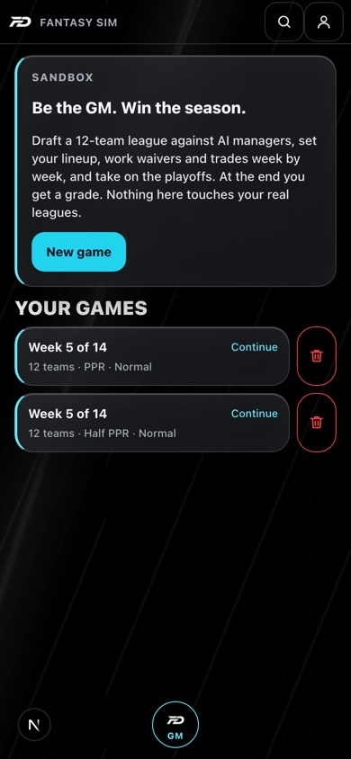 | 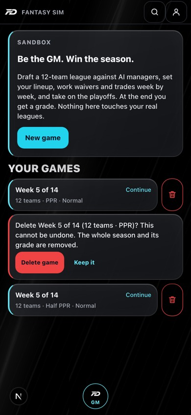 | 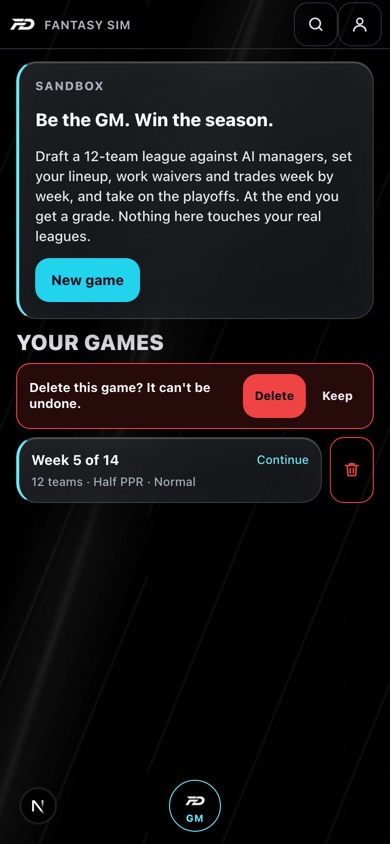 |

The other variants (tap-again, row ask, an inline link that asks, the error state):

| Tap again | Row ask | Inline ask | Error |
|---|---|---|---|
| 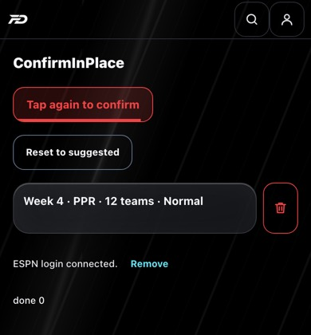 | 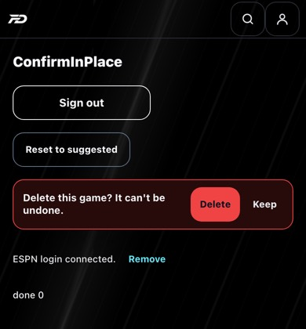 | 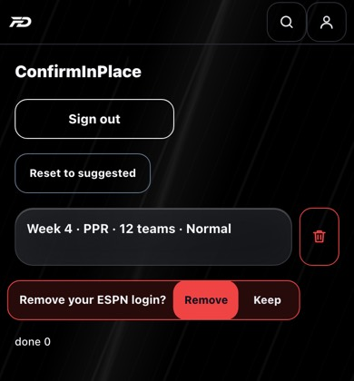 | 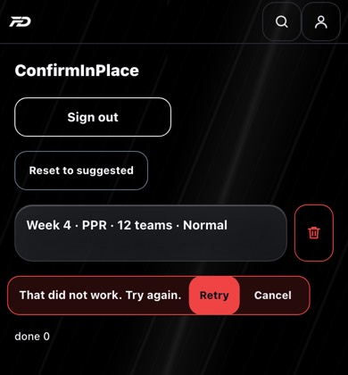 |

### Where it is applied

| Action | Web | Mobile | Pattern |
|---|---|---|---|
| Delete a Fantasy Sim saved game (hub) | `SimGameContent.tsx` | `GmGameScreen.tsx` | icon trash, ask, row |
| Delete game / Reset week (game More tab) | `SimGameContent.tsx` | `GmGameScreen.tsx` | ask / tap-again |
| Sign out (header menu, Account) | `Header.tsx`, `AccountContent.tsx` | `HomeScreen.tsx` | tap-again |
| Remove a failed league (Portfolio) | `PortfolioContent.tsx` | not in the app (Account uses a native alert, which the audit accepts) | ask |
| Remove ESPN login | `EspnLoginPanel.tsx` | `EspnLoginPanel.tsx` | ask |
| Remove my scouting report | `CollegeScoutingContent.tsx` | `ProspectScoutingDetailScreen.tsx` | ask |
| Delete a shared trade | `SharedTradesFeed.tsx`, `app/community/page.tsx` | `SharedTradesFeed.tsx`, `CommunityScreen.tsx` | ask; a failed delete now shows an error instead of being swallowed |
| Reset lineup to suggested | `MatchupPlanner.tsx` | `MatchupPlanner.tsx` | tap-again |
| Remove a team (with assets) from a multi-team trade | `MultiTeamTradeContent.tsx` | `MultiTeamTradePanel.tsx` | ask |
| Remove a GM target | `GmPlanContent.tsx` | `GmPlanScreen.tsx` | **UndoToast** (see below) |

Also applied after #1801 merged: **removing a team from a multi-team trade** (web `MultiTeamTradeContent.tsx`,
mobile `MultiTeamTradePanel.tsx`). Dropping a team takes every asset routed to or from it, so a team that
holds assets asks first ("Remove Team 3 and its assets?"); an empty team is removed straight away.

**Left alone on purpose:** removing a single asset from a trade side. After #1801 that is a chip with an x in
the side summary, and the asset is one tap away in the picker, so a confirm would only add friction. If it
ever needs a safety net it should use `useUndoableRemoval`, not a confirm.

### UndoToast

The low-stakes alternative: remove at once, show "Removed X. Undo" for 6 seconds, and only commit the
removal when the toast expires. A newer removal commits the previous one immediately and leaving the
page flushes it, so an undo window never loses a removal.

```tsx
const { schedule, toast } = useUndoableRemoval<Target>({
  message: (t) => `Removed ${t.name} from your targets.`,
  commit: (t) => api.removeGmTarget(leagueId, t.id),   // runs when the toast expires
  restore: (t) => setTargets((rows) => [t, ...rows]),   // runs on Undo or if commit fails
});
// onRemove: setTargets(filtered); schedule(target);   ...   {toast}
```

## TapForWhy

The first thing someone does to learn more about a number is tap it. `TapForWhy` wraps any number,
chip, badge, rank or grade and opens a small `Sheet` with its "why". It replaces always-visible
explainer paragraphs, `BeginnerHelp` "?" icons, hover `title=` tooltips (which never show on a phone)
and sections that only re-explain a number shown elsewhere on the same screen.

```tsx
import { TapForWhy } from "@/components/ui/TapForWhy";

// A tile: the button takes the tile's own class, so the layout does not change.
<TapForWhy metric="value" variant="tile" className="pqv-stat-tile" spoken={`Value ${score}`} chart={<ValueHistory playerId={id} bare />}>
  <span className="pqv-stat-tile-value">{score}</span>
  <span className="pqv-stat-tile-caption">Value</span>
</TapForWhy>

// An inline number or a chip
<TapForWhy metric="win_probability" spoken="Win probability 62%">62%</TapForWhy>
```

- Renders a real `<button aria-haspopup="dialog">` labelled "Why: Value 2,133" (`spoken`, or the
  registry title). The 44px target is an expanded `::after`, so the visible size does not change.
- Affordance is quiet: a dotted underline (`inline`) or a faint accent ring (`chip`, `tile`) on hover
  and keyboard focus, plus a pressed state. Nothing is added to the resting look. On mobile the
  pressed state is the whole affordance.
- The sheet has one structure: title, 1 to 3 plain sentences, an optional `chart` slot (rendered only
  while the sheet is open, so a heavy chart costs nothing until asked for), and a "learn more" link when
  the registry entry has one. Instance-specific lines go in `extra`.
- Fires a `why_<metric>` usage event (`trackUse`), so we can see which numbers people actually ask
  about.
- **Copy lives in one registry**, `lib/tapForWhyContent.ts` (lib twin): `value, ovr, rank, tier, grade,
  win_probability, playoff_odds, faab, balance, confidence, usage_trend, projection, age`. Entries reuse
  `BEGINNER_HELP`, so captions, the glossary and the popover can never disagree. Add a metric by adding
  an entry; a test fails if an entry has no title or more than three sentences.
- Mobile: `<TapForWhy metric spoken chart extra onLearnMore />`. The learn-more link only shows when the
  caller passes `onLearnMore` (the caller owns navigation so it can close its own modal first).

### Applied: Player Quick View (web + mobile)

Owner direction: consolidate. The standalone **Value history** and **Model** sections are gone; the
Value tile opens the value history chart and the Player score (OVR) tile opens the Model radar. The
Usage tile opens its explanation plus the engine's own detail line. `PlayerValueHistory` and
`SubRatingRow` gained a `bare` prop so the same components render inside the popover without a second
heading. The Player Profile page keeps its own Model tab; its tiles open the copy-only popover.

| Before: top | Before: two sections at the bottom | After: top (same layout) |
|---|---|---|
| 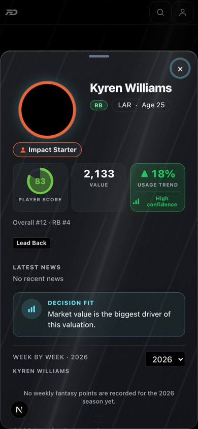 | 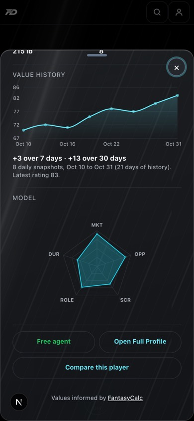 | 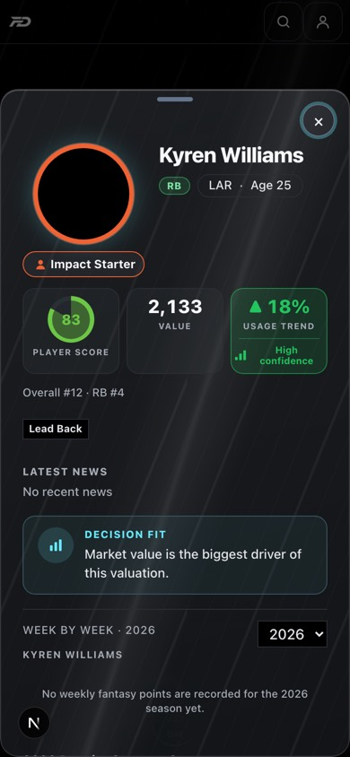 |

| Tap the value | Tap the player score | Tap the usage trend |
|---|---|---|
| 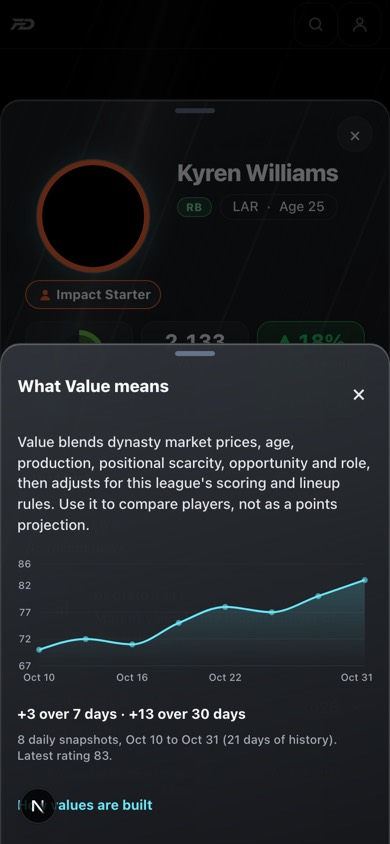 | 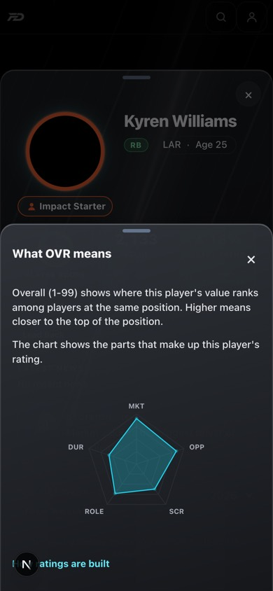 | 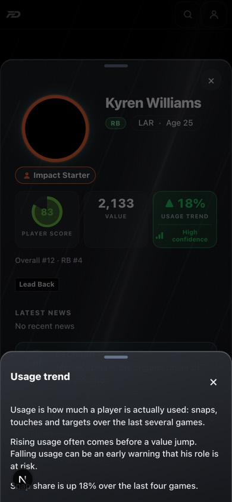 |

Follow-ups (60+ call sites per the audit; each is a one-line wrap now that the component exists):
`ToneBadge` (`onWhy`), `ValueStat`, `SnapshotTile`, win probability and playoff odds on Matchup and
Dashboard, FAAB on Waivers, trade balance and confidence on the verdict card, `projection` and `age`
wherever they appear. The registry already has copy for all of them.

## StructuredRow

The replacement for delimiter-joined strings and generated sentences. One row is **crest/avatar + name
(one line, truncated) + status chip + two or three metric pills + one short reason + chevron**, 64px
tall at most, and tapping it opens a detail `Sheet`. Every part is its own field, so nothing repeats
and nothing is parsed back out of text.

```tsx
import { StructuredRow, StructuredRowList } from "@/components/ui/StructuredRow";

<StructuredRowList
  items={rows}                       // top 3, then "See all (n)" expands the rest in place
  renderRow={(row) => (
    <StructuredRow
      lead={<TeamAvatar avatarUrl={row.avatar_url} name={row.team_name} size={36} />}
      title={row.team_name}
      chip={{ label: row.strategy_display, color: "var(--color-warning)" }}
      pills={signalPills(row)}       // "Picks #10", or "Draft #8" + "Future #6"
      reason={row.reason_short}      // <= 60 characters
      highlight={row.team_id === myRosterId}   // gold outline for the user's own team
      detailTitle={row.team_name}
      detail={<p>{row.reason_long}</p>}        // the long sentence lives only here
    />
  )}
/>
```

Without `detail` or `onOpen` a row is a plain, non-tappable row with no chevron. The pure helpers
(`signalPills`, `strategyTone`, `visibleSignalRows`, `seeAllLabel`, `cardRows`) are the lib twin
`lib/draftSignals.ts`. Mobile: `StructuredRow` and `StructuredRowList` take the same props (`testID`
instead of `testId`).

### API: Draft Center card schema 2 (backend, web, mobile)

`modules/draft_center_cards.py` used to return `items: ["Team | Retool | Draft #10 | Future #10 |
sentence", ...]`. Cards now also carry `schema: 2` and `rows` with these fields:

```json
{ "team_id": "2", "team_name": "...", "avatar_url": null, "strategy": "retool", "strategy_display": "Retool",
  "draft_rank": 10, "draft_rank_tied": false, "future_rank": 10, "future_rank_tied": false, "firsts": 0,
  "reason_code": "too_few_picks", "reason_short": "Too few picks for a retool",
  "reason_long": "Draft rank #10 leaves too little flexibility for a retool build.",
  "evidence": [{ "key": "draft_rank", "label": "Draft capital rank", "value": "#10" }] }
```

- **The legacy `items` strings are still sent, unchanged, for one release.** The iOS build in App Store
  review and older Android builds render them; a response without `rows` renders exactly as before.
  Delete `items` (and `_draft_workspace_team_lines`) once those builds are gone.
- `reason_long` is produced by the same function as the legacy string's sentence, so the two cannot
  drift. `reason_short` never repeats the rank numbers that the pills already show.
- `rows` keeps up to 6 teams per card (`CARD_ROW_POOL`); `items` stays at the top 3. Clients show 3 and
  offer "See all (n)".
- A team name that contains the old delimiter (`|`) is now safe, because nothing is split any more.
- Tests: `tests/test_draft_center_ui.py` (fields, 60-character cap, legacy/row alignment, delimiter in a
  name, partner cards) and `tests/test_mobile_api_service.py` (served schema).

### Applied: Draft Center "League Draft Decision Signals" and "Draft Partner Discovery"

| Before: one joined string per team | After: rows, top 3 + See all, own team outlined | After: tap a row |
|---|---|---|
| 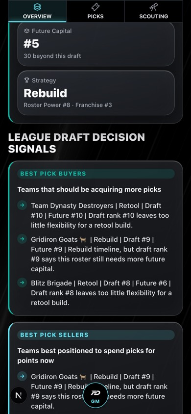 | 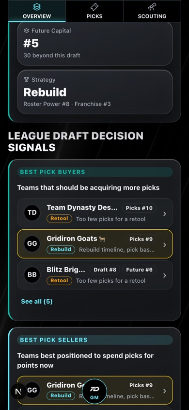 | 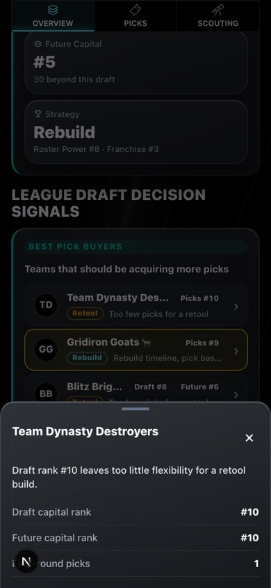 |

Also fixed on the way: `TeamAvatar` built its initials from UTF-16 units, so a team name ending in an
emoji produced half a surrogate pair (a broken glyph, and a server/client HTML mismatch that failed
hydration). It now uses `lib/teamInitials.ts` (code points; lib twin), on web and mobile.

Not done in this pass (the audit's full Draft Center redesign, section 6.4): merging the five cards into a
Buyers / Sellers / Pivot / Pick-rich segmented control, deleting the all-caps label bars, merging Partner
Discovery into the same control, and the detail sheet's "Open trade finder with this team" and "View team"
actions (the Draft Center page does not have the league id wired into the card component yet). The rows
and the API are the foundation for all of those.

## FilterSheet

One **Filters** button (with a count badge) that opens a `Sheet` of grouped chips, committed with
Apply. Replaces a row of native `<select>`s and pill rows. Active filters show as removable chips next
to the button.

```tsx
import { FilterSheet } from "@/components/ui/FilterSheet";
import { singleValue, valuesFromSingles, type FilterGroup } from "@/lib/filterSheet";

const groups: FilterGroup[] = [
  { id: "position", label: "Position", anyValue: "ALL", options: [{ value: "ALL", label: "Any" }, { value: "QB", label: "QB" }] },
  { id: "tags", label: "Tags", multi: true, options: [...] },
];

<FilterSheet
  groups={groups}
  values={valuesFromSingles(groups, { position })}      // what the page is filtering by now
  resultCount={(draft) => countMatches(draft)}          // optional: "Show 24 results" / "No results"
  onApply={(next) => setPosition(singleValue(groups[0], next))}
/>
```

- The sheet edits a **draft**. Nothing on the page changes until Apply, and closing (Escape, backdrop,
  swipe) discards. Reset clears the draft. Apply is disabled when the draft would match nothing.
- Single-select groups behave like radios (tap a chip to choose, tap it again or "Any" to clear);
  multi-select groups toggle. A group can be `hidden` (for example Roster when ownership is unknown).
- a11y: the sheet is a form (a `fieldset` and `legend` per group); single groups are `radiogroup` /
  `radio` with `aria-checked`, multi groups are toggle buttons with `aria-pressed`; the trigger's
  accessible name carries the count ("Filters, 2 active"); the footer count is a polite live region;
  each active chip has its own "Remove Position filter: RB" button.
- The model (`toggleFilterValue`, `activeFilterCount`, `activeFilterChips`, `applyButtonLabel`, ...) is the
  lib twin `lib/filterSheet.ts`. Mobile: `<FilterSheet groups values onApply resultCount />` is the
  multi-group version of `FilterDropdownButton` (which stays for one-group pills elsewhere).

### Applied: Players and Waivers (web + mobile)

- **Players:** the five selects become a one-tap position pill row plus one Filters button (age, status, health, roster). Sort by
  stays a select (it is a sort, not a filter). The live count uses the same filter function as the page
  (including the IDP pool switch), so Apply reads "Show 1 result".
- **Waivers:** the All Free Agents position select is a one-group FilterSheet, so the same control, count
  badge and chips appear everywhere. The Add / Stash / Watch pill row is a segmented control (4 options,
  one level) and stays.

| Before: five selects | After: one button | The sheet | Applied: badge and chips |
|---|---|---|---|
| 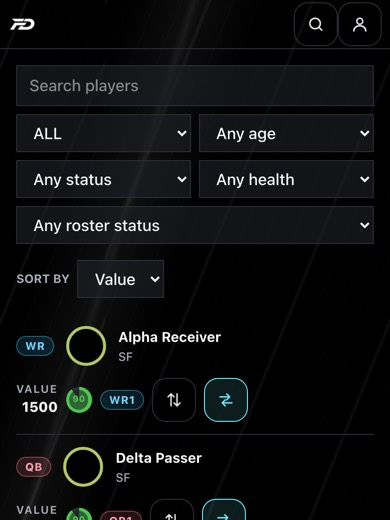 | 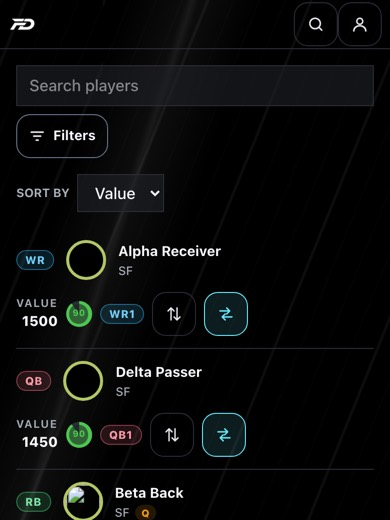 | 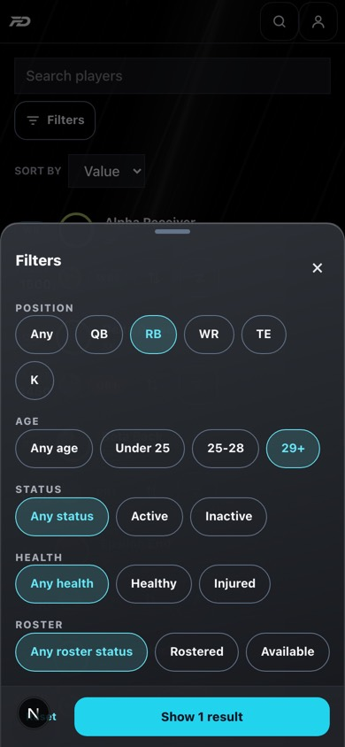 | 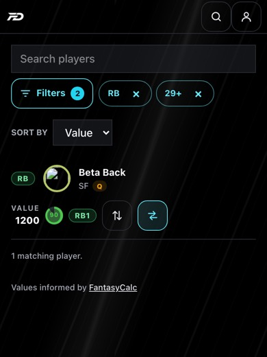 |

Position is the filter people use most, so it is not behind Apply: a pill row (All / QB / RB / WR / TE / K, plus the
defender positions in IDP leagues) sits above the Filters button and applies on one tap. Filters keeps the rest
(age, status, health, roster) with the count badge.

### Not done: TradePickerSheet extraction

The trade picker (`TradePickerSheet`, merged in #1801) already has the same panel: a Filters button with a
count, position and condition chips, committed with Apply. It renders that panel **inline inside its own
sheet**, on purpose, because opening a `FilterSheet` from there would hide the picker (sheets never stack).
So the extraction is not "swap in the component"; it is a small follow-up that adds an `inline` rendering mode
to `FilterSheet` (same groups, same draft model from `lib/filterSheet.ts`, panel instead of a sheet) and moves
the picker onto it, then swaps the picker's shell for `Sheet`. The model already supports both groups
(`position`, `condition`). Left for its own PR so the just-merged picker is not edited alongside this work.
Other planned users: Trade Hub filters, News, Alerts, College Scouting, League Recaps, Live Draft.
## Phone game shell (Fantasy Sim) and BottomTabBar

Phase A of `docs/mobile-ux-plan-2026-11.md`. In the game on phones (`/gm-game`, below 768px):

- The global header and the global GM orb button step aside (`pathOwnsPhoneChrome` in `lib/bottomNav.ts`; the orb's sheet stays mounted so search still opens).
- `SimGameHeader`: one sticky glass line. Back arrow, `Wk 3/14 S1/5`, the team as a tappable chip (opens the team sheet), search, and the overflow menu (rules, reset week, delete). The pre-advance notes are `SimStatusChips`, tappable and scrolling with the content.
- `SimGameOrb`: the game's own navigator, replacing the global orb inside the game. Brand mark plus the current page name and a badge for trade offers. One tap opens Home, Team, Players, Trades, League, More with the current page lit, plus search, All games and a way home.
- The footer is Advance only (`SimActionBar` / `SimOffseasonBar`, `.action-pill`). Auto-set lives on Home, "What to do this week".
- The six top tabs and the "This week | League" strip are gone on phones (`max-md:hidden`); the league cards are a collapsed "League" section on Home.

Layout rule (immune to iOS Safari fixed-position drift): nothing here is `position: fixed` or JS-positioned. The game is a `min-height: 100dvh` flex column and the footer is a `position: sticky; bottom: 0` `.bottom-stack` at the end of it with `env(safe-area-inset-bottom)` padding. The orb is `position: absolute` inside that stack (`.game-orb-dock`), so it can never disagree with the pill.

`BottomTabBar` (`components/ui/BottomTabBar.tsx`, lib twin `lib/bottomNav.ts`) is the 5-tab bar the site shell (Phase B) uses; it lives inside the same `.bottom-stack`. It is not used in the game.

## Phone site shell (Phase B, flagged)

Below 768px, for signed-in users with the flag on, the floating GM orb and the crowded header are replaced by:

- `AppShellBar` (`components/AppShellBar.tsx`): in-flow sticky `.bottom-stack` at the end of the app column (no `position: fixed`, no JS placement, `env(safe-area-inset-bottom)`). Inside a league: Today / Team / Trades / League / More. Outside: Home / Portfolio / Fantasy Sim / News / More. More opens the full grouped menu from the shared `navCatalog.ts` (groups, glyphs, Pro markers).
- `ShellActionSlot` (`<ShellAction>`): a page renders its primary action into the slot above the tab bar (page-aware action strip). Renders nothing where the slot is absent.
- `ShellHeader`: one standard header: back labelled with the parent page ("< Players"), title, league chip, search, alerts bell (only exists inside a league). Search stays the orb sheet's search.
- Fantasy Sim keeps its own header and game orb (`pathOwnsPhoneChrome`); the sign-in/onboarding root `/` keeps the orb where no bar can render.
- Route to tab mapping lives in `lib/shellNav.ts` (`shellActiveTab`), covered by tests.

Flag (`lib/shellNav.ts`, `lib/useShellNav.ts`): `NEXT_PUBLIC_BOTTOM_NAV` = `founder` (default: founder/owner account only), `on` (everyone), `off` (kill switch for everyone, nothing overrides it). `?nav=bottom` turns it on and `?nav=off` turns it off for that browser (remembered in localStorage `fgl:nav`). Naming: "Dashboard" is **Today** everywhere user-facing (route and code names keep `dashboard`); **Fantasy Sim** is the game; **Season Outlook** is the forecast (GM Plan and Games tab; "Season Sim" is a retired term).


## Overlays (one pop-up at a time)

Rule (coridian_, approved): ONE pop-up on screen at a time.

- Opening a pop-up from inside another one REPLACES it on screen. The first stays mounted but hidden (`hidden` /
  `display:none`; on mobile its Modal is not visible), so its scroll, typed text and selections survive.
- The newer pop-up shows **‹ Back to <previous title>** (`OverlayBack`). The phone back gesture / browser Back (web;
  Android back on mobile) goes back one step. The **X closes everything** and returns to the page. Tapping the scrim
  equals the X; Escape equals Back.
- Confirms happen in place inside the pop-up (`ConfirmInPlace`), never by opening another. Toasts are not pop-ups and
  sit above everything. A real dialog (`kind: "dialog"`, e.g. sign out) sits ON TOP of the visible sheet without hiding
  it, and closing it returns to the sheet underneath.
- Layers (one place, `OVERLAY_Z` / `--z-overlay-*`): sheets 70, dialogs 90, toasts 100. No pop-up picks its own z-index.
  This is what fixes "quick view opens behind a picker": there is no longer a second visible layer to be behind.

Pieces (web; mobile uses the same stack):

| Piece | File |
|---|---|
| Pure stack: entries, hidden / top / previous sheet, back, close-all, history plan | `lib/overlayStack.ts` (byte-identical twin in mobile) |
| Hook every pop-up shell calls once (`useOverlay({ title, onClose })` -> `hidden`, `backTitle`, `back`, `closeAll`, `zIndex`) | `lib/useOverlay.ts` |
| Browser-history sync (one entry per open overlay; Back dismisses the newest; X pops its entries once; route change forgets them) | `lib/overlayHistory.ts` |
| One runtime: body scroll lock, history, close-all on route change | `components/OverlayRuntime.tsx` (mounted in `app/layout.tsx`) |
| Back button | `components/OverlayBack.tsx` (mobile: inside `Sheet.tsx`) |
| Swipe down to dismiss (per pop-up, unchanged) | `lib/useSheetDragDismiss.ts` |

A shell does: `const overlay = useOverlay({ title, onClose })`; renders its backdrop with `hidden={overlay.hidden}`;
renders `<OverlayBack overlay={overlay} />` at the top; wires the X and scrim to `overlay.closeAll` and Escape to
`overlay.back`; and focuses itself when `!overlay.hidden`. It must NOT lock body scroll, push history or set a
z-index itself. Hand-rolled `.pqv-backdrop` shells keep their markup and only gain those lines.

Migrated (all of them): web `Sheet` (and everything built on it: TapForWhy, FilterSheet, StructuredRow, the game
navigator), `PlayerQuickView`, `SimSheet` (claim, team and every Fantasy Sim sheet), `TradePickerSheet`, and through
`PopupShell` (the shell for hand-built `.pqv-backdrop` pop-ups) `ManagerProfileSheet`, Matchup `SwapSheet`,
`PercentileExplorerSheet` and the multi-team "Send to" sheet; `AlertsDropdown`, the GM orb menu and
`EmbeddedCheckoutModal` call `useOverlay` directly. `PasswordRecoveryGate` is a blocking gate (not dismissible, so not on
the stack) but takes its layer from `--z-overlay-dialog`. Mobile: `Sheet`, and every `SheetModal` registers itself
(`lib/useOverlay.ts`), so all ~30 Modal-based pop-ups replace each other instead of fighting (RN cannot present two
Modals reliably); `Sheet` also draws the Back row.

Not overlays (left as they are): header and sidebar dropdown menus (`role="menu"`), the privacy-mode pill, the Beginner
Help popover, in-picker filter panels and in-place confirms (`ConfirmInPlace`), toasts.

New pop-ups: use `ui/Sheet`, or `PopupShell` for a hand-built layout. Never hand-roll a backdrop, set a z-index, lock
body scroll or push history.

Tests: `lib/overlayStack.test.ts`, `lib/overlayHistory.test.ts`, `components/OverlayManager.test.tsx` (replace, Back,
selection survives, X), `components/OverlayRuntime.test.tsx` (the one scroll lock). Real-browser check:
`scripts/sim_layout_playwright/overlay_back.mjs` (browser Back closes a pop-up without leaving the page; a card opened
from the trade picker replaces it and Back returns with the selection intact; the X closes everything).
