# UI spacing and tabs

One rhythm and one tab pattern, implemented once in shared components and
tokens (web `globals.css` / `PillRow`, mobile `theme.ts` / `SegmentedTabBar`).
Style is unchanged: textured animated background, frosted-glass cards, cyan
accent, gold highlights. Nothing here adds a new design language.

## Tabs

Every page-level tab strip is `PillRow` (web) or `SegmentedTabBar` (mobile).
Options carry a `glyph` name from the central registry
`web-next/src/lib/tabIcons.ts` (byte-identical twin at `mobile/src/lib/tabIcons.ts`,
enforced by `scripts/check_lib_twins.mjs`). The registry maps each name to an
outline Ionicons glyph, like `navCatalog` does for destinations:

- web: `TabGlyph` draws the same Ionicons SVG (`tabGlyphMarkup.generated.ts`);
- mobile: `TabIcon` renders the Ionicons font glyph.

Add or change an icon by editing the registry only, then pass `glyph: "<name>"`.

Pattern (both platforms):

- Phone: icon stacked over the label, equal-width segments. Five or more icon
  tabs in a fill row split the width equally with a smaller label so all six
  Fantasy Sim tabs (Home/Team/Players/Trades/League/More) fit 390px with no
  clipped last tab. From `sm` up (web) icon and label sit side by side.
- Touch target is 44px, including the sticky bar when it carries icons.
- Active state: cyan icon and label on a cyan glass tint, plus a sliding
  underline (web: ~180ms transform, `.tab-indicator`; mobile: a sliding glass
  pill, 180ms). Both are instant under reduced motion.
- Counts are small accent pills; on phones with an icon they sit on the tab's
  top-right corner so they never push the label out of its cell.
- Many or long labels use `variant="scroll"` (web) / `scrollable` (mobile): a
  single row with edge fades and the active tab scrolled into view.
- Accessibility: `role="tablist"` / `role="tab"` + `aria-selected`, roving
  tabindex and arrow/Home/End keys on web; `accessibilityRole="tab"` and
  `accessibilityState.selected` on mobile.

Icons are used for navigation tabs. Filters, sort toggles, year/number
pickers and form choice rows (position filter, bench size, difficulty, goal)
stay text-only on purpose: they are options, not places.

Tab strips with icons: Trades (Hub/Finder/Analyzer/History), Waivers, GM Plan,
Players/Picks, Draft Center, Games, Sample League, Player profile, Portfolio,
Matchup, College scouting, League recaps (Recaps/Roundup/History/Storylines),
and Fantasy Sim (main tabs, Home sub-tabs, League, Team, Trades, Draft panels,
Season in Review). Account has no tabs: its sections are stacked cards.

## Spacing

Scale (web `--space-*`, mobile `spacing.*`, already tested to match):
2xs 2, xs 4, sm 8, md 12, lg 16, xl 24, 2xl 32.

Rules:

| Where | Rule |
| --- | --- |
| Page gutter | 16 (`--page-gutter`, `spacing.lg`) |
| Gap between page sections | 16 (`--page-gap`) |
| Page vertical padding | 16 (`--page-pad-y`) |
| Long-form pages (legal, pricing, features) | gap and vertical padding 24 (`.page-shell-prose`) |
| Narrow pages (account, sample league, features) | `.page-shell-narrow`, 42rem max |
| Space under a page-level tab strip | 12 (`spacing.md`); above it 8 |
| Inside a card | 16 padding, 8 to 12 between rows |
| Touch rows and tabs | at least 44 high |

Web: every app page `<main>` is now `.page-shell` (34 pages used five
different gap/padding combinations: gap 2/3/4/5/6 with padding 3/4/6/8). New
pages should use `className="page-shell"`; do not restate gutter/gap/padding.
Left alone on purpose: centered empty/loading shells and the Player Compare
page (its sections own their margins).

Mobile: tab-strip wrappers on Trades, Teams, My Team and Trade Hub were using
xs/sm above and sm below; they now use sm above and md below.

## Before / after at 390px

Rendered with `next dev`, dummy Supabase env, and Playwright route mocks
(`scripts/sim_layout_playwright/` pattern). Dashboard and Trade Analyzer are
the sample-league tabs (fixtures); the rest use mocked API payloads, so some
areas show empty states.

| Screen | Before | After |
| --- | --- | --- |
| Dashboard |  | 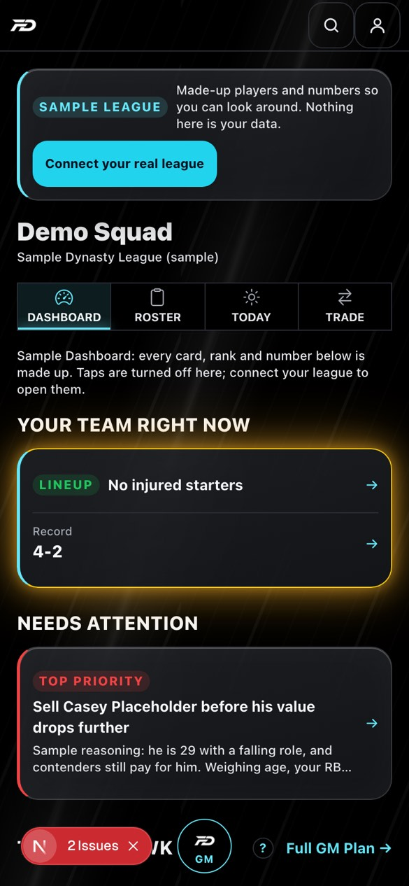 |
| Trade Analyzer (sample trade tab) |  |  |
| Players | 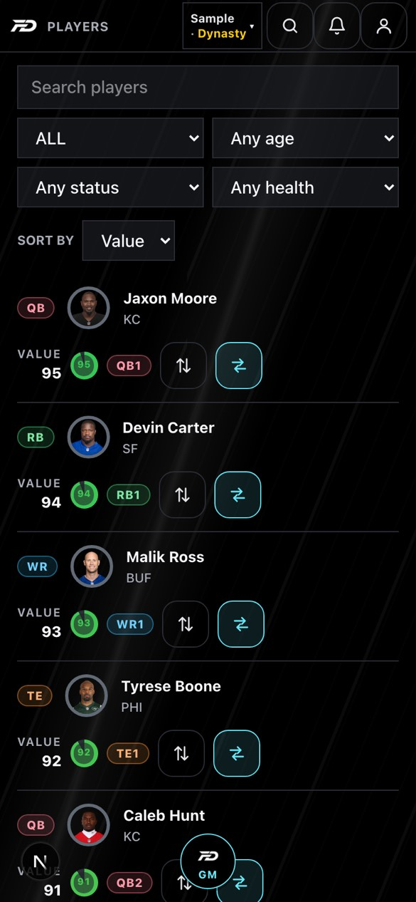 | 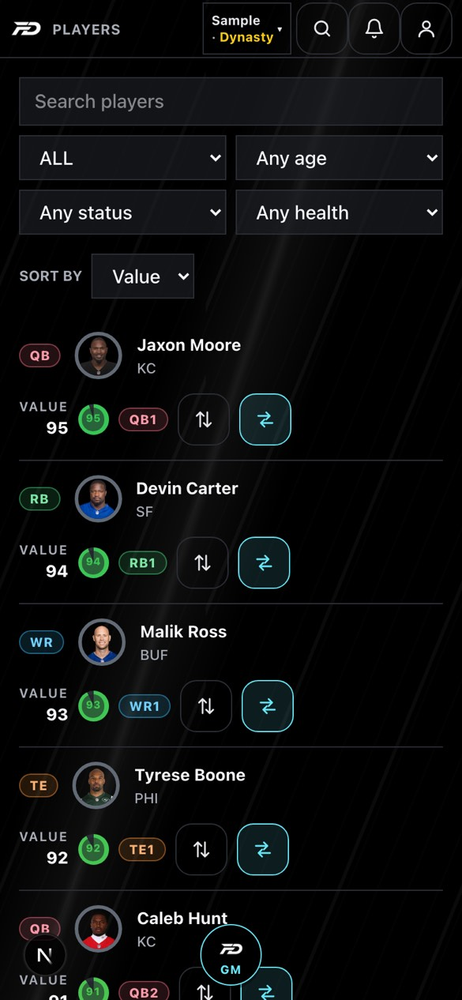 |
| Waivers | 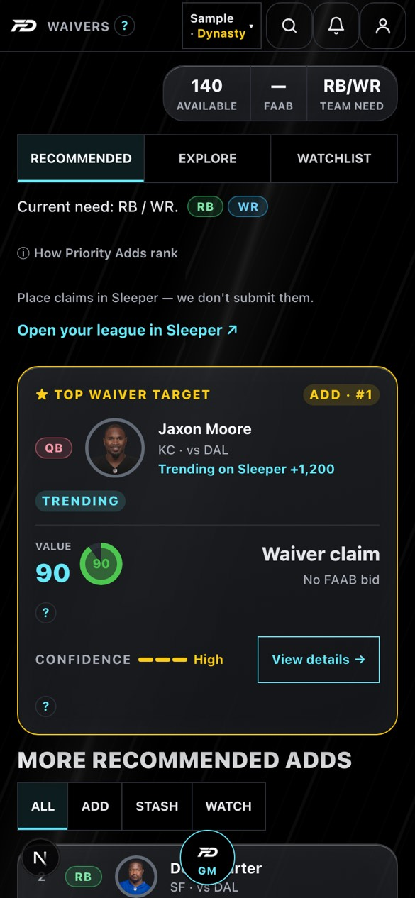 | 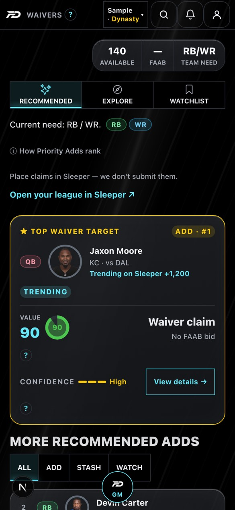 |
| League recaps |  | 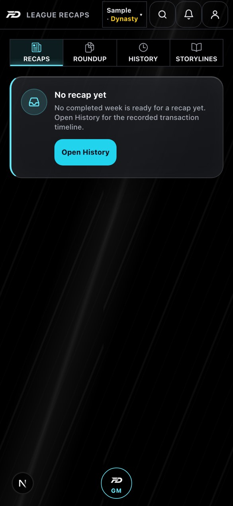 |
| GM Plan | 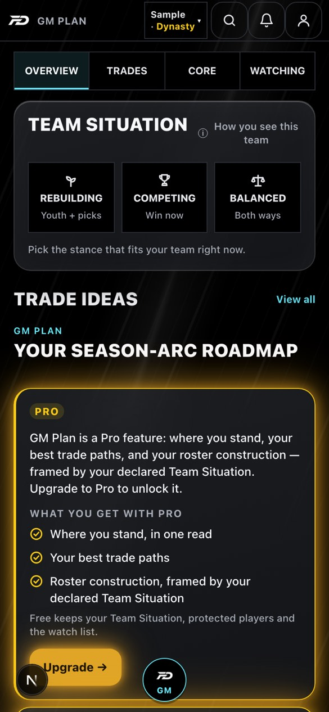 | 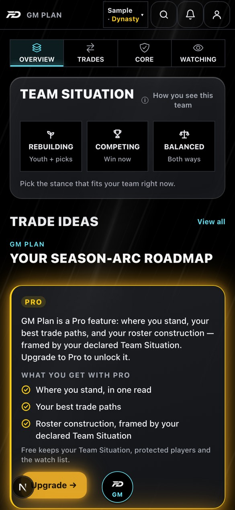 |
| Account | 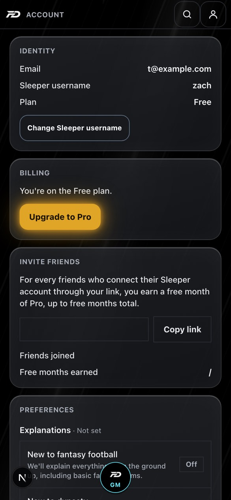 | 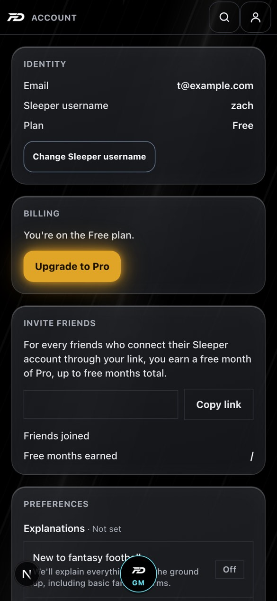 |
| Fantasy Sim Home |  | 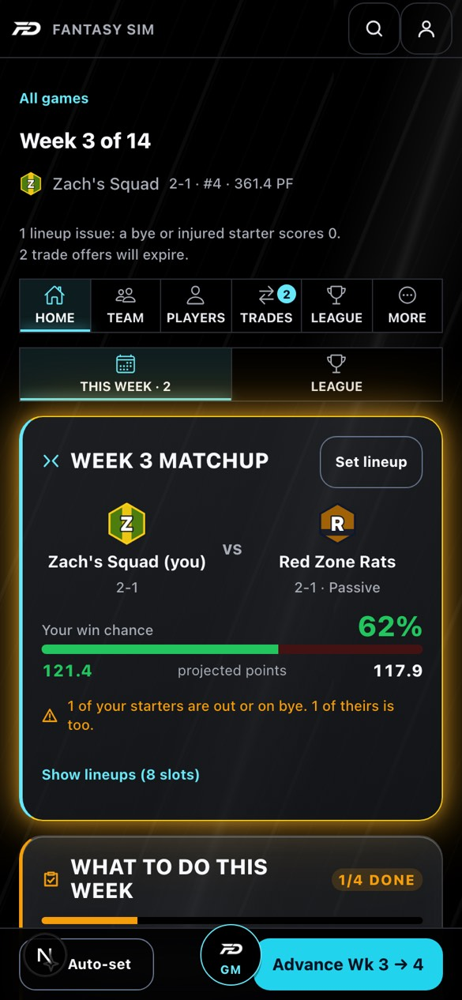 |
